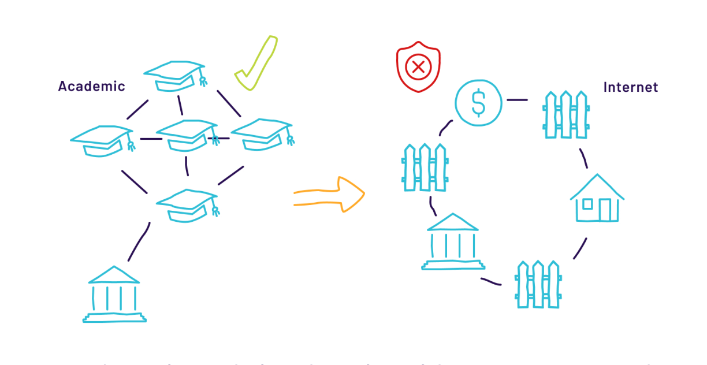
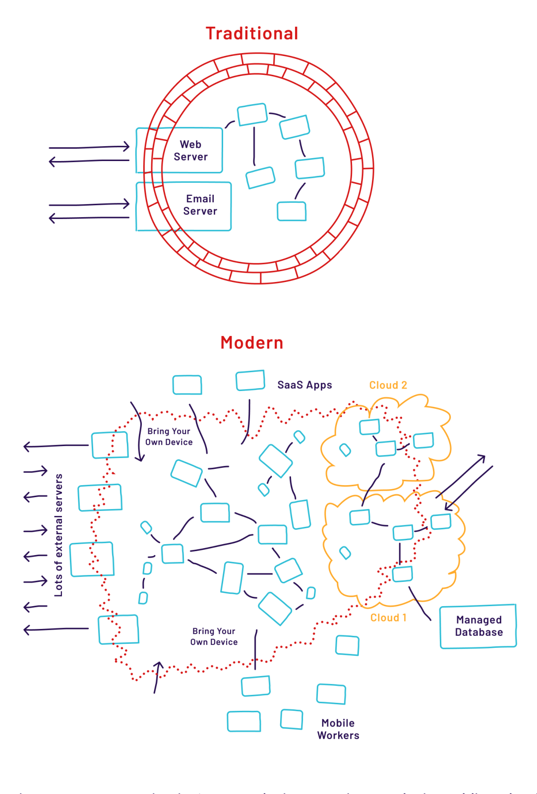
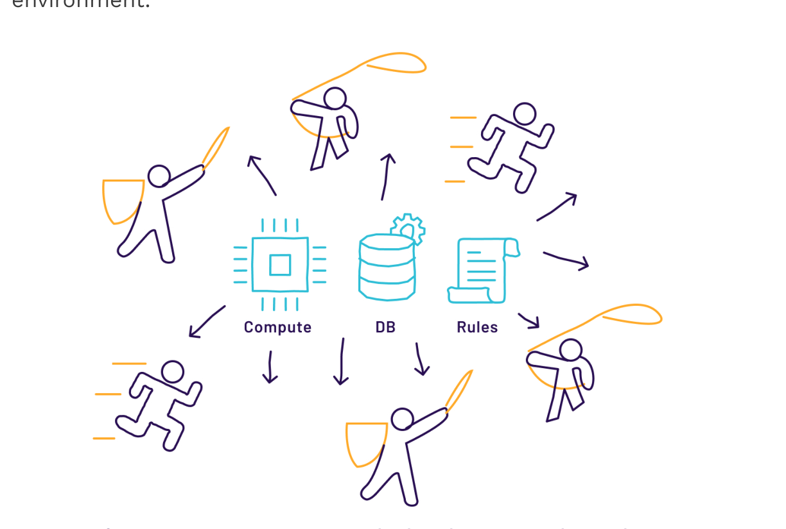
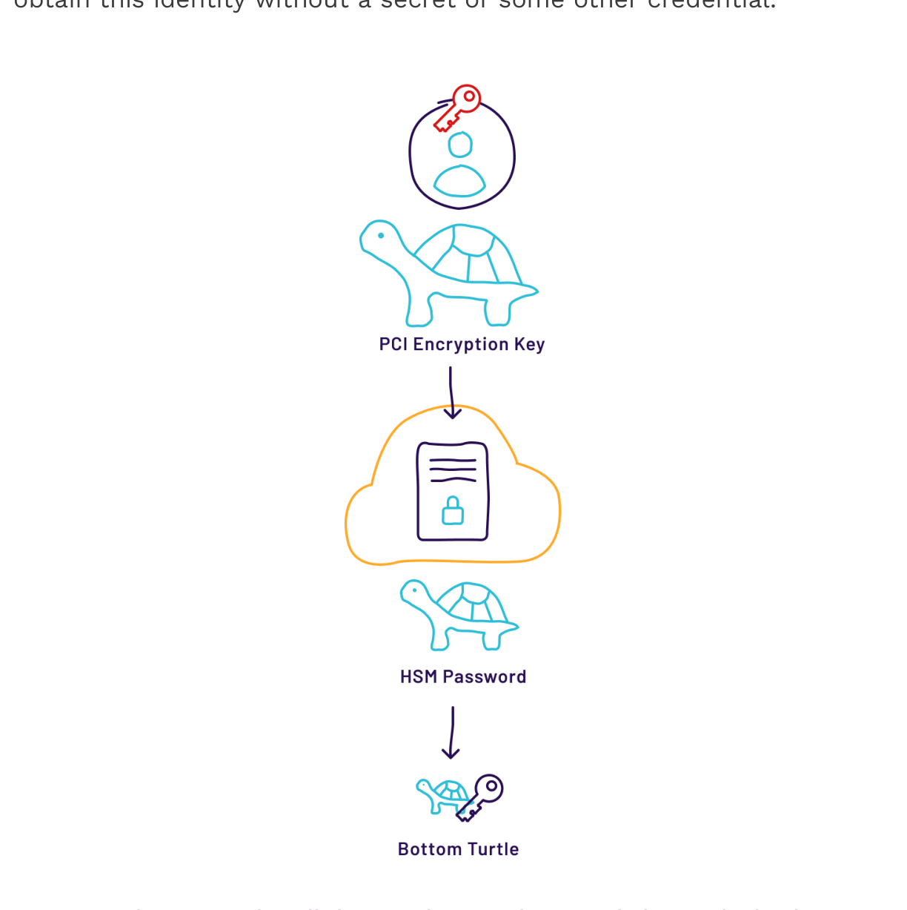
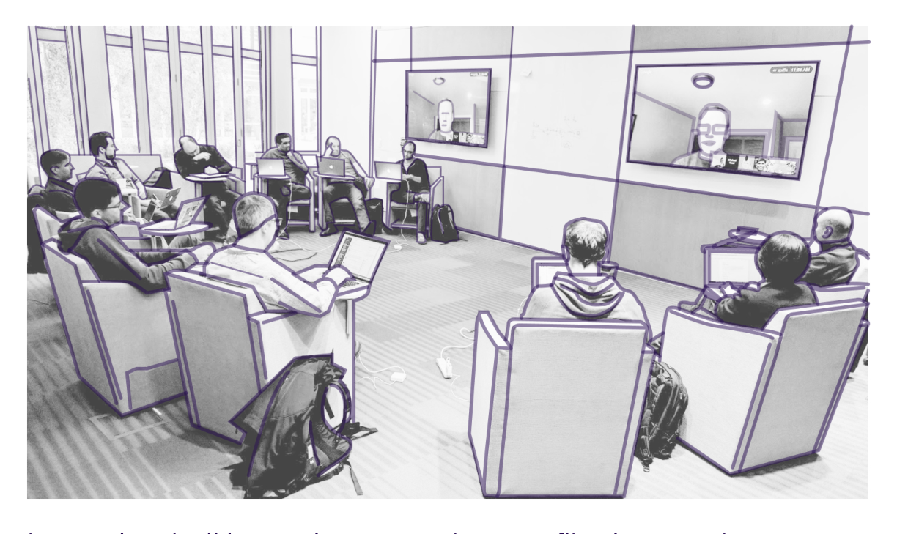

# 第 1 章　历史与 SPIFFE 的诞生动因

本章将介绍 SPIFFE（Secure Production Identity Framework For Everyone，面向所有人的安全生产身份框架）的诞生背景及其由来。

## 迫切的动因与需求

我们走到今天并非一帆风顺，而是经历了不少成长的阵痛。

1981 年互联网首次广泛投入使用时，全网仅有 213 台不同的服务器，安全几乎连事后补救都算不上（参见：<https://tools.ietf.org/html/rfc1296>）。随着互联计算机数量的不断增加，安全始终是一个薄弱环节：易于利用的漏洞引发了多起大规模攻击事件，例如 1988 年接管了互联网上大多数 Unix 服务器的莫里斯蠕虫（Morris Worm，参见：<https://spaf.cerias.purdue.edu/tech-reps/823.pdf>），以及 2003 年在数十万台 Windows 服务器间肆虐的 Slammer 蠕虫（参见：<https://www.caida.org/publications/papers/2003/sapphire/sapphire.html>）。

数十年过去，昔日传统的边界防御模式已不再适应现代技术不断演进的计算架构与边界形态。底层网络安全理念未能跟上现代化步伐，留下的裂痕越来越大，各种点状方案和技术只好一层叠一层地往上修补。

那么，为什么边界模式如此盛行？我们又该如何弥补它的缺陷？

多年来，我们观察到三大显著趋势，凸显出传统边界模式已经成为网络未来发展的掣肘：

- **软件不再运行在由组织掌控的单台服务器上。** 自 2015 年以来，新开发的软件通常被构建为一组微服务，这些服务可以独立横向扩展，也可以迁移到云托管服务商。如果你连需要保护的服务边界都划不出一道清晰的线，就不可能围绕它们筑起一道高墙。
- **你无法信任一切，哪怕是公司内部的软件。** 过去，我们以为软件漏洞就像苍蝇一样，可以一只一只拍死；如今，它们更像是成群结队的蜜蜂。美国国家漏洞数据库（National Vulnerability Database）平均每年报告超过 15,000 个新的软件漏洞（参见：<https://nvd.nist.gov/vuln/search/statistics>）。无论你是自己编写还是采购软件，它迟早都会存在某些漏洞。
- **你同样无法完全信任人。** 人会犯错，也会心生不满，而且他们往往拥有内部服务的完全访问权限。首先，每年有数以万计的成功攻击源于网络钓鱼（参见：<https://www.comparitech.com/blog/vpn-privacy/phishing-statistics-facts/>）或窃取合法的员工凭证。其次，随着云应用和移动办公的普及，员工可能需要在许多不同的网络环境下合法访问资源。当人们为了完成日常工作不得不频繁翻越这道墙时，再筑墙就已经毫无意义了。

由此可见，边界安全对于当今的组织而言已不再是现实的解决方案。边界安全执行得过于严格，会阻碍组织使用微服务和云计算；执行得过于宽松，又会放任入侵者长驱直入。早在 2004 年，Jericho Forum 就认识到必须寻找边界安全的替代方案。十年后的 2014 年，Google 发表了一篇关于 BeyondCorp 安全架构的案例研究（参见：<https://research.google/pubs/pub43231/>）。然而，两者当时都未能得到广泛普及。

## 曾经友好的网络：只要我们关起门来

互联网最初的使用场景集中在学术界，其初衷是共享信息，而非阻止访问。当其他组织开始将联网计算机系统用于涉及商业机密的业务场景时，他们高度依赖物理边界和物理验证来确保访问网络的个人已获得授权。当时，“受信任的内部威胁”这一概念尚未出现。随着网络从学术用途演进为商业用途，软件从单体架构演进为微服务架构，安全逐渐成了业务增长的障碍。

*图 1.1：网络从大学校园的局域范围演变为全球互联的网络之网。*

起初，人们通过防火墙、网络分段、私有地址空间和访问控制列表（ACL）来模拟传统上用高墙和保安保护计算机物理访问的做法。在当时这是合理的，尤其是考虑到需要管控的接入点数量有限。

随着网络的普及以及用户和商业伙伴接入点的增多，物理身份核验（就像高墙与保安所做的那样）开始走向虚拟化，转而通过安全地交换和管理密钥、凭证和令牌来实现。然而，随着技术和需求的不断演进，这些手段变得越来越难以应对。

## 拥抱公有云

从传统的本地部署和数据中心运维向公有云迁移，进一步放大了历史遗留问题。凭借在云端自由创建计算资源的新能力，组织内的开发团队与运维团队开始更紧密地协作，围绕 DevOps 理念组建新团队，专注于软件的自动化部署与管理。公有云快速演进的动态环境使团队的部署频率大幅提升——从每隔几个月部署一次，变为每天部署多次。按需供给和回收资源的能力，催生了高速构建的成套专用服务：它们职责更单一、边界更清晰、可独立部署，通常被称为微服务。这反过来又增加了跨部署集群识别和访问服务的需求。

这种高度动态且富有弹性的环境打破了原有的边界安全理念，迫切需要一种不依赖于底层网络的、更完善的服务层交互机制。传统的边界管控使用 IP 地址和端口来进行认证、授权和审计，但在云计算范式下，IP 和端口已无法与工作负载形成清晰的一一对应。

公有云实践催生的各种模式——例如面向多服务工作负载的 API 网关或托管负载均衡器——进一步凸显了这样一种需求：身份不能依赖于网络拓扑或网络路径。保护这些服务间通信的完整性变得愈发重要，尤其是当团队需要在各类工作负载之间保持一致的安全机制时。

*图 1.2：随着组织网络日趋复杂，不断加入公有云、SaaS 和移动办公人员，构建和维护边界安全变得越来越难以为继。*

## 休斯顿，我们遇到麻烦了

随着组织采用容器、微服务、云计算和无服务器函数（serverless functions）等新技术，一个趋势愈发明显：软件被拆分成数量更多、粒度更小的组件。这既增加了攻击者可利用的潜在漏洞面，也让管理边界防御变得越来越不切实际。

为了做得更多、更快，越来越多的组件被部署在自动化基础设施之上，而这往往以牺牲安全性和可靠性为代价。绕过防火墙规则工单或安全组变更等人工流程的情况并不鲜见。在这个现代化的新世界里，无论部署环境如何，面向网络的访问控制都会迅速过时，并需要持续不断地维护。

*图 1.3：随着各类技术创新层出不穷，基础设施环境及相关运维需求变得日益复杂。*

虽然这些规则与例外的管理可以实现自动化，但它们必须能够迅速生效，这在大型基础设施中颇具挑战性。此外，网络地址转换（NAT）等网络拓扑机制会让这类管理变得困难且容易出现漏洞。随着基础设施规模更大、动态性更强，依赖人工介入（human-in-the-loop）的系统根本无法扩展。毕竟，没有人愿意花钱养着一整支团队，整天摆弄防火墙规则却依然疲于奔命。

在动态调度和弹性伸缩的应用世界里，依赖服务器名称、DNS 名称、网络接口细节等与位置相关的信息存在诸多弊端。尽管网络层面的概念被广泛使用，但这种模型并不能有效地代表软件身份。转向应用层后，使用传统的用户名和密码组合或其他硬编码凭证虽然能在一定程度上体现身份，但它们更多解决的是授权问题，而非认证问题。

将安全融入软件开发生命周期的早期阶段并尽早引入反馈，能够让开发人员对其工作负载的身份识别与信息交换机制拥有更强的运维掌控力。借此转变，授权策略的决策权可以下放给各个服务或产品负责人——他们最了解相关组件，也最适合做出恰当的决策。

## 重塑访问控制

组织在采用公有云之前就已饱受层出不穷的问题困扰，而上云之后这些问题更是接踵而至、令人痛切。这一切推动了人们的共识：传统边界已经力不从心，必须寻找更好的解决方案。归根结底，去边界化（deperimeterization）意味着组织必须弄清楚如何识别自己的软件，并实现服务间的访问控制。

### 以密钥作为解决方案

在分布式系统中，密码和 API 密钥等共享密钥为访问控制提供了一种简单的选择。但这种方案随之带来了诸多问题：密码和 API 密钥极易泄露（不妨试着在 GitHub 上搜索 `"client_secret"` 之类的词，看看会发生什么）。在大型组织中，一旦发生泄露，轮换密钥也十分棘手，因为每个相关服务都需要协同感知这一变更，只要漏掉一个服务就可能导致系统中断。

为了缓解密钥管理及其生命周期方面的难题，业界开发了 HashiCorp Vault 等工具和密钥库。虽然还有许多其他工具试图解决这一问题，但它们提供的方案往往更加局限，效果平平（参见《Secrets at Scale: Automated Bootstrapping of Secrets & Identity in the Cloud》，<https://www.youtube.com/watch?v%3D15H5uCj1hlE>）。采用所有这些方案，我们最终都会回到同一个起点：工作负载究竟该如何获取访问密钥库的权限？仍然需要某个 API 密钥、密码或其他密钥。所有这些方案最终都陷入了“一路向下的乌龟”（turtles all the way down）困境：

- 要对数据库或服务等资源启用访问控制，需要一个 API 密钥或密码之类的密钥。
- 该密钥或密码需要保护，因此你可能会对其进行加密；但这样一来，你又得操心用于解密的密钥该如何保管。
- 你可以把这个解密密钥存进密钥库，但访问密钥库本身仍然需要密码或 API 密钥之类的凭证。
- 归根结底，保护一个密钥的访问权限，最终总会引入另一个需要你去保护的新密钥。

为了打破这个死循环，我们需要找到“最底层的乌龟”（bottom turtle）——也就是某种能够解锁认证和访问控制所需其余密钥的初始凭据。一种做法是在部署服务时人工下发密钥。然而，在高度动态的生态系统中，这种方式根本无法扩展。随着组织转向具备快速部署流水线和自动伸缩资源的云计算，每当新的计算单元创建时再人工配置密钥已变得不可行。而且，一旦密钥泄露，吊销旧凭证的风险可能会拖垮整个系统。

为了免去人工下发而将密钥直接嵌入应用程序，其安全属性甚至更糟。嵌入源代码中的密钥往往会不知怎么就出现在公开代码仓库中（你试过前面建议的 GitHub 搜索了吗？）。即便在构建阶段将密钥嵌入机器镜像，这些镜像仍有可能被误推送到公共镜像仓库，或者作为攻击链（kill chain）的第二步从内部镜像仓库中被提取出来。

我们需要的是一种不包含长期有效密钥（既容易泄露又难以轮换）、也不需要向工作负载人工下发密钥的解决方案。要实现这一点，必须在硬件或云服务商层面存在一个信任根，并在此基础上构建一套以软件（工作负载）身份为核心的自动化方案。这一身份随后将成为所有需要认证与授权的交互行为的基石。为了避免制造出另一只“最底层的乌龟”，工作负载必须能够在不持有任何密钥或其他凭证的情况下获取这一身份。

*图 1.4：有了稳固的身份“基石”，就不再陷入“一路向下的乌龟”困境。*

## 迈向未来的探索

自 2010 年以来，业界针对软件身份问题开展了多项探索。Google 的低开销认证服务（Low Overhead Authentication Service，LOAS，后来更名为应用层传输安全，Application Layer Transport Security，ALTS；参见：<https://cloud.google.com/security/encryption-in-transit/application-layer-transport-security/>）定义了一套新的身份格式和通信协议，用于从运行时环境获取软件身份并将其应用于所有网络通信。这种能力被誉为“拨号音级别的安全”（dial tone security，意指像拿起电话就能听到拨号音一样开箱即用、无处不在）。

另一个例子是 Netflix 内部研发的方案（代号 Metatron，参见：<https://www.usenix.org/sites/default/files/conference/protected-files/enigma_haken_slides.pdf>）。它利用云 API 验证实例上运行的机器镜像，并结合 CI/CD 集成在机器镜像与代码身份之间建立加密绑定，从而按实例粒度确立软件身份。这种软件身份以 X.509 证书的形式存在，用于执行服务间通信的双向认证，包括访问作为该方案一部分开发的密钥服务，从而在这一基础之上实现密钥管理。

业界还有许多其他尝试，包括 Facebook 等公司的实践（参见：<https://engineering.fb.com/security/service-encryption/>），这些都证明了市场对这类系统的迫切需求，同时也凸显了其实现的难度。

### 面向所有人的安全生产身份框架（SPIFFE）愿景

在通用解决方案诞生之前，必须先确立能够沉淀为框架的核心原则。回顾过往工作中接触过的各类让工程团队如虎添翼的技术，Kubernetes 创始工程师 Joe Beda 于 2016 年发出号召，呼吁打造一套专为生产环境身份而生的解决方案，以通用的方式解决这一难题，使其能够跨越多种不同类型的系统加以应用，而不必再依赖“硬啃 PKI（公钥基础设施）”的权宜之计。这场由多家公司共同参与、旨在基于 PKI 制定全新服务身份标准的大规模协作，正是 SPIFFE 的开端。

Beda 的论文于 2016 年在 GlueCon 大会上发表（参见：<https://engineering.fb.com/security/service-encryption/>），阐述了一个包含以下要素的棘手问题：

- 借助基于内核的自省机制，在调用方无需出示凭证的情况下获取其信息，从而解决第零号密钥问题（secret zero）；
- 采用 X.509，因为绝大多数软件已经天然兼容；
- 将身份概念与网络定位符彻底解耦。

SPIFFE 概念提出后，服务身份领域的专家们在 Netflix 园区举行了一次会议，共同探讨最初 SPIFFE 提案的最终形态与可行性。许多参会者此前都曾自行实现、持续改进并反复解决过工作负载身份问题，这凸显了社区协作的契机。与会成员希望实现彼此之间以及与其他系统之间的互操作性。这些专家意识到，大家为了解决同一个问题构建了大同小异的方案，完全可以携手共建一套通用标准。

解决工作负载身份问题的最初目标，是制定一份开放规范并提供相应的生产级实现。该框架需要在不同实现以及现有商用/开源软件之间提供互操作性，其核心是在不可信环境中建立信任根，消除隐式信任，并最终摆脱以网络为中心的身份模式，以获得更高的灵活性与更优异的扩展性。

*图 1.5：一切的起点——2016 年在 Netflix 举行的会议上，安全专家们开始勾勒 SPIFFE 的基本构想。*
