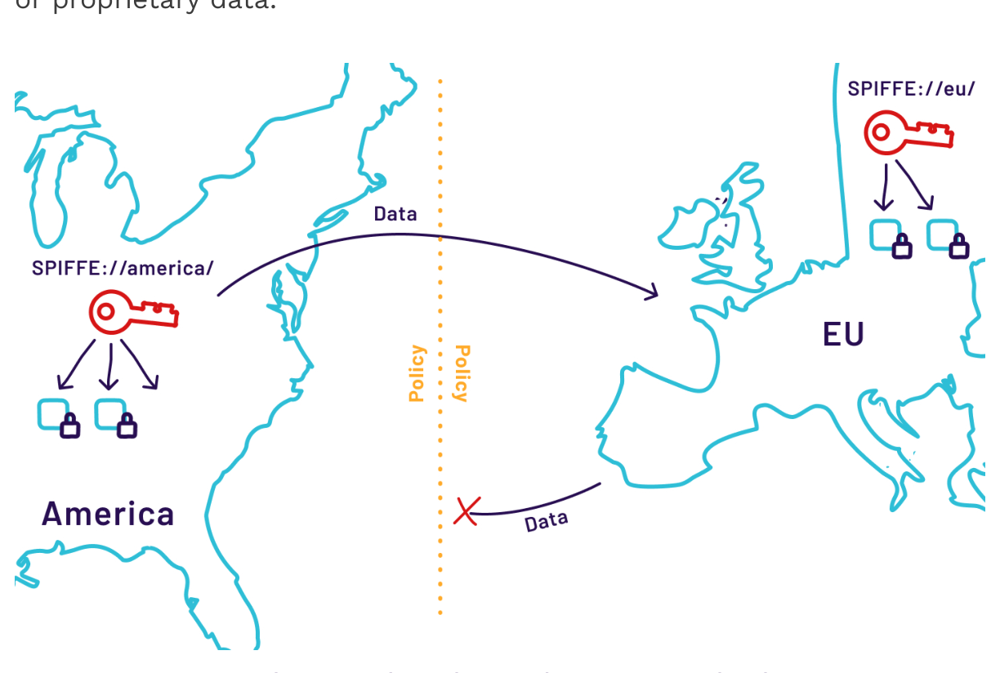

# 第 2 章　SPIFFE/SPIRE 带来的收益

本章将从业务与技术两个视角，阐述在基础设施中部署 SPIFFE 和 SPIRE 所带来的收益。

## 面向所有人，无处不在

SPIFFE 和 SPIRE 致力于以一种通用方式加强软件组件的身份识别，使任何人、在任何地方都能跨分布式系统加以利用。现代基础设施的技术版图错综复杂，各种硬件和软件投资交织在一起，导致环境日益异构化。无论系统部署在何处、由谁部署，通过标准化系统定义、验证和维护软件身份的方式来保障软件安全，都能带来诸多收益。

对于关注业务效率与投资回报的业务领导者而言，SPIFFE 和 SPIRE 能够大幅降低管理和签发加密身份文档（如 X.509 证书）所带来的开销；同时，开发者不再需要深入理解用于保护服务间通信的身份与认证技术，从而加快开发和部署的速度。

对于致力于交付稳健、安全且具备互操作性产品的服务提供商和软件供应商而言，SPIFFE 和 SPIRE 解决了将多个解决方案互联整合为最终产品时普遍存在的关键身份问题。例如，SPIFFE 可以一举作为产品 TLS 功能以及用户管理/认证功能的基础。再如，SPIFFE 可以替代为平台访问而管理和签发 API 令牌的做法，不仅免费获得自动轮换能力，还消除了客户存储和管理这些令牌访问权限的负担。

对于不仅希望加强传输中数据安全、还希望满足监管合规要求并解决信任根问题的安全从业者而言，SPIFFE 和 SPIRE 能够在不可信环境中提供双向认证，而无需交换密钥。安全边界和管理边界可以轻松划定，并在策略允许的时间和位置实现跨边界通信。

对于需要身份管理抽象，以及需要与现代云原生服务和解决方案实现互操作性的开发者、运维人员和 DevOps 从业者而言，SPIFFE 和 SPIRE 兼容软件开发生命周期中的众多其他工具，有助于交付可靠的产品。开发者可以专注于日常工作，直接投入业务逻辑开发，而不必为证书、私钥和 JWT 等繁琐细节分心。

## 面向业务领导者

### 现代组织有着现代需求

在当今的商业环境中，通过差异化的应用与服务快速交付创新的客户体验，是获取竞争优势的必要条件。因此，组织正见证着应用和服务的架构设计、构建及部署方式的深刻变革。云和容器等新技术帮助组织以更大规模、更快速度发布产品。服务需要以极高的迭代速度构建，并部署在纷繁多样的平台之上。随着开发节奏加快，为了提供一致的客户体验，这些系统之间的相互依赖和互联程度也越来越高。

然而，合规要求、专业人才储备不足，以及团队/组织之间和现有解决方案内部的互操作性挑战等主要因素，可能会阻碍组织实现高速迭代、赢得市场份额或保障关键任务可靠运行。

### 互操作性的影响

随着系统不断演进，对互操作性的需求也在持续增长。彼此独立的团队构建出各自为政、互不知晓的服务，但最终它们仍需相互感知与协作。企业并购会让全新的、前所未见的系统需要融入现有体系。新的业务合作关系建立后，往往要求与深藏于技术栈底层的服务建立新的通信通道。所有这些挑战都归结为一个核心问题：“如何将这些各自带有独特属性和历史包袱的服务安全地连接在一起？”

当组织整合要求不同的技术栈汇聚并实现互操作时，技术集成往往是一项艰巨的挑战。在系统间通信的身份与认证方面统一采用行业公认的通用标准，可以大幅简化跨多个技术栈实现全面互操作与集成的技术复杂度。

SPIFFE 为“什么是软件身份”建立了共识。通过进一步利用 SPIFFE 联邦（SPIFFE Federation），不同组织或团队中异构系统的组件能够建立信任并安全通信，而无需引入 VPN 隧道、一次性证书或系统间共享凭据等额外开销。

### 合规性与可审计性

SPIRE 实现中的可审计性通过在环境中强制实施双向认证，确保执行操作的身份具有不可抵赖性。此外，SPIFFE/SPIRE 签发的身份文档使 mTLS（双向 TLS）的广泛部署成为可能，从而有效解决了此类项目中最棘手的难题之一。mTLS 带来的其他收益还包括对服务间传输中数据的原生加密，这不仅保护了通信的完整性，也保障了敏感数据或专有数据的机密性。

*图 2.1：使用 SPIFFE 无缝满足合规与监管目标。*

另一项常见的合规要求源自《通用数据保护条例》（GDPR）——具体而言，它要求欧盟（EU）数据必须完全留存在欧盟境内，不得途经欧盟司法管辖区以外的实体或由其处理。借助多个信任根，跨国组织可以确保欧盟境内的实体仅与同样位于欧盟境内的其他实体通信。

### 专业人才储备

确保开发、安全和运维团队具备恰当的知识与经验，以妥善处理安全敏感型系统，始终是一项重大挑战。企业需要能够招聘到掌握基于标准的技能的开发者，以缩短入职适应时间、加快产品上市速度并降低风险。

要以自动化方式为每一个软件实例交付加密身份，并实现自根而下的凭据轮换，是一项极具挑战性的难题。对于安全和运维团队来说，具备实施此类系统所需专业能力的人才凤毛麟角。如果在日常运维中无法借助社区或行业经验，问题就会进一步恶化，最终导致服务中断和相互推诿。

我们不能指望开发者具备安全领域的实战专业知识，尤其是在组织环境内涉及服务身份的问题上。同时，既精通开发、运维，又深入了解工作负载运行机制的安全从业者更是寥寥无几。借助开放标准和开放规范来解决关键的身份问题，能够让缺乏相关个人经验的从业者通过一个支持完善、不断壮大的 SPIFFE/SPIRE 最终用户与实践者社区来拓展知识。

### 成本节约

采用 SPIFFE/SPIRE 可以在多个方面实现成本节约，包括减少云/平台锁定、提升开发者效率以及降低对高度专业化人才的依赖等。

通过将云服务提供商的身份接口抽象为一组基于开放标准、定义清晰的通用 API，SPIFFE 显著降低了开发和维护云感知应用的负担。由于 SPIFFE 与平台无关，它几乎可以部署在任何环境中。当需要进行平台技术变更时，这一差异化优势能够节省大量时间和资金，甚至能增强组织在与现有平台供应商谈判时的议价能力。历来，身份与访问管理服务都是每个组织部署体系中的指挥与控制中枢——云服务提供商深谙此道，并将其作为深度绑定平台的主要锁定机制。

在提升开发者效率方面，同样存在可观的成本节约空间。SPIFFE/SPIRE 的两个重要特性释放了这部分价值：一是加密身份及其整个生命周期的全自动化签发与管理；二是认证及服务间通信加密的统一化与卸载（offloading）。前者消除了人工操作流程，后者省去了研究与反复试错的时间，使开发者能够更专注于真正重要的事情——业务逻辑。

从历史经验来看，拥有高技能专业工程师的《财富》50 强科技企业，耗费了数十年时间才解决这一身份难题。将 SPIFFE/SPIRE 纳入组织的云原生解决方案目录，意味着你可以直接站在多年来高度专业化的安全与研发人才积累的成果之上，而无需承担相应的高昂成本。

凭借强大的社区支持，SPIFFE/SPIRE 已支撑了从几十个到数十万个节点不等的部署规模，其在复杂大规模环境中的运行经验足以满足组织的需求。

**提升开发者生产力**

| 评估指标 | 数值 |
| --- | --- |
| 开发者为每个应用组件获取凭据以及配置认证/机密性协议的平均耗时（小时） | |
| 开发者为每个应用组件沟通协调获取凭据所减少的时间比例 | 95% |
| 开发者学习和实现特定 API 网关、密钥存储等控制措施的平均耗时（小时） | |
| 开发者学习和实现特定 API 网关、密钥存储等控制措施所减少的时间比例 | 75% |
| 年度新开发的应用组件数量 | |
| 因开发者生产力提升而预计节省的总工时 | |

## 面向服务提供商和软件供应商

减轻客户在使用产品过程中承担的负担，始终是优秀产品经理的首要目标。理解那些表面上看似无害的功能背后所蕴含的实际影响至关重要。例如，如果一款数据库产品为了满足客户合规要求而需要支持 TLS，在产品中加几个配置项就草草了事似乎很简单。

不幸的是，这种做法将诸多重大难题转嫁给了客户。即便是看似简单的用户管理功能，也会面临类似的挑战。请思考一下，这两项常见功能默认都会引入以下客户痛点：

- 由谁来生成证书和密码？如何生成？
- 如何将它们安全地分发给需要它们的应用程序？
- 如何限制对私钥和密码的访问？
- 如何存储这些密钥，以确保它们不会泄露到备份中？
- 当证书过期或必须更改密码时会发生什么？这一过程是否会导致服务中断？
- 这些任务中有多少必然需要人工运维介入？

在客户看来，只有先回答了所有这些问题，这些功能才真正可用。而客户自行设计或部署的解决方案，在运维层面往往十分痛苦。

这些客户负担是真实存在的。有些组织甚至为此设立了专门的团队来应对这些负担。只需在产品中支持 SPIFFE，上述所有顾虑便迎刃而解。产品可以无缝接入现有基础设施，直接获得 TLS 支持。此外，由 SPIFFE 赋予的客户端（用户）身份还可以替代直接管理用户凭据（如密码）的需求。

### 平台访问管理

访问某个服务或平台（例如 SaaS 服务）同样面临类似的挑战。归根结底，这些挑战源于凭据管理固有的复杂性，当凭据是共享密钥时尤其如此。

不妨想一想 API 令牌——SaaS 提供商普遍使用 API 令牌来对非人类 API 调用者进行身份认证。它们本质上就是密码，客户必须谨慎管理每一个令牌。上面列出的所有挑战在这里同样适用。支持 SPIFFE 认证的平台可以大幅减轻客户访问平台时的负担，一次性解决存储、签发和生命周期管理问题。借助 SPIFFE，问题被简化为只需向指定的工作负载授予所需权限即可。

## 面向安全从业者

技术创新绝不能成为打造安全产品的绊脚石。开发、分发和部署工具需要与安全产品及方法实现无缝集成，既不影响软件开发的自主性，也不给组织的成功增添负担。组织需要易于使用、并能为现有工具增添额外安全保障的软件产品。

SPIRE 并非解决所有安全问题的终极灵丹妙药。它并不能取代稳健的安全实践、纵深防御或分层安全体系。然而，作为全面安全战略的一部分，利用 SPIFFE/SPIRE 在不可信网络中提供信任根，能够使组织在迈向零信任架构（参见：https://csrc.nist.gov/publications/detail/sp/800-207/final）的道路上迈出意义重大的一步。

### 默认安全

SPIRE 可以帮助缓解多项主要的 OWASP（参见：https://owasp.org/www-project-top-ten/）安全威胁。为了降低因凭据泄露导致入侵的可能性，SPIRE 在整个基础设施范围内提供经过强验证的身份用于认证。保障安全承诺的自动化机制使平台实现了默认安全（secure-by-default），消除了开发团队额外的配置负担。

对于希望解决其产品或服务中信任根与身份问题的组织而言，SPIFFE/SPIRE 还通过实现普遍的 mTLS 认证，无论工作负载部署在何处都能安全地传递通信，从而满足客户的安全需求。此外，与所有开源产品一样，代码库背后的社区和贡献者会在代码合并前后以多双眼睛进行审查。这种对“林纳斯定律（Linus’ Law）”（参见：https://en.wikipedia.org/wiki/Linus%27s_law）的践行超越了“四眼原则”，确保任何潜在缺陷或已知安全问题在进入发行版之前就被及时发现。

### 策略执行

SPIRE 的 API 为安全团队提供了一种易于使用的机制，使其能够跨平台、跨业务单元执行一致的认证策略。当与定义良好的策略结合使用时，服务之间的交互可以被控制在最小范围内，确保只有经过授权的工作负载才能彼此通信。这限制了恶意实体的潜在攻击面，并在触发策略引擎的默认拒绝规则时能够发出告警。

SPIRE 依托一个实时运行的强大多因素验证引擎，以高度确定性决定加密身份的签发。它还会自动签发、分发和续期短期凭据，确保组织的身份架构准确反映工作负载的实际运行状态。

### 零信任

在架构中采用零信任模型，可以在发生安全入侵时有效缩小爆炸半径（blast radius）。双向认证与信任吊销机制可以阻止已被攻破的前端应用服务器从网络中或集群内可能存在的无关数据库中窃取数据。尽管在网络安全管控严密的组织中这种情况不太容易发生，但 SPIFFE/SPIRE 无疑增加了额外的防御层，能够缓解因防火墙配置错误或未更改默认登录凭据而导致的漏洞与暴露风险。它还将安全决策的依据从 IP 地址和端口号（这些信息可能以难以察觉的方式被篡改）转移到具备完整性保护的加密标识符上。

### 日志记录与监控

SPIRE 有助于提升基础设施的可观测性。身份请求和签发等关键 SPIRE 事件都是可记录的日志事件，有助于提供更完整的基础设施视图。SPIRE 还会为多种操作生成事件，包括身份注册、注销、验证尝试、身份签发和轮换。这些事件随后可以被聚合，并发送到组织的安全信息与事件管理（SIEM）解决方案中，实现单一控制台的统一监控。

## 面向开发、运维与 DevOps 人员

尽管无论在何种环境中，采用和支持 SPIFFE/SPIRE 带来的开发者或运维生产力提升都可以被量化，但归根结底，它消除了团队面临的大量琐碎繁杂的运维劳务（toil），让团队成员在日常工作中重新找回专注、心流与愉悦感。

安全绝不能成为技术创新的阻碍。安全工具和控制措施需要与现代产品及方法实现无摩擦集成，既不影响开发的自主性，也不给运维团队增加负担。

### 专注

SPIFFE 和 SPIRE 提供了一个统一的服务身份控制平面，并通过跨平台、跨领域的一致 API 对外提供能力，使团队能够专注于交付应用和产品，而不必担心目标部署环境或为其编写特殊配置。每位开发者都可以借助这一 API，轻松、安全地实现跨平台、跨领域的身份认证。

开发者还可以请求并获取身份，进而基于该身份构建额外的、面向特定应用的控制逻辑；与此同时，运维和 DevOps 团队能够以自动化方式管理和扩展身份，并同步实现和执行消费这些身份的策略。此外，团队还可以利用 OIDC 联邦将 SPIFFE 身份与各类云认证系统（如 AWS IAM）关联起来，从而减少对难以管理的密钥的依赖。

### 心流

有史以来生成的每一份凭据都面临着同样的问题：在某个时刻，它必须被更换或吊销。当这一时刻到来时，整个过程往往依赖人工操作且痛苦不堪——而且正如软件部署一样，执行频率越低，过程就越痛苦。对流程的不熟悉，以及因更新不及时或更新步骤繁琐而引发的服务中断，早已司空见惯。

需要进行凭据轮换时，运维人员和开发者往往都不得不付出高昂的上下文切换成本。SPIFFE/SPIRE 将轮换视为核心关键功能来解决这一问题：轮换完全自动化，并且无需人工干预即可定期执行。轮换频率由运维人员自行决定，其中存在一定权衡；不过，SPIFFE 凭据每小时轮换一次的做法并不罕见。这种高频、自动化的轮换方式最大限度地减少了凭据生命周期管理对运维和开发人员造成的中断。

值得注意的是，实现自动化的不仅仅是轮换。凭据（最常见的是 X.509 证书）的初始签发同样完全自动化。这有助于让开发者的工作流更加顺畅，将生成或获取凭据的任务从启动新服务的检查清单中彻底移除。

### 互操作性

开发者和集成人员不再需要因组织内安全身份与认证解决方案缺乏互操作性而感到沮丧。SPIRE 提供了一个插件模型，允许开发者和集成人员根据自身需求扩展 SPIRE。如果组织需要使用一组专有 API 来生成 SPIRE 的密钥，或者要求 SPIRE 的中间签名密钥存放在特定的专有密钥管理服务（KMS）中，这一能力就显得尤为重要。由于组织遵循的是开放规范，开发者也无需为新上线的工作负载编写自定义封装代码。

### 日常工作的改善

许多团队不敢修改或删除允许网络间流量的防火墙规则，因为担心会对关键系统的可用性产生不利影响。运维人员可以将身份及其关联策略的作用域限定在应用级别，而非全局级别。局部作用域的身份和策略赋予了运维人员实施变更的信心，而不必担心波及下游系统。

在缺乏健全软件身份系统的情况下，服务间访问管理通常依赖网络层控制（例如基于 IP/端口的策略）来实现。遗憾的是，这种方法会带来大量管理网络访问控制列表（ACL）的运维劳务。随着弹性基础设施的动态扩缩容以及网络拓扑的不断变化，这些 ACL 需要持续不断地维护和照料。它们甚至会阻碍新基础设施的上线，因为现有系统必须先被告知这些新组件的存在。

SPIFFE 和 SPIRE 致力于减少这种运维劳务，因为与网络中主机和工作负载的编排变化相比，软件身份的概念相对稳定。此外，它们还为将授权决策下放给服务所有者铺平了道路——服务所有者归根结底是做出此类决策的最佳人选。例如，当服务所有者希望向新的调用方授予访问权限时，无需关心创建访问策略所涉及的网络层细节——他们只需声明希望授权的服务名称，然后继续其他工作即可。

SPIFFE/SPIRE 还有助于提升可观测性、监控能力，并最终提高服务级别目标（SLO）的达成率。通过在多种不同类型的系统（不仅限于容器化或云原生系统）之间统一规范软件身份，并提供身份签发与使用的审计追踪，SPIFFE/SPIRE 能够显著增强故障发生前、发生中及发生后的态势感知能力。更成熟的团队甚至可能会发现，这还能提升他们在问题影响服务可用性之前提前预测问题的能力。
