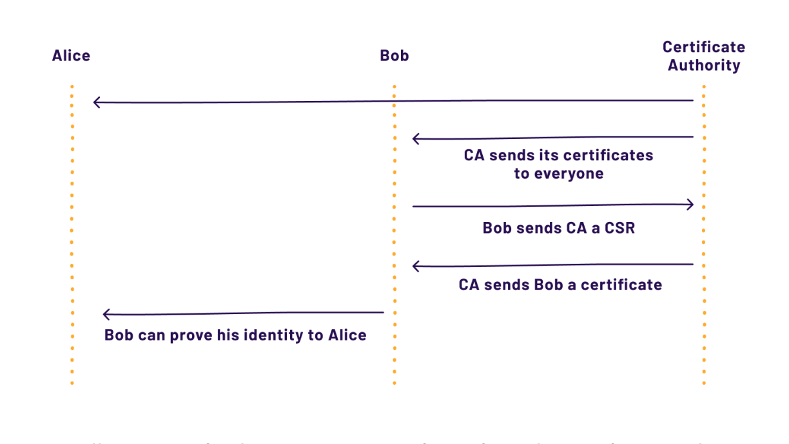
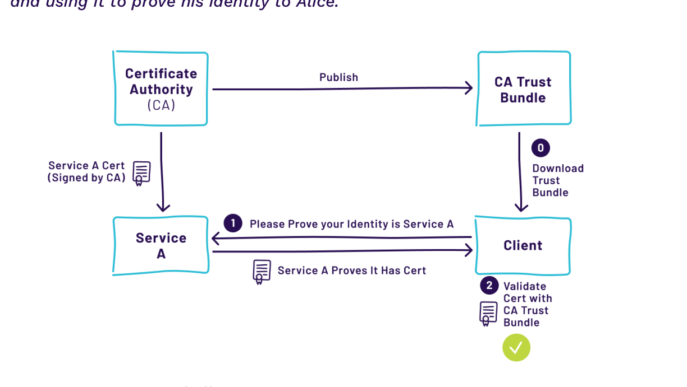
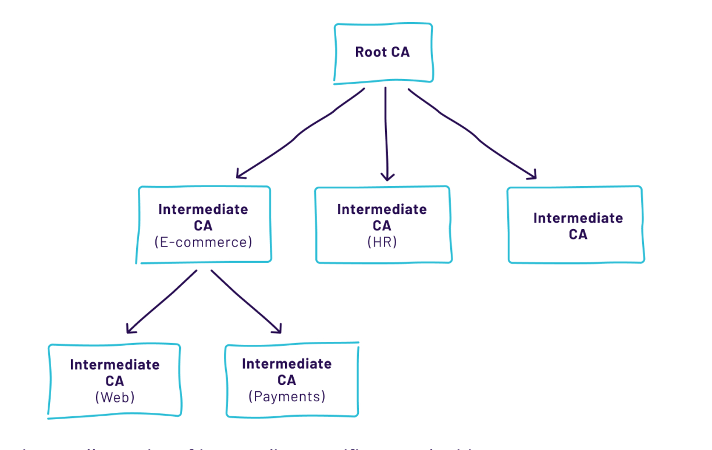

# 第 3 章　身份背后的基础概念

本章将介绍什么是身份，以及身份分发、管理和使用的基础知识。这些概念是理解 SPIFFE 和 SPIRE 工作原理的前提。

## 什么是身份？

对人类而言，身份是一件复杂的事情。每个人都是独一无二的个体，无法被克隆，也不可能把头脑替换成另一套代码，而且人的一生中往往拥有多重社会身份。软件服务同样如此复杂。

单个程序可能会横向扩展到数千个节点，或者随着构建系统推送新更新而在一天之内多次变更代码。在如此快速变化的环境中，身份必须代表该服务特定的逻辑用途（例如客户账单数据库），同时体现它与既定权威机构或信任根（例如 `my-company.example.org`，或面向生产环境工作负载的签发机构）之间的关联。

一旦为组织内的所有服务签发了身份，这些身份就可以用于身份认证（authentication）：证明某个服务确实如其所声称的那样。当服务之间能够相互认证后，它们还可以利用身份来实现授权（authorization）——即控制谁可以访问这些服务——以及机密性（confidentiality），即确保彼此之间传输的数据不被泄露。尽管 SPIFFE 本身并不直接提供身份认证、授权或机密性功能，但它所签发的身份可以用于实现上述所有能力。

为组织规划服务身份，与设计组织基础设施的任何其他部分类似：它紧密依赖于组织的实际需求。当服务横向扩展、代码变更或迁移位置时，让它继续保持同一个身份在逻辑上往往是合理的。

既然我们已经定义了什么是身份，那么该如何表示这个身份呢？当某个软件（或工作负载）声称自己拥有某个身份时，我们又如何确信这一声明是可信的？要回答这些问题，我们首先需要探讨身份是如何建立起来的。

### 人类的身份

让我们借助每个人都熟悉的事物来解释这些概念：我们在现实世界中的身份。

#### 身份文档

如果说名字代表一个人的身份，那么证明这一身份的凭证就是身份文档。护照是一种能够让人证明自己身份的证件，因此它就是一种身份文档。就像不同国家的护照外观各异一样，不同类型的软件身份文档在形式上也会有所不同，所包含的信息也不尽相同。但为了发挥作用，它们通常至少会包含一些通用信息，例如使用者的名称。

一本护照和一张随手写着你名字的餐巾纸之间有什么区别？

#### 可信身份

最核心的区别在于来源。对于护照，我们相信签发机构已经核实了你的身份，并且我们有办法校验这本护照确实是由该受信任的机构签发的（即验证）。而对于那张餐巾纸，我们既不知道它来自哪里，也无法校验它是否真的出自你所说的那家餐厅；我们更无法相信那家餐厅在餐巾纸上写对了你的名字，或者在你报出名字时核实过其准确性。

#### 信任签发机构

我们之所以信任护照，是因为我们从根本上信任签发护照的权威机构。我们信任它们签发这些身份文档的流程：它们有完善的记录和控制措施，确保只向正确的个人签发身份。我们信任这一流程的治理机制，因此相信该机构签发的护照能够如实代表某个人的身份。

#### 校验身份文档

既然如此，我们该如何区分真护照和假护照？这就需要用到校验（verification）。相关机构需要一种方法来判断身份文档是否确实由我们所信任的权威机构签发。在现实世界中，这通常通过难以伪造但易于核查的水印来实现。

#### 认证出示身份文档的人

护照记录了它所代表之人的多项信息。首先，护照上附有持证人的照片，可用于核实出示护照的人与护照上的照片是否为同一人。护照上还可能包含持证人的其他生理特征，例如身高、体重和瞳孔颜色。所有这些属性都可以用来认证出示护照的人。

总结一下：护照是我们的身份文档，我们之所以用它来相互识别，是因为我们信任签发机构，并且有办法校验该文档确实源自该机构。最后，我们可以通过将护照内容与持证人本人进行交叉比对，来认证出示护照的人。

## 数字世界中的身份：密码学身份

回到工作负载身份，上述概念如何映射到计算机系统中呢？在数字世界里，我们使用数字身份文档来替代护照。X.509 证书、经过签名的 JSON Web Token（JWT）以及 Kerberos 票据都是数字身份文档的例子。数字身份文档可以通过密码学技术进行校验，随后计算机系统便能像持护照的人一样完成身份认证。

实现这一目标最实用、最普及的技术之一便是公钥基础设施（PKI）。PKI 被定义为创建、管理、分发、使用、存储和吊销数字证书以及管理公钥加密所需的一系列角色、策略、硬件、软件和流程的集合。借助 PKI，数字身份文档可以仅凭一小套静态的根信任包在本地离线完成验证。

### X.509 简介

1988 年，国际电信联盟电信标准化部门（ITU-T，参见 https://www.itu.int/en/ITU-T/about/）首次发布了面向 PKI 的 X.509 标准。这在当时是一项极具雄心的创举，即便放在今天依然如此。该标准最初设想为人类、服务器以及其他各类设备统一颁发证书，从而构建一个庞大且全球互联的安全通信体系。尽管 X.509 从未达到其最初设想的覆盖规模，但它已成为几乎所有安全通信协议所依赖的基础。

### 单一权威机构下的 X.509 工作原理

1. Bob 的计算机需要一张证书。他生成一个随机私钥，以及一份证书签名请求（Certificate Signing Request，CSR）。CSR 包含他计算机的基本信息，例如主机名（我们称之为 `bobsbox`）。CSR 有点像护照申请表。
2. Bob 将他的 CSR 发送给证书颁发机构（CA）。CA 会验证 Bob 确实是 Bob。具体的验证方式各不相同——可能需要人工审核 Bob 的证明材料，也可能通过自动化检查来完成。
3. 随后，CA 将 CSR 中提供的信息进行编码，并附上数字签名，从而生成一张证书。这个数字签名用于声明 CA 已经核实证书内包含的信息真实无误。CA 将该证书发回给 Bob。
4. 当 Bob 希望与 Alice 建立安全通信时，他的计算机可以出示自己的证书，并通过密码学方式证明自己持有 Bob 的私钥（整个过程中无需向任何人泄露该私钥的内容）。
5. Alice 的计算机可以通过检查该证书是否由 CA 签名，来确认 Bob 的证书确实属于 Bob。她信任 CA 在签发证书前已经妥善核实了 Bob 的身份。

*图 3.1：Bob 向证书颁发机构申请证书，并用该证书向 Alice 证明自己身份的示意图。*

*图 3.2：PKI 简明概览。*

### 使用中间证书颁发机构的 X.509

在许多情况下，签发某张证书的 CA 并非广为人知。相反，该 CA 拥有自己的密钥和证书，而它的证书是由另一个 CA 签发的。通过签发这张 CA 证书，上级 CA 证明了下级 CA 已被授权签发数字身份。这种由上级 CA 向下级 CA 授权的机制称为委派（delegation）。

委派可以逐级重复进行，下级 CA 可以继续将其权限向下委派，从而形成一棵任意高度的证书颁发机构树。位于最顶层的 CA 称为根 CA（root CA），其证书必须是广为人知的。证书链中的其他所有 CA 都称为中间 CA（intermediate CA）。这种做法的好处在于，需要广为人知的密钥数量更少，因而受信任密钥列表的变更频率也更低。

*图 3.3：中间证书颁发机构示意图。*

但这也引出了 X.509 的一个关键弱点：任何 CA 都可以不受限制地签发任何证书。如果一名黑客决定自行搭建一个中间 CA，并且设法从任何一个现有的中间 CA 获得了批准，那么她实际上就可以随心所欲地签发任何身份。因此，每一个广为人知的 CA 都必须完全可信，而且它们所委派的每一个中间 CA 也必须完全可信。

### 证书与身份生命周期

PKI 还包含多项额外特性，使数字身份的管理与认证更加简便和安全，例如权限委派、身份吊销以及限制身份文档的有效期等。

#### 身份签发

总有某个时刻需要签发全新的身份。新生命会降生，新的软件服务会被开发出来，在这些场景下，我们都必须从无到有地签发一个身份。

首先，服务需要申请一个新身份。对于人类来说，这可能是一张纸质表格；而对于软件来说，它是一份称为证书签名请求（CSR）的 X.509 文档，随同对应的私钥一起生成。CSR 与证书很相似，但由于它尚未经过任何 CA 签名，因此没有人会承认它是有效的。随后，服务会将 CSR 安全地发送给 CA。

接下来，CA 会将 CSR 中的每一项细节与发起申请的服务进行核对。最初，这一过程被设计为人工操作：由工作人员审查材料并逐案做出决定。如今，审核与签发流程往往已完全自动化。如果你用过广受欢迎的 LetsEncrypt 证书颁发机构，那么你对全自动的 CA 签发流程一定不会陌生。

一旦审核通过，CA 就会在 CSR 上附加自己的数字签名，使其成为一张正式的证书，并将其发回给该服务。结合先前生成的私钥，该服务便可以安全地向外界证明自己的身份。

#### 证书吊销

那么，如果某个服务遭到入侵会怎样？如果 Bob 的笔记本电脑被黑客攻破，或者 Bob 离职后不应再拥有访问权限，又该怎么办？

这种撤销信任的过程称为证书吊销（Certificate Revocation）。CA 会维护一个名为证书吊销列表（Certificate Revocation List，CRL）的文件，其中记录着已被吊销证书的唯一 ID，并将该文件的签名副本分发给任何请求方。

吊销机制在实践中颇为棘手，原因有几点。首先，CRL 必须托管在某个服务端点上对外提供访问，这就带来了如何确保该端点持续在线且可达的挑战。当端点不可达时……PKI 会就此停止工作吗？实际上，大多数软件会选择“故障开放（fail open）”，即在 CRL 不可用时继续信任证书，这使得 CRL 在这种情况下形同虚设。

其次，CRL 可能会变得庞大而笨重。一张被吊销的证书必须一直保留在 CRL 中直到其过期，而证书的有效期通常很长（往往以年计）。这会导致在托管、下载和处理吊销列表本身时出现性能问题。

业界已经开发了多种技术来尝试让证书吊销更简单、更可靠，例如在线证书状态协议（Online Certificate Status Protocol，OCSP）。然而，五花八门的实现方案反而让证书吊销成为一项持续存在的难题。

#### 证书过期

每张证书都内置了一个过期时间。过期时间是 X.509 安全性的重要组成部分，原因有以下几方面：应对技术淘汰、限制证书所标识身份发生变更的风险、控制 CRL 的体积，以及降低密钥被盗的可能性。

证书技术已经存在很长时间了。在早期，许多 CA 使用诞生于 1989 年的 MD2 哈希算法，而该算法很快就被发现存在安全缺陷。如果那些旧证书至今仍然有效，攻击者就可以伪造它们。

限制证书有效期的另一个重要原因在于，CA 只有一次机会在签发时验证申请者的身份，但这些信息并不能保证随时间推移始终保持准确。例如，域名经常会发生所有权变更，而域名恰恰是证书中通常包含的最关键信息之一。

如果启用了证书吊销列表，那么每一张仍然有效的证书都有可能被吊销。如果证书永不过期，证书吊销列表就会无限膨胀。为了保持 CRL 足够小，证书必须设定过期时间。

最后，证书的有效期越长，该证书对应的私钥——或者通往根证书路径上任意一级证书的私钥——被窃取的风险就越高。

#### 频繁续期证书

解决吊销难题的一种折中方案，是更多地依赖过期机制。如果证书的有效期非常短（例如只有几个小时），那么 CA 就可以频繁地重新执行最初的核验检查。只要证书续期足够频繁，甚至可能不再需要 CRL，因为直接等待证书自然过期可能反而更快。

**身份有效期的权衡**

| 较短的有效期 | 较长的有效期 |
| --- | --- |
| 若身份文档被盗，其有效时间更短 | 减轻证书颁发机构（人工与程序）的负载 |
| CRL 更短，甚至可能不再需要 | 减轻网络负载 |
| 同一时间处于有效状态的身份文档更少（更易于追踪） | 当节点因网络中断无法续期证书时，具备更好的容错能力 |

### 另一种密码学身份：JSON Web Token（JWT）

另一种基于公钥的数字身份文档是 JSON Web Token（RFC7519），它的运作方式也类似于 PKI 体系。它不使用证书，而是使用 JSON 令牌，并通过一种名为 JSON Web 密钥集（JSON Web Key Set）的结构作为 CA 信任包来验证这些 JSON 令牌的真实性。证书与 JWT 之间存在若干重要差异，这些细节超出了本书的讨论范围；但与 X.509 证书一样，JWT 的真实性也可以借助 PKI 进行校验。

### 外部身份的可信度

无论使用哪种身份，都必须由某个受信任的权威机构来签发。在很多情况下，并非所有人都信任相同的权威机构，或其签发身份的流程。Alice 的纽约州驾照在纽约是有效的身份证明，但在伦敦却无效，因为伦敦当局并不信任纽约州政府。然而，Bob 的美国护照在伦敦是有效的，因为英国当局信任美国政府机构，而伦敦当局又信任英国当局。

数字身份文档领域的情况如出一辙。Alice 和 Bob 持有的证书可能由两个完全不相关的 CA 签发，但只要双方都信任这两个 CA，他们就能相互完成身份认证。这并不意味着 Alice 必须信任 Bob，而只是意味着她能够安全地识别 Bob 的身份。

## 软件身份的用途

一旦软件拥有了数字身份文档，它就可以用于多种不同目的。前面我们已经讨论过利用身份文档进行身份认证，此外它们还可以用于双向 TLS（mTLS）、授权、可观测性和计量。

### 身份认证

身份文档最常见的用途是作为身份认证的基础。对于软件身份而言，存在多种不同的认证协议，它们使用 X.509 证书或 JWT 来向另一个服务证明自身的身份。

### 机密性与完整性

机密性意味着攻击者无法窥探消息的内容，而完整性意味着攻击者无法在传输过程中篡改消息。传输层安全协议（Transport Layer Security，TLS）是一种广泛用于建立安全连接的协议，它利用 X.509 证书在不可信的网络连接之上同时提供身份认证、机密性和消息完整性。

TLS 的一项特性是，连接的任意一方都可以使用证书进行身份认证。例如，当你访问银行网站时，你的浏览器会使用银行出示的 X.509 证书来认证银行的身份，但你的浏览器不会向银行出示证书（你是通过用户名和密码登录，而不是通过证书）。

当两个软件之间进行通信时，连接双方通常都会持有 X.509 证书并相互认证对方。这种机制称为双向认证的 TLS（mutually authenticated TLS）。

### 授权

一旦数字身份通过认证，就可以将其用于服务访问的授权。通常，每个服务都会维护一份允许向其发起请求的其他服务白名单。授权只能在身份认证之后进行。

### 可观测性

身份还有助于提升组织基础设施内部的可观测性。在大型组织中，陈旧或缺乏维护的服务之间以神秘且毫无文档记录的方式相互通信，这种情况屡见不鲜。为每个服务分配唯一身份，再结合可观测性工具，就能有效解决这一问题。在日志记录中，如果日后出现问题，能够明确追溯请求方的身份也会非常有用。

### 计量

在微服务架构中，一个常见需求是对请求进行限流，以免高速运行的微服务压垮处理较慢的微服务。如果每个微服务都拥有唯一身份，就可以利用该身份来管理每秒请求数配额，从而解决这一问题，甚至在必要时彻底拒绝访问。

## 小结

人类和软件都拥有身份，并且都可以借助身份文档来证明自己的身份。对于人类而言，护照是一种典型的身份文档；对于软件而言，最常见的数字身份文档则是 X.509 证书。

证书由证书颁发机构（CA）签发。CA 必须谨慎地核实证书申请者（无论是人还是系统）的身份，并妥善管理证书的生命周期。证书签发之后，任何使用该证书的一方都需要信任签发它的 CA。

一旦具备了受信任的数字身份文档，它们便能发挥诸多作用。最常见的用途之一是建立双向认证的 TLS 连接，从而同时获得身份认证、机密性和完整性。另一个常见用途则是授权。有了身份认证、机密性、完整性和授权的共同保障，服务之间的连接便安全可靠。
