# 第 4 章　SPIFFE 与 SPIRE 概念简介

本章在第 3 章介绍的概念基础上，详细阐述 SPIFFE 标准，说明 SPIRE 实现的各个组件及其协同工作方式，并在最后讨论威胁模型以及特定组件受损时可能产生的影响。

## 什么是 SPIFFE？

SPIFFE（Secure Production Identity Framework For Everyone，面向所有人的安全生产身份框架）是一套用于软件身份的开源标准。为了以与组织和平台无关的方式实现可互操作的软件身份，SPIFFE 定义了以全自动方式获取和验证加密身份所需的接口与文档。

SPIFFE 由五个部分组成：

- **SPIFFE ID**：软件服务名称（即身份）的表示方式。
- **SPIFFE 可验证身份文档（SVID，SPIFFE Verifiable Identity Document）**：一种可通过密码学方式验证的文档，用于向对端证明服务的身份。
- **SPIFFE Workload API**：一个简单的节点本地 API，服务无需进行身份认证即可通过它获取自身身份。
- **SPIFFE 信任包（Trust Bundle）**：一种用于表示给定 SPIFFE 签发机构所使用公钥集合的格式。
- **SPIFFE 联邦（Federation）**：一种用于共享 SPIFFE 信任包的简单机制。

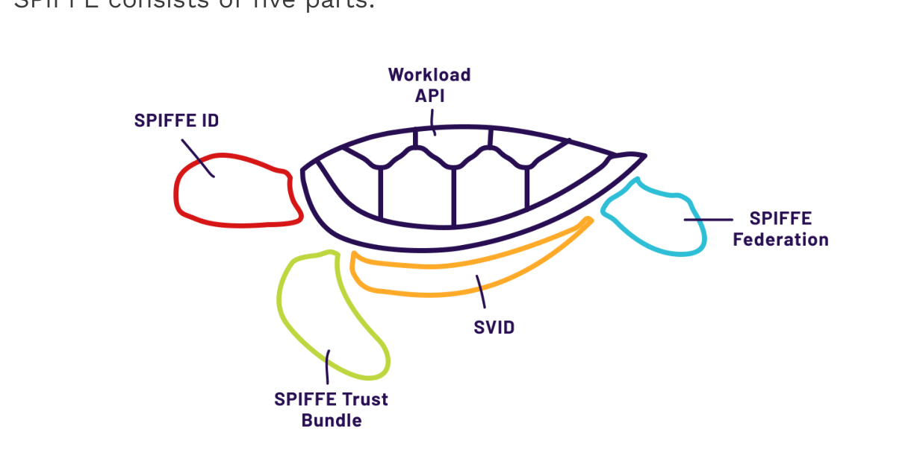

*图 4.1：SPIFFE 的组成部分。*

## SPIFFE 不是什么

SPIFFE 旨在标识通过计算机网络进行通信的服务器、服务以及其他非人类实体。这些实体的共同点在于，其身份必须能够自动签发（无需人工介入）。尽管从技术上讲或许可以用 SPIFFE 来标识人类或其他生物，但该项目有意将这些用例排除在适用范围之外，除机器与自动化系统外并未做任何特殊考量。

SPIFFE 负责向服务交付身份及相关信息，并管理该身份的生命周期，但其角色仅限于身份提供方，本身并不直接使用所交付的身份。如何使用接收到的 SPIFFE 身份，是服务自身的职责。目前已有多种利用 SPIFFE 身份来构建认证层的方案，例如端到端加密通信或服务间授权与访问控制；不过，这些功能同样不属于 SPIFFE 项目的范围，SPIFFE 不会直接解决这些问题。

## SPIFFE ID

SPIFFE ID 是一个用作服务唯一名称的字符串。它采用 URI 形式建模，由多个部分组成：前缀 `spiffe://`（作为 URI 的 scheme）、信任域的名称（作为 host 部分），以及特定工作负载的名称或身份（作为 path 部分）。

一个简单的 SPIFFE ID 可能形如 `spiffe://example.com/myservice`。

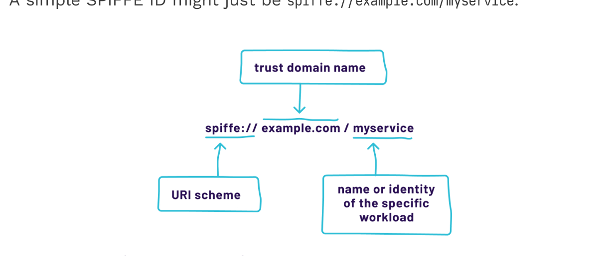

*图 4.2：SPIFFE ID 示例及其组成。*

SPIFFE ID 的第一个组成部分是 `spiffe://` URI scheme。虽然看似平淡无奇，但包含这一前缀是一个重要细节，它用于将 SPIFFE ID 与 URL 或其他类型的网络定位符区分开来。

SPIFFE ID 的第二个组成部分是信任域名称（如 `example.com`）。在某些情况下，整个组织只需一个信任域；而在另一些情况下，则可能需要多个信任域。信任域的语义将在本章后面介绍。

最后一个组成部分是工作负载本身的名称部分，由 URI 路径表示。SPIFFE ID 这一部分的具体格式和构成由各站点自行决定，组织可以自由选择最适合自身的命名方案。例如，可以选择同时反映组织归属与工作负载用途的命名方案：

`spiffe://example.com/bizops/hr/taxrun/withholding`

需要注意的是，SPIFFE ID 的主要目的是以灵活、且便于人类和机器理解的方式表示工作负载身份。切忌试图在 SPIFFE ID 的格式中塞入过多语义。例如，试图将某些属性编码进 SPIFFE ID，以便后续作为独立的授权元数据使用，可能会导致互操作性和灵活性方面的问题。更好的做法是使用一个独立的旁路数据库（参见：https://en.wiktionary.org/wiki/lookaside）。

## SPIFFE 信任域

SPIFFE 规范引入了信任域（trust domain）的概念。信任域用于管理组织内部以及组织之间的管理边界和安全边界；如前所述，每个 SPIFFE ID 都内嵌了其所属信任域的名称。

具体而言，信任域是 SPIFFE ID 命名空间中的一个子集，在此范围内，特定的一组公钥被视为具有权威性。由于不同的信任域拥有不同的签发机构，一个信任域受损不会导致另一个信任域受损。这一重要特性使得彼此之间未必完全信任的各方能够安全地进行通信——例如预发布环境与生产环境之间，或者两家不同公司之间。

跨多个信任域验证 SPIFFE 身份的能力称为 SPIFFE 联邦，将在本章后续部分介绍。

## SPIFFE 可验证身份文档（SVID）

SPIFFE 可验证身份文档（SVID）是一种可通过密码学方式验证的身份文档，用于向对端证明服务的身份。每个 SVID 包含单个 SPIFFE ID，并由代表该服务所在信任域的签发机构签名。

SPIFFE 没有发明一种需要让各类软件重新学习支持的新文档类型，而是选择采用业已广泛使用且广为人知的文档类型。截至本书撰写之时，SPIFFE 规范定义了两种可用作 SVID 的身份文档类型：X.509 和 JWT。

### X509-SVID

X509-SVID 将 SPIFFE 身份编码到标准的 X.509 证书中（参见：https://tools.ietf.org/html/rfc5280）。对应的 SPIFFE ID 作为 URI 类型设置在主题备用名称（Subject Alternative Name，SAN）扩展字段中。虽然一个 X509-SVID 中只允许设置一个 URI SAN 字段，但证书可以包含任意数量的其他类型 SAN 字段，包括 DNS SAN。

凡是条件允许的场景，都建议优先使用 X509-SVID，因为其安全特性优于 JWT-SVID。具体来说，与 TLS 结合使用时，X.509 证书无法被中间人记录并重放。

使用 X509-SVID 可能还涉及其他要求，请参阅规范中的 X509-SVID 部分（参见：https://github.com/spiffe/spiffe/blob/master/standards/X509-SVID.md）。

### JWT-SVID

JWT-SVID 将 SPIFFE 身份编码到标准的 JWT 中（参见：https://tools.ietf.org/html/rfc7519）——具体而言是 JWS（参见：https://tools.ietf.org/html/rfc7515）。JWT-SVID 用作持有者令牌（bearer token），在应用层向对端证明身份。与 X509-SVID 不同，JWT-SVID 容易遭受一类称为“重放攻击（replay attacks，参见：https://en.wikipedia.org/wiki/Replay_attack）”的攻击，即未经授权的一方获取令牌并将其重复使用。

SPIFFE 强制规定了三种机制来缓解这一攻击向量。首先，JWT-SVID 必须仅通过安全信道传输。其次，受众声明（audience claim，即 `aud` 声明）必须设置为令牌目标接收方的严格字符串匹配值。最后，所有 JWT-SVID 都必须包含过期时间，从而限制被窃令牌的有效期。

至关重要的是，尽管有上述缓解措施，JWT-SVID 从根本上仍然容易受到重放攻击，因此应当谨慎使用并妥善处理。即便如此，它们仍是 SPIFFE 规范集中的重要组成部分，因为它们使得在无法建立端到端通信信道的场景下，SPIFFE 认证依然能够发挥作用。

使用 JWT-SVID 可能还涉及其他要求，请参阅规范中的 JWT-SVID 部分（参见：https://github.com/spiffe/spiffe/blob/master/standards/JWT-SVID.md）。

## SPIFFE 信任包

SPIFFE 信任包是一个包含某信任域公钥的文档。每种 SVID 类型在该信任包中都有特定的表示方式（例如，对于 X509-SVID，信任包中包含代表公钥的 CA 证书）。每个 SPIFFE 信任域都有一个与之关联的信任包，其中的材料用于验证声称归属于该信任域的 SVID。

由于信任包不包含任何机密信息（只包含公钥），因此可以安全地对外公开共享。尽管如此，在分发信任包时仍需确保安全性，以防止其内容遭到未经授权的篡改。换句话说，信任包不需要机密性，但需要完整性。

SPIFFE 信任包采用 JWK Set（即 JWKS 文档）格式，与 OpenID Connect（参见：https://openid.net/connect/）等现有认证技术兼容。JWKS 是一种灵活且广泛采用的格式，可用于表示各类加密密钥与文档，这也为将来定义新的 SVID 格式提供了一定的前瞻性兼容保障。

## SPIFFE 联邦

在实际场景中，往往需要允许位于不同信任域中的服务进行安全通信。在许多情况下，你无法将所有服务都放在同一个信任域中。一个常见例子是需要相互通信的两家不同组织；另一个例子则是单一组织内部需要建立安全边界，例如在信任度较低的云环境与高信任度的本地自建服务之间。

为了实现这一点，每个服务都必须持有远端服务所在外部信任域的信任包。因此，SPIFFE 信任域必须对外暴露或以其他方式共享其信任包内容，使外部信任域中的服务能够验证本地信任域的身份。用于共享信任域信任包内容的机制称为信任包端点（bundle endpoint）。

信任包端点是简单的、受 TLS 保护的 HTTP 服务。希望与外部信任域建立联邦的运维人员，必须在自身的 SPIFFE 实现中配置外部信任域的名称及信任包端点的 URL，以便定期拉取该信任包的内容。

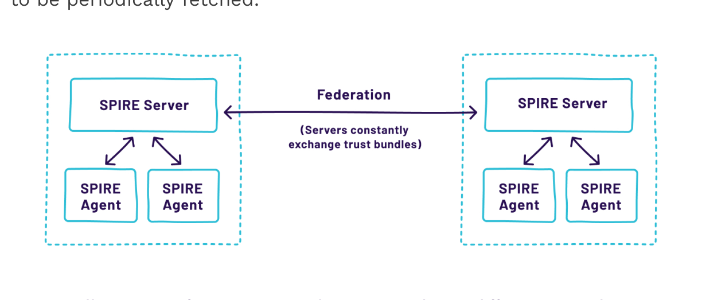

*图 4.3：通过联邦连接两个不同信任域的企业架构示意图。每个 SPIRE Server 只能为其自身的信任域签发 SVID。*

## SPIFFE Workload API

SPIFFE Workload API 是一个本地、非网络化的 API，工作负载通过它获取当前的身份文档、信任包及相关信息。关键在于，该 API 无需身份认证，不要求工作负载预先持有任何凭证。

将此功能作为本地 API 提供，使 SPIFFE 实现能够采用富有创意的方式来识别调用者，而无需直接认证（例如利用操作系统提供的特性）。Workload API 作为 gRPC 服务器对外暴露，并使用双向流，从而能够在需要时向工作负载推送更新。

Workload API 不要求调用它的工作负载了解自身身份，也不要求在调用 API 时持有任何凭证。这避免了随工作负载一同部署任何认证密钥的需要。

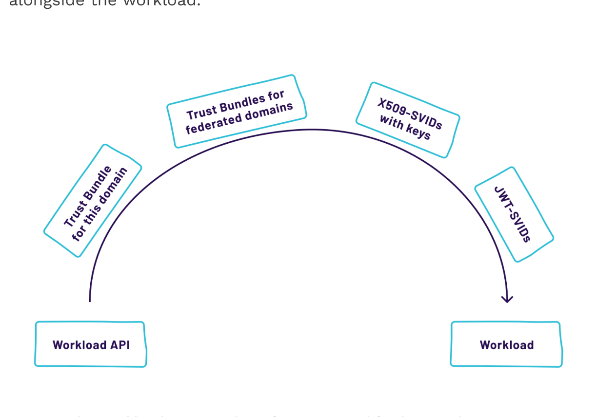

*图 4.4：Workload API 提供用于使用 SPIFFE 身份的信息与能力。*

SPIFFE Workload API 负责向工作负载交付 SVID 和信任包，并在必要时对其进行轮换。

## 什么是 SPIRE？

SPIRE（SPIFFE Runtime Environment，SPIFFE 运行时环境）是面向生产环境的开源实现，完整实现了 SPIFFE 规范的全部五个部分。

SPIRE 项目（以及 SPIFFE）由云原生计算基金会（Cloud Native Computing Foundation，CNCF）托管。该基金会由众多领先的基础设施技术公司共同创立，旨在为惠及云原生社区的开源项目提供一个中立的归属地。

SPIRE 包含两个主要组件：Server 和 Agent。Server 负责对 Agent 进行身份认证并签发 SVID，而 Agent 负责提供 SPIFFE Workload API 服务。两个组件均采用面向插件的架构编写，因此能够轻松扩展，以适配大量不同的配置与平台。

## SPIRE 架构

SPIRE 的架构由两个核心组件组成：SPIRE Server 和 SPIRE Agent。

### SPIRE Server

SPIRE Server 管理并签发某个 SPIFFE 信任域中的所有身份。它使用数据存储来保存有关 Agent、工作负载等信息。SPIRE Server 通过注册条目（registration entry）获知其所管理的工作负载——注册条目是用于向节点和工作负载分配 SPIFFE ID 的灵活规则。

可以通过 API 或 CLI 命令来管理 Server。需要注意的是，由于 Server 持有 SVID 签名密钥，因此被视为关键安全组件。在决定其部署位置时应当特别谨慎，本书后续章节将对此展开讨论。

### 数据存储

SPIRE Server 使用数据存储来跟踪当前的注册条目以及已签发 SVID 的状态。目前支持多种不同的 SQL 数据库。SPIRE 内置了嵌入式内存数据库 SQLite，用于开发和测试目的。

### 上游 CA

信任域中的所有 SVID 均由 SPIRE Server 签名。默认情况下，除非配置了上游证书颁发机构（Upstream Certificate Authority）插件接口，否则 SPIRE Server 会生成一个自签名证书（使用自身随机生成的私钥签名的证书）来签发 SVID。借助上游证书颁发机构插件接口，SPIRE 可以从另一个证书颁发机构获取其签名证书。

在许多简单场景下，使用自签名证书即可满足需求。然而，对于更大规模的部署，可能希望利用已有的 CA 以及 X.509 证书的层级结构，使多个 SPIRE Server（以及其他生成 X.509 证书的软件）能够协同工作。

在某些组织中，上游 CA 可能是组织用于其他用途的中央 CA。如果你同时使用多种不同类型的证书，并希望它们在整个基础设施中都受到信任，这种方式会非常有用。

### SPIRE Agent

SPIRE Agent 只有一项职责，但极其重要：提供 Workload API 服务。在完成这项任务的过程中，它同时解决了一些相关问题，例如确定调用它的工作负载的身份，以及安全地向 SPIRE Server 表明自身身份。在这一架构安排中，繁重的工作都由 Agent 完成。

Agent 不需要像 SPIRE Server 那样进行主动管理。虽然它需要一个配置文件，但 SPIRE Agent 会直接从 SPIRE Server 获取关于本地信任域以及可能调用它的工作负载的信息。在给定信任域中定义新工作负载时，只需在 SPIRE Server 中定义或更新相应记录，新工作负载的信息便会自动传播到对应的 Agent。

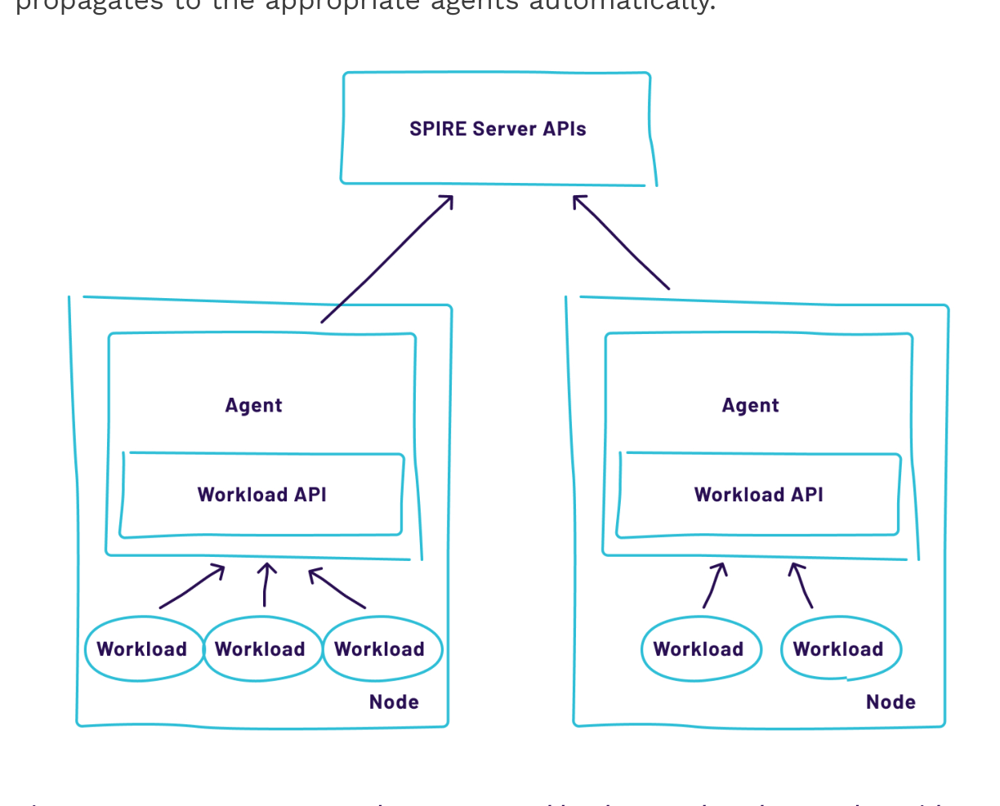

*图 4.5：SPIRE Agent 暴露 SPIFFE Workload API，并与 SPIRE Server 协同工作，向调用该 Agent 的工作负载签发身份。*

### 插件架构

SPIRE 以一组插件的形式构建，因此可以轻松扩展，以支持新的节点验证器、工作负载验证器和上游 CA。

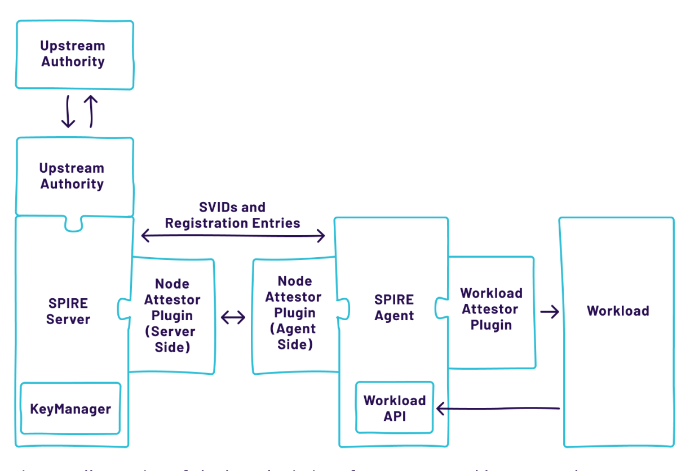

*图 4.6：SPIRE 支持的核心插件接口示意图。Server 端包括 Node Attestor、KeyManager 和 Upstream Authority 插件，而 Agent 端包括 Node Attestor 和 Workload Attestor 插件。*

### SVID 管理

SPIRE Agent 使用在节点验证期间获得的身份向 SPIRE Server 进行认证，并为其获准管理的工作负载获取 SVID。由于 SVID 具有时效性，Agent 还负责在需要时续期 SVID，并将这些更新通知给相关工作负载。信任包同样会轮换并接收新的信任包，Agent 会跟踪这些更新并将其传达给工作负载。Agent 在内存中维护所有这些信息的缓存，因此即使 SPIRE Server 宕机，SVID 仍可正常提供；同时，由于调用 Workload API 时无需往返 Server，这也确保了 Workload API 响应的高性能。

## 验证

验证（attestation）是指发现并断言工作负载及其环境信息的过程。换言之，就是利用可用信息作为证据，确凿地证明工作负载身份的过程。

SPIRE 中有两种验证类型：节点验证和工作负载验证。节点验证断言描述节点的属性（例如节点属于某个特定的 AWS 自动扩缩组，或节点位于哪个 Azure 区域）；工作负载验证断言描述工作负载的属性（例如工作负载运行在哪个 Kubernetes Service Account 中，或二进制文件在磁盘上的路径）。这些属性在 SPIRE 中的表示形式称为选择器（selector）。

SPIRE 开箱即用支持数十种选择器类型，并且该列表仍在不断增长。截至本书撰写之时，节点验证器已支持裸金属、Kubernetes、Amazon Web Services、Google Cloud Platform、Azure 等；工作负载验证器已支持 Docker、Kubernetes、Unix 等。此外，SPIRE 的可插拔架构允许运维人员根据需要轻松扩展系统，以支持更多选择器类型。

### 节点验证

节点验证在 Agent 首次启动时发生。在节点验证过程中，Agent 联系 SPIRE Server 并进行交互，Server 借此确切识别 Agent 所运行的节点及其所有相关选择器。为实现这一点，Agent 和 Server 双方都会调用特定于平台的插件。例如，在 AWS 环境中，Agent 插件从 AWS 收集只有该特定节点才能访问的信息（一份由 AWS 密钥签名的文档），并将其发送给 Server；Server 插件随后验证该 AWS 签名，并进一步调用 AWS API，既核实该声明的准确性，又收集关于该节点的其他选择器。

节点验证成功后，会向该 Agent 签发身份。此后，Agent 将使用此身份与 Server 进行所有后续通信。

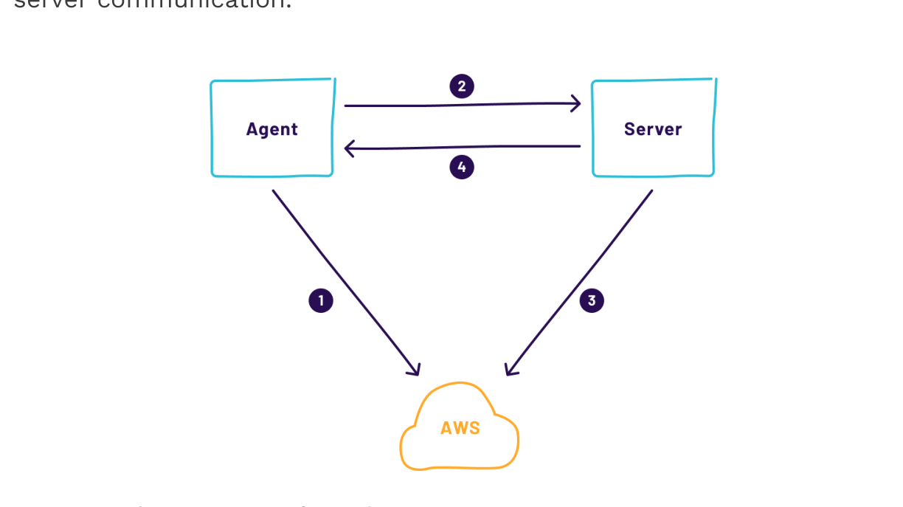

*图 4.7：运行在 AWS 中的节点的节点验证过程。*

1. Agent 调用 AWS API 收集节点身份证明。
2. Agent 将此身份证明发送给 Server。
3. Server 通过调用 AWS API 验证第 2 步获取的身份证明，然后为该 Agent 创建一个 SPIFFE ID。

### 工作负载验证

工作负载验证是指确定工作负载身份、并最终签发和交付身份文档的过程。每当工作负载调用并建立到 SPIFFE Workload API 的连接时（在工作负载向该 API 发起的每一次 RPC 调用中），都会触发工作负载验证，随后的流程由 SPIRE Agent 上的一组插件驱动。

在 Agent 收到来自调用工作负载的新连接的瞬间，Agent 会利用操作系统特性来精确确定是哪个进程打开了该新连接。所利用的操作系统特性取决于 Agent 运行的操作系统。在 Linux 环境下，Agent 会发起系统调用，检索在该特定套接字上发起调用的远端进程的进程 ID（PID）、用户标识符（UID）以及全局唯一标识符（GID）。在 BSD 和 Windows 上请求的内核元数据则会有所不同。随后，Agent 将调用工作负载的 ID 提供给各验证插件。由此，验证过程向各个插件扇出，收集关于调用者的更多进程信息，并以选择器的形式返回给 Agent。

每个验证插件负责内省调用者，并生成一组描述它的选择器。例如，某个插件可能查看内核级细节，生成进程运行所用的用户和组等选择器；另一个插件可能与 Kubernetes 通信，生成进程所在的命名空间和 Service Account 等选择器；第三个插件则可能与 Docker 守护进程通信，生成 Docker 镜像 ID、Docker 标签和容器环境变量等选择器。

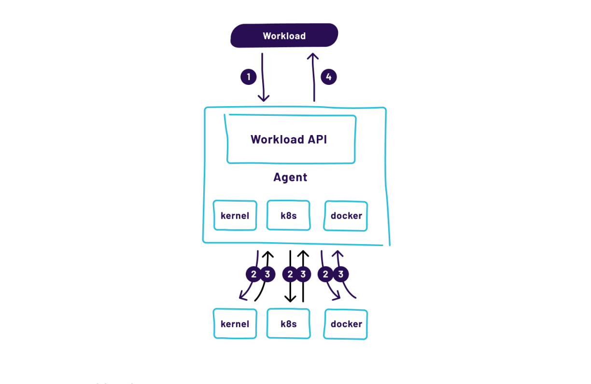

*图 4.8：工作负载验证。*

1. 工作负载调用 Workload API 请求 SVID。
2. Agent 查询节点内核，获取调用进程的属性。
3. Agent 获取发现的选择器。
4. Agent 将发现的选择器与注册条目进行比对，确定工作负载身份，并将正确的 SVID 返回给工作负载。

## 注册条目

要让 SPIRE 签发工作负载身份，必须先告知它在当前环境中预期或允许存在哪些工作负载——哪些工作负载应当运行在何处、它们的 SPIFFE ID 以及大致特征是什么。SPIRE 通过注册条目获知这些信息；注册条目是通过 SPIRE API 创建和管理的对象，其中包含上述信息。

每条注册条目都包含三个核心属性。第一个是 **Parent ID**——它实际上告诉 SPIRE 某个特定工作负载应当运行在*哪里*（进而决定哪些 Agent 有权代表该工作负载请求 SVID）。第二个是 **SPIFFE ID**——当我们看到这个工作负载时，应当向其签发什么 SPIFFE ID？最后，SPIRE 还需要一些有助于识别该工作负载的信息，这正是通过验证所发现的选择器发挥作用的地方。

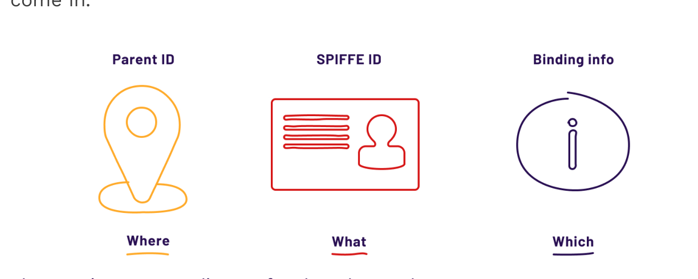

*图 4.9：注册条目的三个核心属性。*

注册条目将 SPIFFE ID 绑定到它们所要代表的节点和工作负载上。

一条注册条目既可以描述一组节点，也可以描述一个工作负载，而后者通常会通过 Parent ID 引用前者。

### 节点条目

描述节点（或一组节点）的注册条目使用节点验证生成的选择器来分配 SPIFFE ID，该 SPIFFE ID 后续可在注册工作负载时被引用。单个节点经验证后可能拥有匹配多条节点条目的选择器集合，从而使其能够同时隶属于多个分组。这在精确限定某个工作负载允许运行的位置时，提供了极大的灵活性。

SPIRE 内置了多种开箱即用的节点验证器，每一种都会生成特定于平台的选择器。虽然 SPIRE Server 支持同时加载多个节点验证器插件，但 SPIRE Agent 只支持加载一个。可用节点选择器的一些示例包括：

- 在 Google Cloud Platform（GCP）上的平台特定节点选择器
- 在 Kubernetes 上，节点所属的 Kubernetes 集群名称
- 在 Amazon Web Services（AWS）上，节点所属的 AWS 安全组（Security Group）

节点条目的 Parent ID 被设置为 SPIRE Server 的 SPIFFE ID，因为正是 Server 在执行验证并断言该节点确实匹配条目中所定义的选择器。

### 工作负载条目

描述工作负载的注册条目使用工作负载验证生成的选择器，在满足特定条件集合时向工作负载分配 SPIFFE ID。当 Parent ID 和选择器条件同时满足时，该工作负载即可获得对应的 SPIFFE ID。

工作负载条目的 Parent ID 描述了该工作负载被授权运行在*哪里*，其值为某个节点或某组节点的 SPIFFE ID。运行在这些节点上的 SPIRE Agent 会收到该工作负载条目的副本，其中包括在为该条目签发 SVID 之前必须通过验证的选择器。

当工作负载调用 Agent 时，Agent 会执行工作负载验证，并将发现的选择器与条目中定义的选择器进行交叉比对。如果工作负载具备条目中定义的全部选择器，则条件满足，该工作负载将获发带有指定 SPIFFE ID 的 SVID。

与节点验证不同，SPIRE Agent 支持同时加载多个工作负载验证器插件。这使得工作负载条目中可以自由组合不同的选择器。例如，一条工作负载条目可以要求工作负载位于特定的 Kubernetes 命名空间中、其 Docker 镜像带有特定标签，并且具有特定的 SHA 校验和。

## 威胁模型

SPIFFE 和 SPIRE 所面临的具体威胁因场景而异。理解 SPIFFE/SPIRE 的通用威胁模型，是确认它能否满足你的特定需求、以及发现哪些环节需要额外缓解措施的重要一步。

在本节中，我们将阐述 SPIFFE 和 SPIRE 的安全边界，以及系统中各个组件受损时所造成的影响。在本书后续章节中，我们还将讨论不同 SPIRE 部署模式所带来的具体安全考量。

### 假设前提

SPIFFE 和 SPIRE 旨在作为分布式身份与认证的基础设施，与云原生（参见：https://github.com/cncf/toc/blob/master/DEFINITION.md）设计架构保持一致。SPIRE 支持 Linux 和 BSD 系列操作系统（包括 macOS）。目前尚不支持 Windows，尽管在这一领域已有一些早期原型探索。

SPIRE 遵循零信任网络安全模型，即假设网络通信是敌对的，或推定网络已完全沦陷。话虽如此，该模型同时假设运行 SPIRE 组件的硬件及其运维人员是可信的。如果硬件植入或内部威胁属于你的威胁模型范围，则应当仔细考量 SPIRE Server 的物理部署位置以及其配置参数的安全性。

此外，根据所选的节点验证和工作负载验证方式，可能还隐含着对第三方平台或软件的信任。通过多种独立机制共同断言信任，可以提供更强的信任保证。例如，采用基于 AWS 或 GCP 的节点验证意味着假设计算平台是可信的，而采用 Kubernetes 进行工作负载验证则意味着假设该 Kubernetes 部署是可信的。由于实现验证的方式多种多样，且 SPIRE 架构是完全可插拔的，这些验证过程本身的安全性（及相关假设）未纳入本次评估，而应当视具体情况逐一评估。

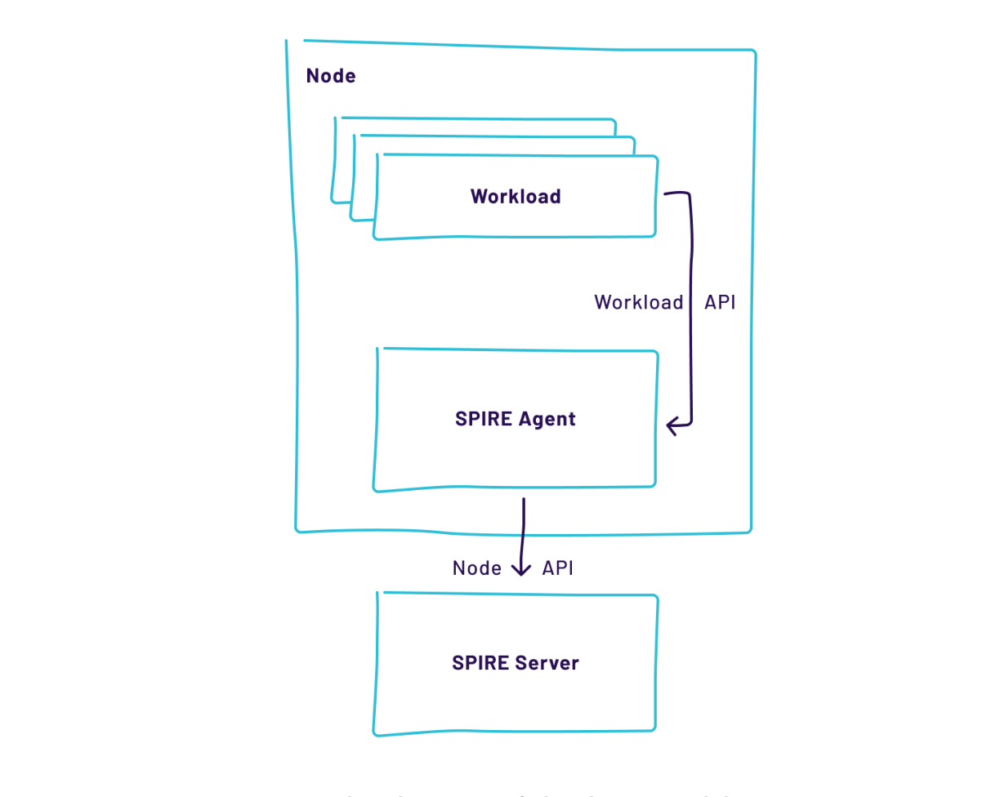

*图 4.10：威胁模型中所考量的组件。*

### 安全边界

安全边界在形式上被定义为两个具有不同信任级别的区域之间的交界线。

SPIFFE/SPIRE 定义了三条主要的安全边界：工作负载与 Agent 之间的边界、Agent 与 Server 之间的边界，以及不同信任域中 Server 之间的边界。在此模型中，工作负载完全不可信，其他信任域中的 Server 也完全不可信；如前所述，网络通信始终完全不可信。

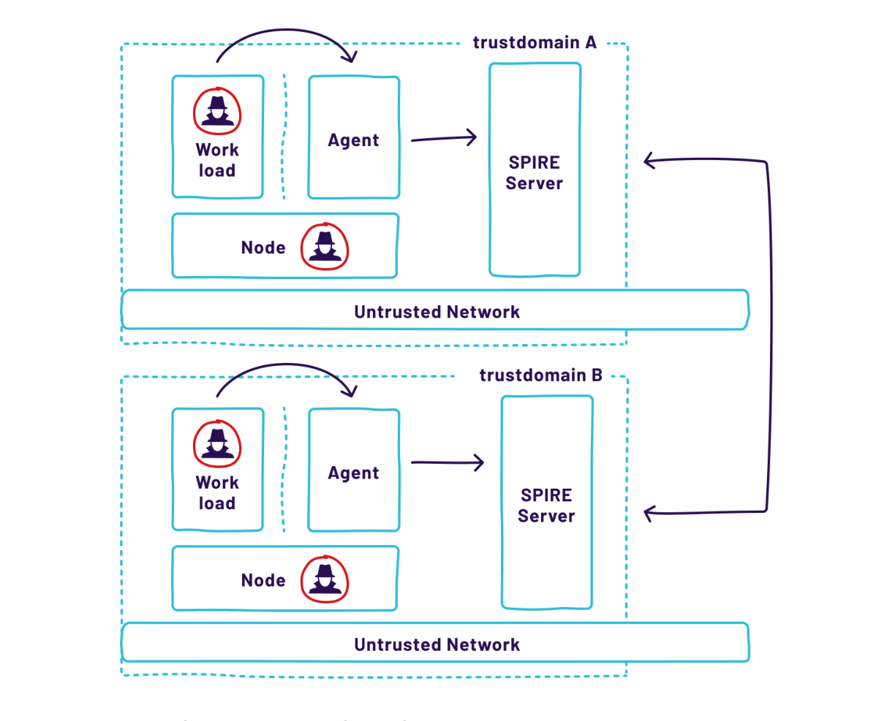

*图 4.11：SPIFFE/SPIRE 安全边界。*

#### 工作负载与 Agent 之间的边界

随着我们在系统中依次跨越这些边界，信任级别逐步提高。从工作负载出发，我们首先跨越安全边界到达 Agent。通常预期（尽管并非强制要求）在工作负载与 Agent 之间存在 SPIRE 设计之外的安全机制，例如借助 Linux 用户权限和/或容器化技术进行隔离。

Agent 不信任工作负载提供的任何输入。Agent 对工作负载身份所做的一切断言，均通过带外（out-of-band）检查完成。在工作负载验证的语境下，这是一个至关重要的细节——任何其值可由工作负载自身操控的选择器，本质上都是不安全的。

#### Agent 与 Server 之间的边界

下一条边界位于 Agent 与 Server 之间。Agent 比工作负载更可信，但不如 Server 可信。SPIRE 的一项明确设计目标是能够在节点沦陷的情况下依然保持安全。由于工作负载完全不可信，在任何时候，我们距离节点沦陷可能都只有一两步攻击之遥。Agent 具备代表工作负载创建和管理身份的能力，但也必须将任何单个 Agent 的权限严格限制在完成其任务所必需的最小范围内（遵循最小权限原则）。

为缓解节点（及 Agent）沦陷带来的影响，SPIRE 要求明确知晓某个特定工作负载被授权运行在何处（通过 Parent ID 表示）。Agent 必须能够证明自己拥有某条注册条目的归属权，才能为其获取身份。因此，受损的 Agent 无法获取任意身份——它只能获取原本就应当运行在该节点上的工作负载的身份。

值得注意的是，在节点验证过程的不同阶段，SPIRE Server 与 SPIRE Agent 之间的通信会分别使用 TLS 和 mTLS（双向 TLS），具体取决于该节点是尚未完成验证，还是 Agent 已经持有有效 SVID 并可将其用于 mTLS——一旦进入后一阶段，Server 与 Agent 之间的所有通信都是安全的。

#### Server 与 Server 之间的边界

最后一条边界位于不同信任域中的 Server 之间。SPIRE Server 仅被信任在其直接管理的信任域内签发 SVID。当不同信任域的 SPIRE Server 彼此联邦并交换公钥信息时，它们收到的密钥仍然被限定在来源信任域的范围内。与 Web PKI 不同，SPIFFE 不会将所有公钥混杂在一起一视同仁。因此，外部信任域受损并不会导致攻击者能够在本地信任域内签发 SVID。

需要指出的是，SPIRE Server 不具备多方保护机制。同一信任域中的每一台 SPIRE Server 都可以访问签名密钥并借此签发 SVID。Server 之间的安全边界严格限于不同信任域的 Server 之间，并不适用于同一信任域内部的 Server。

### 组件受损的影响

虽然工作负载始终被假定处于受损状态，但通常预期 Agent 并非如此。如果某个 Agent 受损，攻击者将能够获取该 Agent 获准管理的任何身份。在工作负载与 Agent 呈 1:1 关系的部署中，这一风险影响较小；但在单个 Agent 管理多个工作负载的部署中，理解这一点就显得尤为重要。

当某个 Agent 被引用为某身份的父级（Parent）时，该 Agent 即获准管理该身份。因此，最佳实践是将注册条目的 Parent ID 范围尽可能收紧到合理限度。

一旦 Server 受损，可以预见攻击者将能够在该信任域内签发任意身份。SPIRE Server 无疑是整个系统中最敏感的组件，对其管理与部署位置必须慎之又慎。例如，SPIRE 针对不可信工作负载解决了节点沦陷问题，但如果 SPIRE Server 与不可信的工作负载运行在同一台宿主机上，那么 Server 便不再享有原本由 Agent/Server 安全边界所提供的保护。因此，强烈建议将 SPIRE Server 部署在与所管理的不可信工作负载相隔离的独立硬件上。

#### 关于 Agent 的注意事项

SPIRE 通过将 Agent 的权限限定在仅限于其直接获准管理的身份，来应对单个节点沦陷的问题……但如果攻击者能够攻破多个 Agent，甚至攻破*所有* Agent，情况就会严重得多。

SPIRE Agent 之间没有任何通信通道，这大大限制了攻击者在 Agent 之间横向移动的可能性。这是一项旨在缓解潜在 Agent 漏洞影响的重要设计决策。然而，必须认识到某些配置或部署选择可能会部分或完全削弱这一缓解措施。例如，SPIRE Agent 支持暴露 Prometheus 指标端点；如果所有 Agent 都暴露了该端点，且该处恰好存在漏洞，那么除非部署了充分的网络层控制措施，否则横向移动将变得轻而易举。出于这一原因，强烈不建议将 SPIRE Agent 暴露给入站网络连接。
