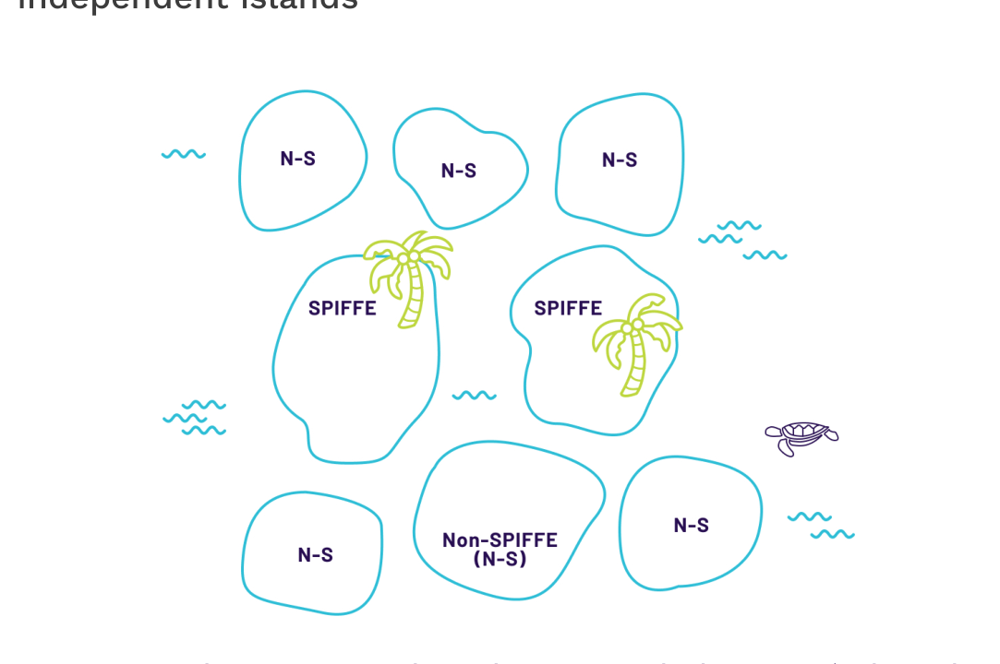
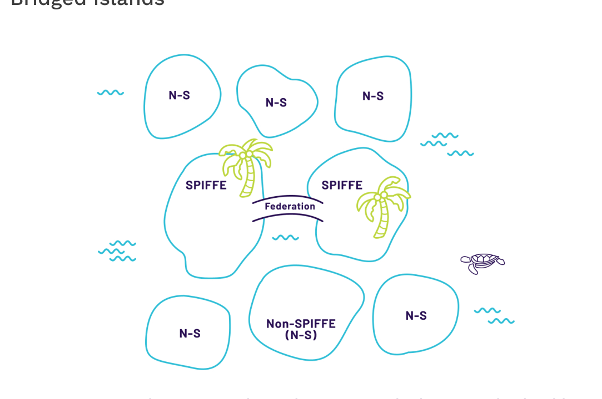
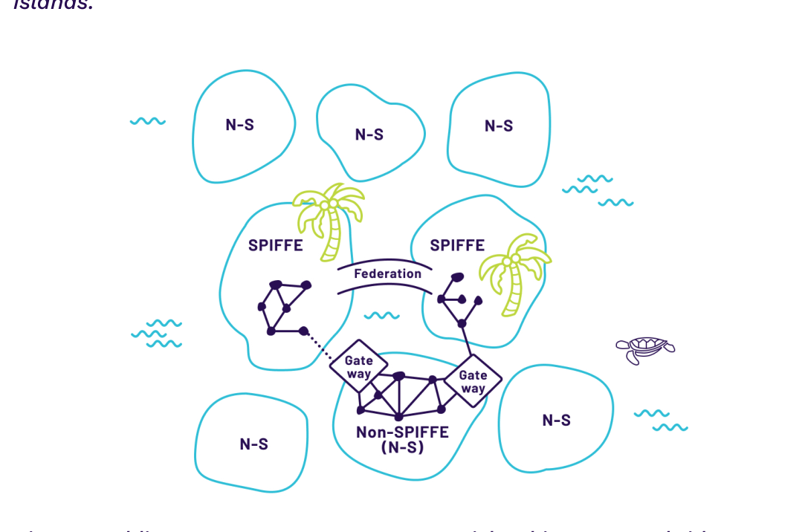
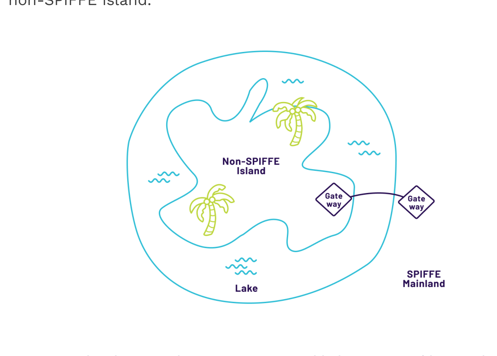
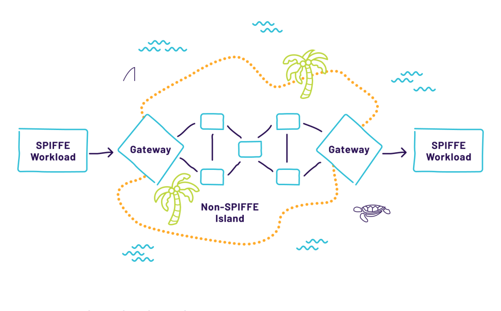
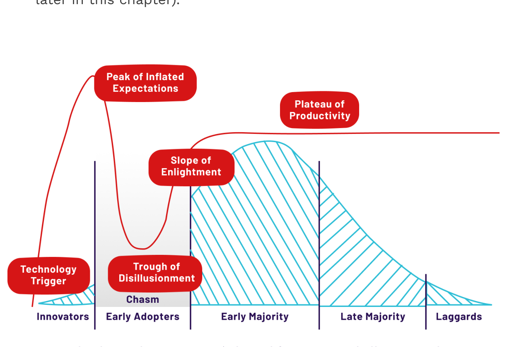
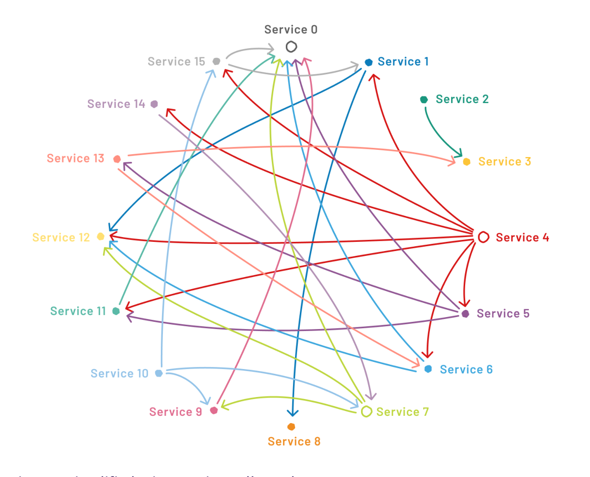

# 第 5 章　启动之前的准备

> 本章旨在帮助你做好准备，以应对在落地 SPIFFE/SPIRE 过程中需要做出的诸多决策。

读完前面几章，你一定迫不及待地想开始使用 SPIRE 来管理身份，使其能够跨多种不同类型的系统以及组织内的所有服务发挥作用。然而，在真正动手之前，你需要认识到：部署 SPIRE 是一项重大的基础设施变革，可能会影响许多不同的系统。本章将介绍如何着手规划 SPIRE 部署——包括争取各方支持、以无中断的方式启用 SPIRE 支持，以及在此基础上实现新的安全控制。

## 做好人的准备

### 组建团队并识别其他利益相关方

要部署 SPIRE，你需要从安全、软件开发和 DevOps 团队中识别出关键的利益相关方。谁来维护 SPIRE Server 本身？谁来部署 Agent？谁来编写注册条目？谁负责将 SPIFFE 功能集成到应用程序中？这会对现有的 CI/CD 流水线产生什么影响？如果发生服务中断，由谁负责修复？系统的性能要求和服务级别目标（SLO）又是什么？

在本书以及许多公开的技术博客和大会演讲中，都有不少组织成功部署 SPIRE 的案例。这些案例既可以作为可借鉴的实施模式，也能作为向同事推广 SPIRE 的有力材料。

SPIRE 横跨多个传统 IT 职能孤岛，因此可以预见，DevOps 团队、软件开发团队和安全团队之间将会有更多的跨组织协作。各方通力合作，是确保部署成功且平稳过渡的关键。需要认识到，每个团队都有各自不同的需求与优先级，只有妥善回应这些诉求，才能赢得他们的支持。

### 阐明理由并争取支持

在规划 SPIRE 部署时，你需要明确对业务而言最重要的成果是什么，并将这些成果提炼为项目的驱动力以及所交付方案的价值。每个团队不仅要看到 SPIRE 对整体业务的好处，还要看到它对自身工作的直接收益。本书第 2 章（收益）已经阐述了部署 SPIRE 的诸多优势，本节将其中一部分提炼为更具说服力的论点。

#### 面向安全团队的说服理由

减轻安全团队的工作负担，是部署 SPIRE 最具说服力的理由之一：安全团队不必再疲于部署零散的临时安全方案，也不必手动管理成百上千张证书，而是可以将精力集中在设计恰当的注册条目上，确保每个服务都能获得正确的身份。

从更长远来看，SPIRE 能够提升组织的整体安全态势，因为 SPIRE 不存在容易被窃取或滥用的凭据。大量与凭据盗用、身份冒充以及敏感数据泄露相关的攻击都将得到有效缓解。你还可以向外部审计人员证明，正确的服务之间正在安全地通信，不存在因人为疏忽而遗漏的可能。即便外部攻击者攻破了某个服务，他们借此向其他服务发起攻击的能力也会受到严格限制。

#### 面向软件开发团队的说服理由

对应用开发团队而言，最具吸引力的理由在于：无需再等待工单审批或人工流程来签发证书，从而能够显著加快交付速度。如果他们目前不得不将密钥随代码一同手动部署，并因此屡屡被安全团队约谈，那么今后就再也不必忍受这种困扰，也无需在密钥存储中维护这些密钥。

另一个附带收益是，软件组件之间可以以过去无法安全实现的方式直接通信。如果某些云服务过去因为缺乏安全手段而无法访问关键数据库或核心云服务，现在就有可能借助 SPIFFE 身份建立安全连接，为团队打开新的架构可能性。

#### 面向 DevOps 团队的说服理由

部署 SPIRE 带来的最大收益往往体现在 DevOps 团队身上。只要每个服务都拥有自身的安全身份，服务就可以部署在任何位置——无论是任意本地数据中心、不同的云服务商，还是同一云服务商内的不同区域。由于部署决策可以独立于安全要求之外独立做出，这种全新的灵活性能够带来更低的成本、更高的可扩展性以及更强的可靠性。

对 DevOps 团队而言，另一个关键优势在于：发往每个服务的入站请求都会带有 SPIFFE ID 标记，可被记录到日志、进行度量并上报至监控系统。对于拥有成百上千个服务的大型组织来说，这对性能管理极有帮助。

## 制订计划

### 规划孤岛与桥梁

规划 SPIRE 部署的首要目标，是确定是否每个服务都需要具备 SPIFFE 感知能力，还是允许存在非 SPIFFE 服务的“孤岛”也能满足需求。将所有服务都迁移到 SPIFFE 是最直接的方案，但在规模非常庞大的组织中，一次性全部迁移往往极具挑战性。

有些环境相当复杂，既可能涉及多个业务组织，也可能同时包含遗留系统与新建应用。在这种情况下，人们通常只希望先让环境中的一部分支持 SPIFFE。根据系统之间的集成程度和跨系统复杂度，需要考虑两种架构方案，我们称之为“独立孤岛”（Independent Islands）和“桥接孤岛”（Bridged Islands）。

每个孤岛都被视为各自独立的信任域，孤岛上运行着各种工作负载，也就是岛上的“居民”。

#### 独立孤岛

*图 5.1：此处展示了两个独立的 SPIFFE 部署（独立孤岛）。*

独立孤岛模型允许各个信任域彼此独立运行。这通常是最容易落地的选项，因为每个孤岛都可以按照最适合自身的方式运行 SPIRE。

#### 桥接孤岛

*图 5.2：此处展示了通过联邦机制桥接的两个独立 SPIFFE 部署，使两个孤岛上的服务能够互相信任并通信。但 SPIFFE 孤岛与非 SPIFFE 孤岛之间仍然无法通信。*

*图 5.3：向非 SPIFFE 孤岛添加网关，是桥接 SPIFFE 孤岛与非 SPIFFE 孤岛的一种方式。*

在桥接孤岛模型中，非 SPIFFE 孤岛上的非 SPIFFE 服务可以先与网关通信，再由网关将请求转发给目标 SPIFFE 孤岛上的居民（我们不妨称其为 Zero）。从 Zero 的视角来看，请求是由网关发出的。同样，Zero 及其在 SPIFFE 孤岛上的伙伴也可以向网关进行身份认证，并向非 SPIFFE 孤岛上的服务发送消息。

*图 5.4：在此示意图中，存在一个启用了 SPIFFE 的生态系统（大陆），而在该生态系统内部有一小片非 SPIFFE 服务（湖中孤岛）。要让大陆与孤岛上的服务相互通信，就需要引入网关。*

*图 5.5：桥接孤岛架构。*

采用桥接孤岛架构时，需要在未启用 SPIFFE 的孤岛上部署网关。这些非 SPIFFE 孤岛难以轻易采用 SPIFFE 架构的原因有很多：可能运行着难以修改或升级的遗留软件；可能已经在使用自有的身份识别体系，例如 Kerberos 或“SPIFFE 与其他技术的比较”一章中介绍的其他方案；又或者系统上运行的工作负载所依赖的技术并不太契合 SPIRE 等现有 SPIFFE 实现的模型。

在这些情况下，使用网关服务来桥接 SPIFFE 世界与非 SPIFFE 孤岛之间的连接会非常实用。当启用了 SPIFFE 的工作负载需要与非 SPIFFE 孤岛中的工作负载通信时，它会先与网关建立经过身份认证的连接，再由网关与目标工作负载建立连接；网关到目标工作负载的连接可以是未经认证的，也可以使用该孤岛自身的非 SPIFFE 身份方案。同理，当非 SPIFFE 孤岛中的工作负载需要连接启用了 SPIFFE 的工作负载时，非 SPIFFE 工作负载先连接到网关，再由网关向目标 SPIFFE 工作负载建立经过 SPIFFE 认证的连接。

在这种场景下，网关与启用 SPIFFE 的工作负载之间的身份认证在网关处终止。这意味着启用 SPIFFE 的工作负载能够验证自己正在与正确的网关通信，但无法验证网关另一侧的究竟是不是正确的目标工作负载。同样，目标工作负载只知道请求来自网关服务，却丢失了原始 SPIFFE 工作负载的认证上下文。不过，这种模型使结构复杂的组织能够分步引入 SPIFFE，而不必一次性完成全面改造。

当请求和工作流需要穿越非 SPIFFE 孤岛时，使用 JWT-SVID 在请求链路中透传身份信息会很有帮助。更好的做法是，使用 X.509-SVID 对文档进行签名（例如 HTTP 消息请求签名，参见：https://tools.ietf.org/id/draft-cavage-http-signatures-12.html），而不仅仅依赖服务间的 mTLS（双向 TLS），这样另一侧启用 SPIFFE 的工作负载就能校验整条消息的真实性。对于已知安全性较弱的孤岛而言，这种做法尤为有用，因为它能够确保穿越中间生态系统的消息未被篡改。

### 文档与可观测性埋点

在准备启动推广时，务必对服务进行可观测性埋点，使指标和流量日志的输出能够满足以下要求：

- 负责统筹推广的人员能够清楚地知道哪些（以及有多少）服务已经启用了 SPIFFE，哪些（以及有多少）尚未启用。
- 客户端开发者能够清楚地知道他们调用的服务中，哪些已经启用了 SPIFFE，哪些尚未启用。
- 服务负责人能够清楚地知道哪些（以及有多少）客户端正在调用启用了 SPIFFE 的端点，哪些仍在调用旧版端点。

在推广前，还需要为客户端和服务端实现者编写参考文档，提前覆盖你预期会收到的各类支持请求。

同样重要的是，构建用于常见调试和故障排查任务的工具。回想一下 SPIFFE 和 SPIRE 的价值所在：在组织中引入 SPIFFE 应当赋能开发者、消除障碍。如果让利益相关方觉得你在增加额外工作量或制造阻力，最终只会拖慢甚至中断更大范围的采纳。为了避免这种情况，并确保文档与工具覆盖恰当的主题，我们建议先完成以下准备步骤：

| 步骤 | 说明 |
| --- | --- |
| 确定需要借助 SPIFFE 实现哪些安全特性 | SPIFFE 身份可用于建立 mTLS（双向 TLS）连接、实施授权，或用于审计日志等其他功能。 |
| 确定要使用哪些格式的 SVID 及其用途 | 最常见的做法是将 X.509-SVID 用于双向 TLS，但需明确这一做法是否适用，以及 SVID 是否还会用于其他应用场景。 |
| 确定需要身份的工作负载数量 | 并非每个工作负载都需要身份，尤其是在推广初期。 |
| 确定需要多少个独立的信任域 | 每个信任域都需要部署独立的 SPIRE Server。关于如何做出这一决策的细节，请参阅下一章。 |
| 确定组织内正在使用哪些需要兼容 SPIFFE 的编程语言、框架、IPC 技术等 | 如果使用 X.509-SVID 实现双向 TLS，需梳理组织内使用的 Web 服务器（Apache HTTPD、NGINX、Tomcat、Jetty 等）以及客户端库。如果客户端库预期执行 DNS 主机名校验，请确保你的 SPIFFE 部署能够兼容这一预期。 |

### 理解性能影响

性能影响也应纳入部署规划的考量范围。

作为推广准备的一部分，你应当针对能够代表组织生产环境中各类应用的多种工作负载，检查相应的基准测试结果。这能确保你至少对推广过程中可能出现的性能问题心中有数，并在理想情况下提前做好应对准备。

#### TLS 性能

在许多组织中，开发和运维团队最先提出的担忧往往是：在服务之间建立双向 TLS 连接会不会太慢？实际上，在现代硬件和现代 TLS 实现上，TLS 带来的性能影响微乎其微：

> “在我们的生产前端机器上，SSL/TLS 仅占不到 1% 的 CPU 负载、每条连接不到 10 KB 的内存，以及不到 2% 的网络开销。许多人认为 SSL/TLS 会消耗大量 CPU 时间，我们希望上述数据有助于打消这种顾虑。”
> —— Adam Langley，Google，《Overclocking SSL》（参见：https://www.imperialviolet.org/2010/06/25/overclocking-ssl.html），2010 年

> “我们已经使用硬件和软件负载均衡器大规模部署了 TLS。我们发现，运行在通用 CPU 上的现代软件 TLS 实现足够快，无需借助专用加密硬件即可承载繁重的 HTTPS 流量负载。”
> —— Doug Beaver，Facebook，《HTTP2 Expression of Interest》（参见：https://lists.w3.org/Archives/Public/ietf-http-wg/2012JulSep/0251.html），2012 年

总体而言，性能影响取决于多种因素，包括网络拓扑、API 网关、L4-L7 防火墙等。此外，所使用的协议及其具体实现，以及证书和密钥的长度，都可能对性能产生影响，因此这是一个相当宽泛的话题。

下表列出了与 TCP 相比，TLS 在握手阶段和数据传输阶段两个不同环节的开销参考数据：

| TLS 阶段 | 协议开销 | 延迟 | CPU | 内存 |
| --- | --- | --- | --- | --- |
| 握手 | TLS 为 2 kB；mTLS 为 3 kB；每增加一张证书 +1 kB | 12–17 ms | 比 TCP 多约 0.5% | <10 kB/连接 |
| 数据传输 | 22 B/数据包 | <3 μs | 比 TCP 多不到 1% | <10 kB/连接 |

## 向 SPIFFE 和 SPIRE 转型

关于组织如何应对、推动和处理变革，已有非常丰富的研究历史；关于新技术在公众以及组织内部的接受与采纳过程，也有大量颇具启发性的研究成果。对这些主题展开深入探讨超出了本书的范围，但鉴于它们与 SPIFFE 能否成功落地息息相关，我们有必要在此加以提及。

### 推动变革落地

在组织内部说服他人接受变革有多种途径。以下列表概括了在推动 SPIFFE 和 SPIRE 变革时可以采用的切入点：

- **感知有用性（Perceived usefulness）**——人们认为 SPIFFE 在多大程度上能帮助自己提升工作绩效。能够展示切实可见的成果，有助于提升感知有用性。
- **感知易用性（Perceived ease-of-use）**——人们认为 SPIFFE 用起来有多容易。用心打磨开发者和运维人员的使用体验至关重要。
- **同伴影响（Peer influence）**——人们对受尊敬同事关于采纳 SPIFFE 的看法以及他们是否已经采纳的感知。这正是你在组织中积累的政治资本发挥作用的时候。很多时候，说服关键人物比试图说服所有人更重要。
- **形象（Image）**——采纳 SPIFFE 在多大程度上能够提升个人在组织内的声望与地位。
- **自愿程度（Voluntariness）**——潜在采纳者认为采纳 SPIFFE 是自愿的还是强制的。这一因素产生的影响取决于公司文化和个人性格。在面对后文将提到的“被迫转型者”和“顽固抵制者”时，请牢记这一点。

### 采纳过程中的角色

*图 5.6：技术采纳曲线（改编自罗杰斯钟形曲线与 Gartner 成熟度曲线）。图中的蓝色区域代表变革规模与 SPIFFE 采纳者数量（参见：https://en.wikipedia.org/wiki/Technology_adoption_life_cycle）；红线代表采纳 SPIFFE 过程中的热情与期望值。*

各类采纳角色与技术采纳曲线相对应，有助于你对向 SPIFFE 和 SPIRE 转型的演进节奏建立合理预期。下面列出了技术采纳曲线中涵盖的经典角色，并补充了你在实践中很可能遇到的另外两类角色。

关于技术采纳曲线中各类采纳角色的更多信息，可查阅本书之外的相关资料。

- **创新者（Innovators）**——既然你已经读到这里，并准备迈出这一步，就可以把自己视为组织中的创新者。你实质上是在开创将 SPIFFE 和 SPIRE 引入现有架构的先河，而且你需要帮手！建议在这一阶段提供“白手套”式的贴身支持和手把手辅导，因此务必从下述“低垂的果实”和“前置条件”类别中，挑选与你关系融洽的志愿者。
- **早期采纳者（Early adopters）**——务必将服务创新者时“白手套”式手把手支持所积累的经验教训沉淀下来，转化为易于获取、通俗易懂的文档、实用的工具以及可扩展的支持渠道。此时可能需要投入相当大的精力，先为“前置条件与赋能组件”（后文详述）启用 SPIFFE，从而解除开发者的阻塞，使他们能够顺利为自己的服务和客户端接入 SPIFFE。
- **早期大众与晚期大众（Early and late majority）**——当推进到早期大众服务接入时，启用 SPIFFE 的流程应当已经像一台运转顺畅的机器。所有常用的赋能组件——例如 CI/CD、工作流引擎、编排器、容器平台和服务网格——都应已支持 SPIFFE，以确保无论应用以何种方式运行，应用开发者在整个应用生命周期中都能获得支持。
- **落后者（Laggards）**——受团队文化、个人性格以及监管或合规要求的影响，你的组织里很可能会存在偏保守的落后者。切忌草率推断某位服务负责人为何落入这一类别，而应深入调查根本原因，并采取恰当措施加以解决。
- **“被迫”转型者（‘Forced’ converts）**——当某个启用了 SPIFFE 的服务只剩下最后一个客户端尚未迁移时，这个客户端可能会感到自己是“被迫”转型的。提前为这类被迫转型者做好准备非常重要，以确保他们在采纳 SPIFFE 时能获得良好的体验。
- **顽固抵制者（Holdouts）**——这类角色难免会出现，因此要让采纳过程尽可能轻松，并提供正向激励。可以重点展示其他团队在进入“生产力高原期”后获得的收益。在引导顽固抵制者走完迁移流程时，也要做好提供额外支持和手把手协助的准备。

### 选择迁移顺序时的考量

在选择各服务的迁移先后顺序时，在整个组织范围内保持最大程度的兼容性至关重要。服务应保留其现有的 API 接口和端口不变，并在新端口上提供启用了 SPIFFE 的 API。这样既能实现平滑过渡，也能在必要时方便回滚。对于拥有来自多个其他团队的众多客户端的服务团队，应当做好长期（超过 6 个月）同时维护和支持两套端点的准备。

只有当某个服务的所有客户端都已启用 SPIFFE，且非 SPIFFE API 不再被使用时，才能关闭这些非 SPIFFE API。

> **注意**：切勿过早关闭旧版端点。要特别留意批处理作业、定时任务以及其他低频或不规则的调用模式。你肯定不希望成为导致季度末或财年末对账作业失败的那个人。

如果你的环境过于庞大或复杂，无法一次性全面切换，那么审慎选择服务启用 SPIFFE 的先后顺序就显得尤为重要。从“大石头”（Big rocks）、“低垂的果实”（Low hanging fruit）以及用于加速采纳的“前置条件与赋能组件”（Precursors and enablers）这三个维度来思考，会非常有帮助。

*图 5.7：简化的微服务调用图。*

#### 大石头

“大石头”指的是拥有最多独立客户端的服务，或者连接了最多独立服务的客户端。早期就去啃“大石头”看似能加快推广进度，但很可能会让你贪多嚼不烂，进而引发问题，反而挫伤其他团队采纳 SPIFFE 的积极性。

观察上面的调用图，连接数最多的节点就是“大石头”。它们可能是被众多客户端调用的核心服务（如 Service 0），也可能是调用了众多服务的客户端（如 Service 4），还可能是同时扮演客户端和服务端双重角色的服务（如 Service 7）。推进这类服务的迁移既伴随收益，也充满风险：

**收益**

- 颇具吸引力的选择
- 有望快速扩大采纳规模
- 带来广泛而深远的收益
- 激励其他团队跟进采纳

**风险与挑战**

- 需要长期同时维护两套端点（旧版端点和 SPIFFE 端点）
- 必须等到所有客户端全部采纳 SPIFFE 后，才能关闭旧版端点
- 增加维护成本
- 增加系统复杂度
- 透支组织承接能力
- 导致被迫采纳
- 引发相关团队不满
- 意想不到的“角落里的底层依赖”（Surprise, there’s a turtle in the corner!）

#### 低垂的果实

“低垂的果实”指的是只有一两个或少数几个客户端的服务，或者仅连接一两个或少数几个服务的客户端。这类服务通常最容易引导完成过渡，是理想的首批采纳对象。

同样观察上面的调用图，“低垂的果实”是连接数很少的节点，例如仅作为单个服务的客户端的 Service 2，或者仅有一个客户端的服务 Service 8。在挑选首批迁移的少连接服务时，明智的做法是优先选择那些最容易同时维护双端点（旧版和 SPIFFE）的服务，或者需要维持双栈运行时间最短的服务。

**收益**

- 一旦出现问题，风险较小
- 所需协调与规划较少，更容易彻底从旧版切换至 SPIFFE
- 提供良好的实践与学习机会

**风险与挑战**

- 推广进度可能会被外界认为过于缓慢
- 可见度或影响力可能不足，难以激发核心服务负责人的采纳意愿

### 加速采纳

有若干前置条件与赋能组件能够显著推动 SPIFFE 在复杂异构环境中的采纳，但每一类都各有需要权衡的收益与挑战。前文的考量原则在此同样适用：优先选择影响力最广的系统，并且在确认所有非 SPIFFE 消费者都已完成迁移之前，切勿关闭非 SPIFFE 功能。

前置条件包括帮助其他团队采纳 SPIFFE 的工具与服务（例如 CI/CD 和工作流引擎）。开发与运维工具应当在首批采纳者（创新者）阶段即提供可用版本，并随着早期采纳者的加入不断迭代完善。目标是当早期大众开始接入时，各类赋能工具与服务已趋于成熟。如果在前置条件上投入不足，晚期大众和落后者在迁移时将会举步维艰。

#### 开发者工具

拥有能够提升生产力的工具，是 SPIFFE 成功推广的关键。请盘点组织内应用从开发、运维到下线全生命周期所使用的现有工具，评估其中哪些需要支持 SPIFFE，以及是否需要自研、采购或部署新工具。在创建、集成和完善工具上投入的时间和精力往往具有力量倍增效应，能为其他团队节省大量时间与精力，从而促成更顺畅的过渡。

值得注意的是，工具不应闭门造车地自研或采购，而应与目标用户充分协商，最好以增量和迭代的方式推进。要把这件事做好，往往需要时间。

判断一个工具何时对首批采纳者和早期采纳者而言已经“够用”，需要依靠经验权衡。在极少数情况下，工具的第一个迭代版本就已经足够满足早期大众和晚期大众的需求。

#### 持续集成与部署系统

由于大多数团队都会频繁与 CI/CD 系统打交道，在 CI/CD 工具中实现 SPIFFE 支持，能够对组织内其他服务采纳 SPIFFE 产生巨大推动作用。但反过来看，这也意味着让 CI/CD 系统的所有消费者都具备 SPIFFE 感知能力是一项庞大的工程，因此要彻底关闭所有非 SPIFFE 集成可能需要相当长的时间。

#### 容器编排器

如果你们组织已经在使用容器编排器（例如 Kubernetes），那么你已经成功了一半！编排器使得在工作负载前端部署具备 SPIFFE 感知能力的代理变得十分容易，从而无需打扰应用开发者。

#### 服务网格

对于大型微服务架构而言，服务网格作为赋能组件尤其具有价值——在服务网格中引入 SPIFFE 支持，是在无需开发团队介入的情况下大范围推广 SPIFFE 的绝佳途径。

当然，服务网格的重要性也伴随着相应的风险与挑战。不难想象，一旦服务网格出现故障，可能会在整个环境中引发大范围连锁反应，甚至酿成灾难性事故。

## 规划 SPIRE 运维

### SPIRE 的日常运维

建议负责管理和支持 SPIRE 基础设施的团队尽早介入。根据组织架构的不同，安全团队或平台团队很可能会承担起整个生命周期的运维职责。

另一个需要深思熟虑的方面，是如何划分涉及影响系统安全性、性能和可用性的各类变更操作。对于与 PKI（公钥基础设施）、硬件安全模块（HSM）、密钥轮换及相关操作有关的任何变更，可能需要更严格的控制与审批门禁。如果你的组织已经围绕此类变更建立了变更管理流程，可以直接沿用；如果还没有，现在正是着手建立的绝佳时机。

你的团队需要针对不同的故障场景编写运维手册（Runbook）并加以演练，以便明确应对步骤、掌握需要关注的关键指标，并据此建立监控与告警。你可能已经确定了要使用的监控和告警系统，但深入了解 SPIRE Server 和 SPIRE Agent 所提供的遥测数据与指标及其含义，将有助于团队避免停机事故。

### 弹性测试

故障注入演练有助于运维人员分析系统在特定故障条件下的表现。你可能基于架构设计对系统的反应做出了一些假设，但 SPIRE 部署中存在多个潜在故障点，值得主动触发以验证这些假设；同时，这也是运维团队检验告警和运维手册是否到位的良好演练。

我们整理了一份可纳入故障测试计划的场景清单。这并非完整指南，仅作为起点，供你结合自身环境和部署模型构建专属检查清单。建议针对所有这些测试分别执行不同持续时间的故障模拟：既包括短于所配置 TTL 一半的中断，也包括长于该时长的中断。

1. 如果 SPIRE 部署使用单个数据库实例，模拟数据库宕机。
2. 如果 SPIRE 部署使用包含一个写副本和多个读副本的数据库集群，模拟写实例宕机。
3. 模拟数据库丢失并测试数据恢复：如果无法恢复数据，或者只能从一个月前的备份恢复，会发生什么？
4. 在高可用（HA）部署中，模拟多台 SPIRE Server 宕机。
5. 在高可用（HA）部署中，模拟负载均衡器宕机。
6. 在 Agent 完成验证后模拟 Agent 宕机，或模拟 SPIRE Server 完全丢失。
7. 如果使用了上游权威机构（upstream authority），模拟上游权威机构故障。
8. 模拟根 CA 和中间 CA 遭泄露、轮换及吊销的场景。

针对每个测试场景，明确哪些指标最为有用，记录这些指标预期的健康范围与危险范围，并长期持续追踪。

这些场景应当有完善的文档记录和明确定义的预期输出，随后通过自动化测试实现定期自动执行。

### 日志记录

与所有系统一样，日志记录是 SPIRE 不可或缺的一部分。然而，SPIRE 生成的日志同时还充当审计与安全事件的证据。日志中包含的身份签发信息以及可观测的验证细节，可用于证明特定工作负载和服务的状态。鉴于日志可作为证据使用，在设计日志方案时应重点考虑以下几点：

- 日志的保留期限应符合组织的法律与合规要求。
- 日志系统在日志接入和存储两个环节都应具备高可用性。
- 日志应当防篡改，并且能够提供防篡改的证明。
- 日志系统应当能够提供完整的证据链（chain of custody）。

### 监控

除了监控 SPIRE 组件的常规健康状态以确保系统正常运行外，还应监控 Server、Agent 及信任包的配置，以检测未经授权的变更——因为这些组件正是整个系统安全的基石。此外，还可以对身份签发行为以及 Server 与 Agent 之间的通信进行监控，以发现异常情况。不过，根据系统签发身份的规模，你可能需要权衡并调整监控的精细程度。

SPIRE 通过遥测（telemetry，参见：https://en.wikipedia.org/wiki/Telemetry）提供灵活的指标上报支持，允许使用多种收集器采集指标。目前支持的指标收集器包括 Prometheus、Statsd、DogStatsd 和 M3。Server 和 Agent 上均可以同时配置多个收集器。

SPIRE 提供了丰富的指标，记录覆盖所有 API 与核心功能：

- **Server**：
  - Management API 操作
  - 各 API 对应的数据库操作
  - SVID 签发 API 操作
  - 轮换与密钥管理
- **Agent**：
  - 与 Server 的交互
  - SVID 轮换与缓存维护
  - 工作负载验证
