# 第 6 章　设计 SPIRE 部署方案

> 本章将介绍 SPIRE 部署的各个组件、可用的部署模型，以及在部署 SPIRE 时需要考虑的性能与安全因素。

SPIRE 部署方案的设计应当满足团队和组织的技术需求，同时也应纳入对可用性、可靠性、安全性、可扩展性和性能的要求。这一设计将成为后续各项部署工作的基础。

## 身份命名方案

回顾前几章（尤其是第 4 章）的内容，SPIFFE ID 是一个结构化字符串，用于表示工作负载的身份名称。追加在信任域名称（URI 的主机部分）之后的工作负载标识符部分（URI 的路径部分）可以灵活组合，用来传达服务的归属信息，例如它运行在哪个平台、由谁负责维护、预期用途是什么，或是其他自定义约定。这一部分有意设计得十分灵活，便于你按需定制。

你的命名方案可以像文件系统路径一样采用层级结构。不过，为减少歧义，命名方案不应以斜杠（`/`）结尾。下面列出了遵循三种不同约定的示例，你可以从中参考，也可以发挥创意制定自己的方案。

### 直接标识服务

从应用的角度出发，直接通过服务所提供的功能及其在软件开发生命周期中所处的环境来标识服务，往往非常实用。例如，管理员可以规定，运行在特定环境中的任意进程都应当能够以特定身份表明自身。例如：

```text
spiffe://staging.example.com/payments/mysql
```

或者：

```text
spiffe://staging.example.com/payments/web-fe
```

上面这两个 SPIFFE ID 分别指向运行在预发布（staging）环境中的支付服务（payments）的两个不同组件——MySQL 数据库服务和 Web 前端。其中，`staging` 表示环境，`payments` 表示高层业务服务。

前面这两个示例以及紧接着的两个示例仅作说明之用，并非强制规范。实施者应权衡各种选项，决定最适合自身的方案。

### 标识服务归属者

许多上层编排器和平台本身都内置了各自的身份概念（例如 Kubernetes ServiceAccount，或 AWS/GCP 服务账号），将 SPIFFE 身份直接映射到这些身份通常会很有帮助。例如：

```text
spiffe://k8s-workload-cluster.example.com/ns/staging/sa/default
```

在这个示例中，信任域 `example.com` 的管理员运行着一个名为 `k8s-workload-cluster.example.com` 的 Kubernetes 集群，其中包含一个 `staging` 命名空间，该命名空间内有一个名为 `default` 的 ServiceAccount（SA）。

### 不透明的 SPIFFE 身份

SPIFFE 路径也可以是不透明的（opaque），并将相关元数据存放在辅助数据库中，以便在需要时查询与该 SPIFFE 标识符关联的任意元数据。例如：

```text
spiffe://example.com/9eebccd2-12bf-40a6-b262-65fe0487d4
```

## SPIRE 部署模型

下面我们将概述在生产环境中运行 SPIRE 的三种最常见方式。这并不意味着我们希望限制你的可选方案，只是在本书范围内，我们将聚焦于这些常见的 SPIRE Server 部署方式。由于通常每个节点上都会安装一个 SPIRE Agent，因此我们将重点关注服务端（Server）的部署架构。

### 数量权衡：大信任域与小信任域

信任域的数量预计是相对固定的，只会在偶尔回顾架构时才重新审视，不太会随时间频繁变动。另一方面，某个信任域中的节点数量以及工作负载数量则会随着负载变化和业务增长而频繁波动。

决定是将基础设施集中到拥有单一大型信任域的单一信任根下，还是分散并隔离到多个信任域中，取决于诸多因素。本章的“安全考量”一节将讨论如何利用信任域实现隔离。选择多个较小信任域而非单个大型信任域的其他常见原因，还包括提高可用性和实现多租户隔离。此外，管理域边界、工作负载数量、可用性要求、云厂商数量以及认证需求等变量，也都会影响这一决策。

例如，你可以为每一个管理边界都设立一个独立的信任域，以便组织内开发实践各不相同的团队能够保持自治。

表 6.1：信任域规模决策表

| 考量维度 | 单一信任域（Single Trust Domain） | 嵌套模式（Nested） | 联邦模式（Federated） |
| --- | --- | --- | --- |
| 部署规模 | 大型（Large） | 超大型（Very Large） | 大型（Large） |
| 跨区域（Multi-region） | 否 | 是 | 是 |
| 多云（Multi-cloud） | 否 | 是 | 是 |

### 一对一：单一信任域中的单个 SPIRE 集群

对于只包含单一信任域的环境，采用高可用（HA）配置部署单个 SPIRE Server 集群是最佳起点。

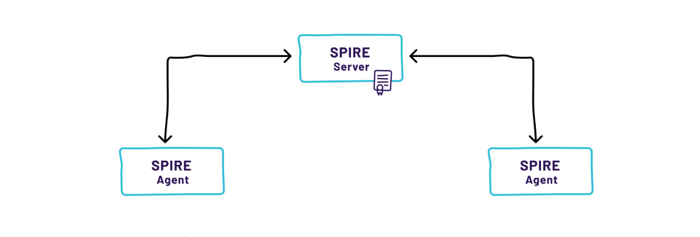

*图 6.1：单一信任域。*

### 嵌套 SPIRE

然而，当单一信任域跨越多个区域、平台和云服务商环境时，如果仍只部署单个 SPIRE Server，那么当 SPIRE Agent 依赖远端的 SPIRE Server 时，就可能出现扩展性问题。在单个部署跨越多个环境的场景下，为了避免在单一信任域中跨环境共用同一个数据存储，可以将 SPIRE Server 配置为嵌套拓扑（nested topology）。

采用嵌套拓扑部署 SPIRE Server，可以让 SPIRE Agent 与 SPIRE Server 之间的通信保持尽可能近的距离。

在这种配置下，顶层 SPIRE Server 持有根证书和私钥，而下游（downstream）SPIRE Server 向其请求中间签名证书，作为下游服务端的 X.509 签名颁发机构。即便顶层服务端宕机，中间层服务端仍能继续运行，从而为整个拓扑提供弹性。

嵌套拓扑非常适合多云部署。由于可以自由组合不同的节点验证器，下游 SPIRE Server 可以部署在不同的云服务商环境中，并为各自环境中的工作负载和 SPIRE Agent 提供身份。

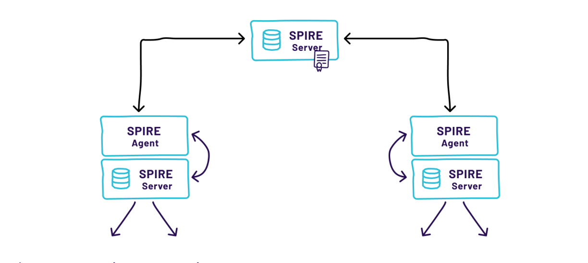

*图 6.2：嵌套 SPIRE 拓扑。*

尽管嵌套 SPIRE 是提升 SPIRE 部署灵活性和可扩展性的理想方式，但它**并不提供额外的安全性**。由于 X.509 无法限制中间证书颁发机构（CA）的权限，因此每一个 SPIRE Server 都可以签发任意证书。即便你的上游 CA 是一台放置在公司地下室混凝土掩体中的加固服务器，只要任意一台 SPIRE Server 遭到攻破，整个网络都可能面临风险。正因如此，确保每一台 SPIRE Server 的安全都至关重要。

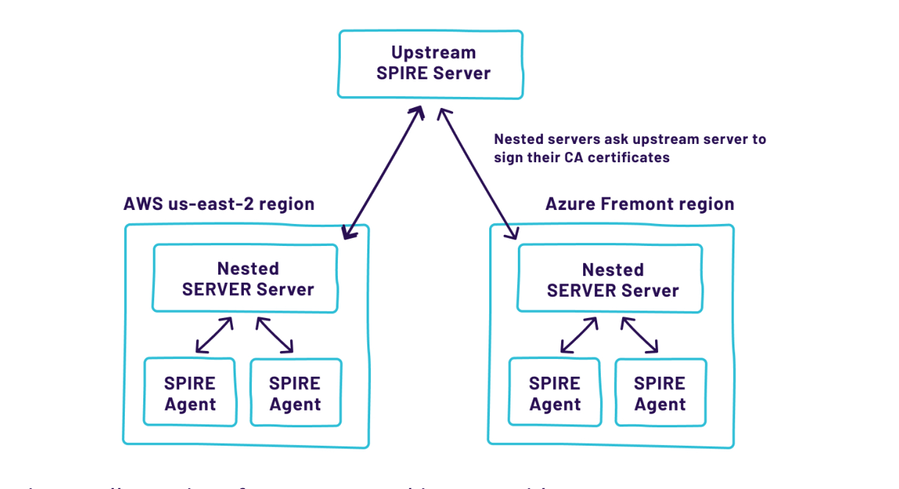

*图 6.3：企业架构示例，包含一个上游 SPIRE Server 和两个嵌套 SPIRE Server。这两个嵌套 SPIRE Server 各自拥有独立配置（分别对应 AWS 和 Azure），且其中任意一个发生故障时，另一个不受影响。*

### 联邦 SPIRE

有些部署可能需要多个信任根，例如一个组织内部存在由不同管理员负责的多个业务部门，或者组织拥有彼此独立但偶尔需要通信的预发布环境和生产环境。

另一种典型场景是跨组织的 SPIFFE 互操作，例如云服务商与其客户之间的互联互通。

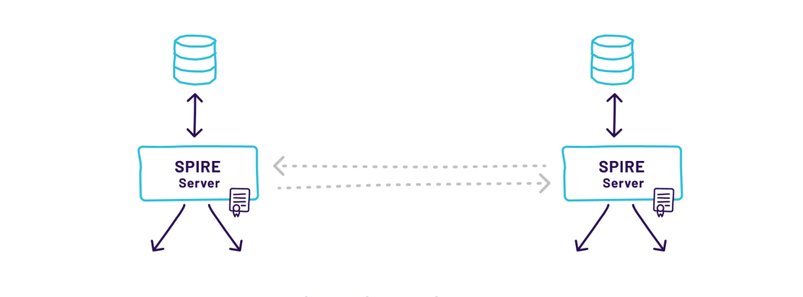

*图 6.4：采用联邦信任域的 SPIRE Server。*

多信任域和跨组织互操作这两种场景，都需要一种定义清晰、可互操作的方法，使一个信任域中的工作负载能够认证另一个信任域中的工作负载。在联邦 SPIRE 中，不同信任域之间的信任是通过以下流程建立的：首先对对方的信任包端点（bundle endpoint）进行身份认证，然后通过该已认证的端点获取外部信任域的信任包。

### 独立部署的 SPIRE Server

运行 SPIRE 最简单的方式是在一台专用服务器上运行它，尤其是在只有单一信任域且工作负载数量不大的情况下。在这种场景下，你可以在同一节点上使用 SQLite 或 MySQL 作为数据库来共置数据存储，从而简化部署。

不过，采用共置部署模型时，务必考虑数据库复制或备份。如果该节点丢失，你可以很快在另一台节点上重新启动 SPIRE Server，但一旦丢失数据库，所有的 SPIRE Agent 和工作负载都必须重新验证以获取新身份。

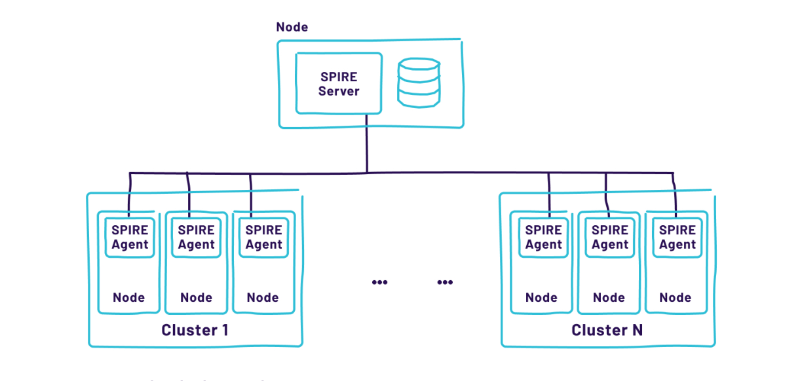

*图 6.5：单台专用 SPIRE Server。*

#### 避免单点故障

简洁带来的好处总是伴随着权衡。如果只有一台 SPIRE Server，一旦该服务器丢失，一切都会丢失并需要重建。通过部署多台 SPIRE Server，可以显著提升系统可用性。此时仍需要共享数据存储，并确保安全的网络连接和数据复制。本章后面将会讨论这些决策带来的不同安全影响。

要对 SPIRE Server 进行水平扩展，需要将同一信任域中的所有服务端配置为读写同一个共享数据存储。

数据存储用于供 SPIRE Server 持久化动态配置信息，例如注册条目和身份映射策略。SQLite 随 SPIRE Server 一同内置，是默认的数据存储。

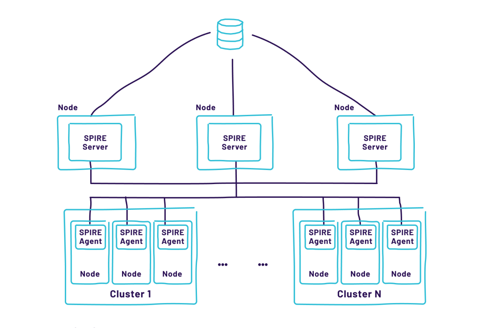

*图 6.6：高可用（HA）模式下运行多个 SPIRE Server 实例。*

## 数据存储建模

在设计数据存储时，首要关注点应放在冗余和高可用上。你需要决定：是为每个 SPIRE Server 集群配置独立的数据存储，还是使用共享数据存储。

数据库类型的选择可能会受到整个系统的可用性要求以及运维团队技术能力的影响。例如，如果运维团队在支持和扩展 MySQL 方面经验丰富，那么 MySQL 就应当作为首选。

### 每个集群独立的数据存储

使用多个数据存储可以让系统中各个独立部分拥有更高的自治性。例如，部署在 AWS 和 GCP 云中的 SPIRE 集群可以各自使用独立的数据存储，或者 AWS 中的每个 VPC 都可以拥有自己的专用数据存储。这种选择的优势在于，如果某个区域或云服务商发生故障，运行在其他区域或云服务商中的 SPIRE 部署不会受到影响。

每个集群独立数据存储的缺点在发生重大故障时最为明显。如果某个区域的 SPIRE 数据存储（以及因此导致该区域的所有 SPIRE Server）发生故障，就需要恢复本地数据存储，或者在信任域跨区域的前提下，将 SPIRE Agent 切换到同一信任域中的另一个 SPIRE Server 集群。

如果必须将 Agent 切换到新集群，就需要特别注意：新集群并不知道原 SPIRE 集群签发过的身份，也没有原集群中的注册条目。Agent 需要向新集群重新进行节点验证，而注册条目则必须通过备份恢复或重新构建。

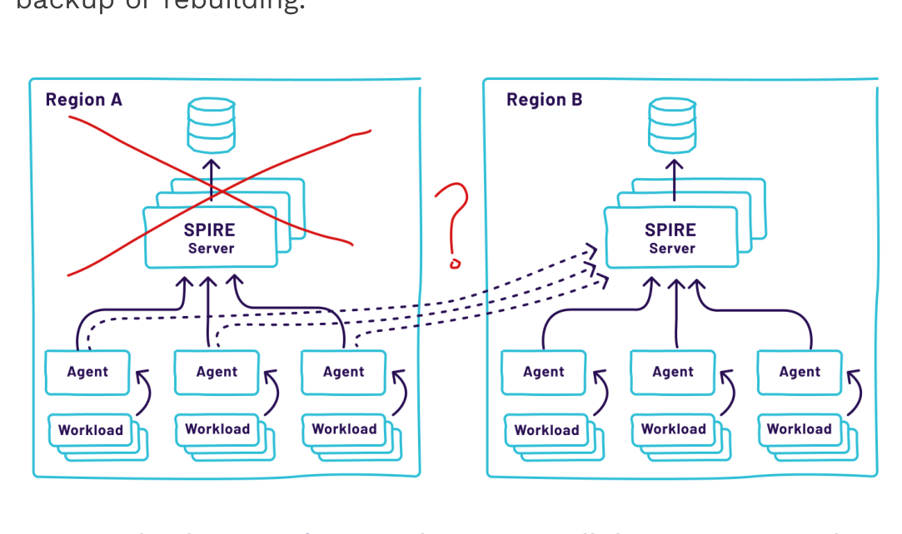

*图 6.7：如果需要将一个集群中的所有 Agent 迁移到另一个集群，会发生什么？*

### 共享数据存储

使用共享数据存储可以解决上述独立数据存储所带来的问题。不过，这可能会使设计和运维变得更加复杂，并需要依赖其他系统在发生故障时检测中断并更新 DNS 记录。此外，这种设计仍然需要为每个 SPIRE 可用域（根据具体基础设施的不同，按区域或数据中心划分）部署相应的数据库基础设施组件。更多细节请参阅 SPIRE 文档（https://github.com/spiffe/spire/blob/master/doc/plugin_server_datastore_sql.md）。

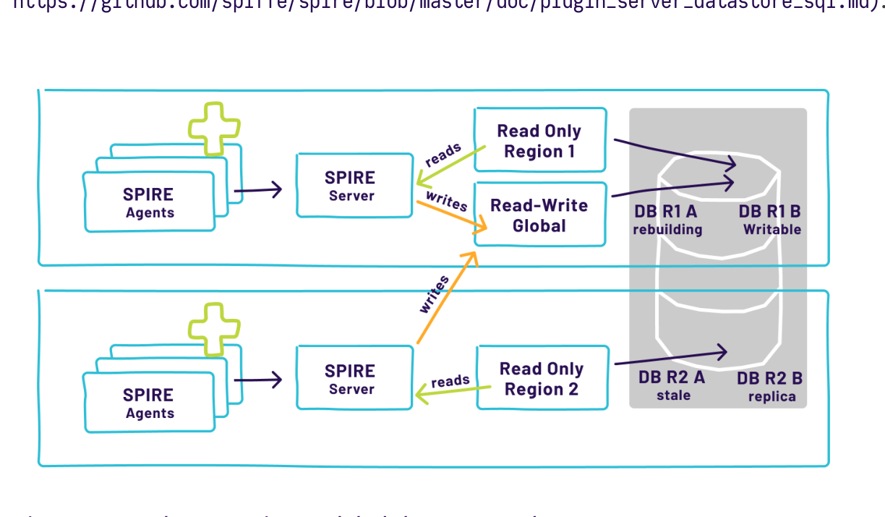

*图 6.8：两个集群使用全局数据存储方案。*

## 故障管理

当基础设施发生中断时，最核心的关切是如何继续向依赖 SVID（SPIFFE 可验证身份文档）正常运作的工作负载签发 SVID。SPIRE Agent 的内存级 SVID 缓存正是作为应对短期中断的第一道防线而设计的。

SPIRE Agent 会定期从 SPIRE Server 获取其获准签发的 SVID，以便在工作负载需要时随时交付。这一过程在工作负载发出 SVID 请求之前就已提前完成。

### 性能与可靠性

SVID 缓存具有两大优势：性能与可靠性。当工作负载请求其 SVID 时，Agent 无需再向 SPIRE Server 发起请求并等待签发，因为缓存中已经备妥，从而省去了一次与 SPIRE Server 的网络往返。

此外，如果在工作负载请求 SVID 时 SPIRE Server 恰好不可用，只要 Agent 已经提前缓存了该 SVID，签发过程就不会受到影响。

这里需要区分 X509-SVID 和 JWT-SVID。JWT-SVID 无法提前签发，因为 Agent 无法预知工作负载所需 JWT-SVID 的具体受众（audience），因此 Agent 只会预先缓存 X509-SVID。不过，SPIRE Agent 也会维护一份已签发 JWT-SVID 的缓存，只要缓存中的 JWT-SVID 仍在有效期内，Agent 就可以直接向工作负载提供该 JWT-SVID，而无需联系 SPIRE Server。

### 生存时间（TTL）

SVID 的一个重要属性是生存时间（TTL，time-to-live）。当缓存中 SVID 的剩余有效期不足 TTL 的一半时，SPIRE Agent 就会对其进行续期。这表明 SPIRE 对底层基础设施能否稳定交付 SVID 采取了保守策略，同时也揭示了 SVID TTL 在抵御基础设施中断方面所起的作用。

较长的 TTL 能为修复和恢复基础设施中断留出更充裕的时间，但选择 TTL 需要在安全性和可用性之间做出权衡。长 TTL 虽然提供了充足的故障处置窗口，但代价是 SVID（及相关密钥）在更长时间内处于暴露风险中；短 TTL 能够缩小恶意攻击者利用已泄露 SVID 的时间窗口，但要求运维团队对中断做出更快速的响应。遗憾的是，并不存在适用于所有部署的“万能”TTL。你必须根据自身可接受的故障修复时间窗口与已签发 SVID 的可接受暴露风险之间的权衡来加以确定。

## 在 Kubernetes 中运行 SPIRE

本节介绍在 Kubernetes 中运行 SPIRE 的具体细节。Kubernetes 是一种容器编排器，能够在多种云服务商环境以及物理硬件上管理软件的部署与可用性。SPIRE 提供了多种不同形式的 Kubernetes 集成。

### Kubernetes 中的 SPIRE Agent

Kubernetes 提供了 DaemonSet 的概念，它能够自动将容器部署到所有节点上，确保每个节点运行一个副本。由于每个节点都必须运行一个 SPIRE Agent，DaemonSet 成为了运行 SPIRE Agent 的理想方式。

当新的 Kubernetes 节点上线时，调度器会自动启动新的 SPIRE Agent 副本。首先，每个 Agent 都需要一份引导信任包（bootstrap trust bundle），分发该信任包最简单的方式是通过 Kubernetes ConfigMap。

Agent 获得引导信任包后，还需要向服务端证明自身身份。Kubernetes 提供了两种认证令牌：

1. Service Account Token（SAT）
2. Projected Service Account Token（PSAT）

Service Account Token 在安全性上并不理想，因为它们永久有效且作用域不受限制。Projected Service Account Token 要安全得多，但需要较新版本的 Kubernetes 并启用相应的特性开关（feature flag）。SPIRE 同时支持使用 SAT 和 PSAT 进行节点验证。

### Kubernetes 中的 SPIRE Server

SPIRE Server 通过两种方式与 Kubernetes 交互。首先，每当其信任包发生变化时，它需要将最新信任包发布到 Kubernetes ConfigMap 中。其次，当 Agent 上线时，它需要调用 `TokenReview` API 来校验 Agent 提供的 SAT 或 PSAT 令牌。这两项功能均通过 SPIRE 插件进行配置，并需要相应的 Kubernetes API 权限。

SPIRE Server 可以完全运行在 Kubernetes 中，与工作负载共处同一集群。不过出于安全考虑，将其运行在独立的 Kubernetes 集群或独立物理硬件上可能更为可取。这样一来，即便主集群遭到攻破，SPIRE 的私钥也不会面临泄露风险。

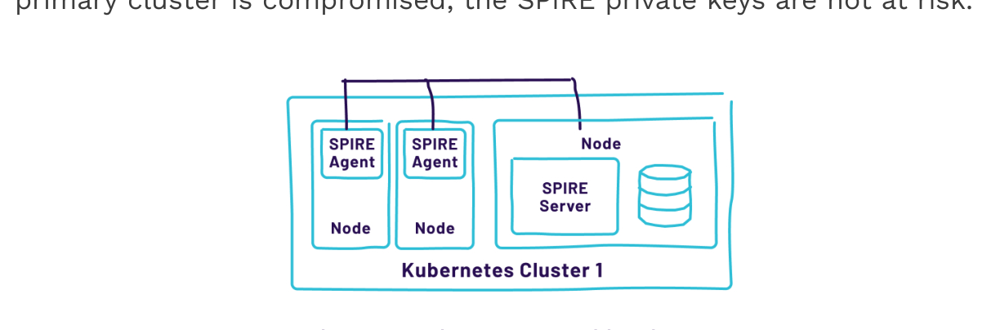

*图 6.9：SPIRE Server 与工作负载运行在同一集群中。*

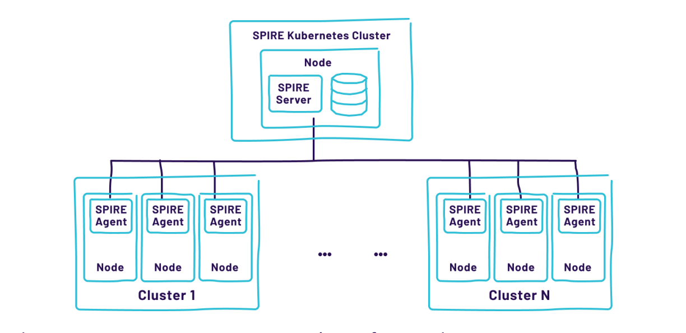

*图 6.10：出于安全考虑，将 SPIRE Server 运行在独立集群中。*

### Kubernetes 工作负载验证

SPIRE Agent 内置了 Kubernetes 工作负载验证器（Kubernetes Workload Attestor）插件。该插件首先通过系统调用识别工作负载的 PID，然后通过本地调用 Kubelet 获取该工作负载的 Pod 名称、镜像及其他特征属性。这些特征属性均可作为注册条目中的选择器使用。

### 自动创建 Kubernetes 注册条目

名为 Kubernetes Workload Registrar 的 SPIRE 扩展可以自动创建节点和工作负载注册条目，充当 Kubernetes API Server 与 SPIRE Server 之间的桥梁。它支持多种识别运行中 Pod 的方法，并在生成注册条目方面具备一定的灵活性。

### 添加 Sidecar

对于尚未适配使用 Workload API 的工作负载（参见第 7 章“与其他系统集成”中的“原生 SPIFFE 支持”一节），Kubernetes 让添加支持 Workload API 的 Sidecar 容器变得非常容易。Sidecar 可以是支持 SPIFFE 的代理（例如 Envoy），也可以是与 SPIRE 配套开发的名为“SPIFFE Helper”的 Sidecar——它会持续监听 Workload API，并在工作负载的 SVID 发生变化时重新配置该工作负载。

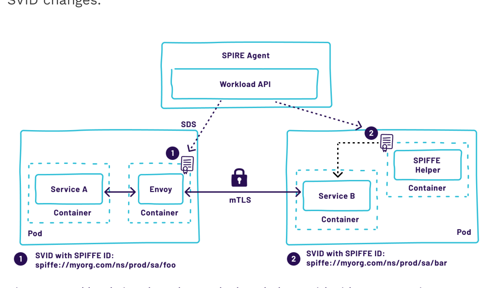

*图 6.11：Kubernetes 集群中与 Sidecar 容器一同部署的工作负载。*

## SPIRE 性能考量

随着连接到服务端的 SPIRE Agent 数量不断增加，服务端、数据存储以及网络本身的负载也会随之上升。多种因素都会对负载产生影响，包括节点数量、单节点上的工作负载数量以及密钥轮换的频率。如果在嵌套 SPIRE 模型中使用 JWT-SVID，各层之间还需要保持公钥同步，这会增加 Agent 与服务端之间需要传输的数据量。

我们没有针对“单个 Agent 可承载的工作负载数量”或“单个服务端可承载的 Agent 数量”给出具体的性能指标要求或推荐值，因为所有这些数据：第一，高度依赖硬件与网络特性；第二，迭代变化非常快。举个例子，最近的一个版本就将数据层性能提升了 30%。

正如你在前几章学到的，SPIRE Agent 会持续与服务端通信，以获取新工作负载的 SVID 或信任包更新等变更。在每次同步过程中，都会触发多次数据存储操作。默认的同步周期为 5 秒；如果该频率给系统带来了过大压力，你可以将其调大以缓解负载。

极短的 SVID TTL 能够降低安全风险，但如果你使用非常短的 TTL，就要做好 SPIRE Server 负载增加的准备，因为签名操作的次数会与轮换频率成正比增长。

另一个影响系统性能的关键因素是每个节点上的工作负载数量。如果你一次性向系统中的所有节点都添加一个新工作负载，这会在短时间内对整个系统造成流量尖峰与负载激增。

如果你的系统重度依赖 JWT-SVID，请记住：Agent 端不会预先生成 JWT-SVID，而是按需请求签名。当 SPIRE Server 和 Agent 处于高负载状态时，这可能会带来额外开销并导致延迟上升。

## 验证插件

SPIRE 为节点验证和工作负载验证提供了多种验证插件。选择哪种验证插件，既取决于你的验证需求，也取决于底层基础设施或平台所提供的支持能力。

对于工作负载验证，选择主要取决于被编排的工作负载类型。例如，在使用 Kubernetes 集群时，适合选用 Kubernetes 工作负载验证器；同理，在 OpenStack 平台上则适合使用 OpenStack 验证器。

对于节点验证，关键在于明确安全与合规要求。有时业务需要对工作负载进行地理围栏（geofencing）限制，在这类场景下，使用云服务商提供的、能够对此作出断言的节点验证器即可提供相应保障。

在高度受监管的行业中，可能要求采用基于硬件的验证机制。这类机制通常依赖底层基础设施的支持，例如专用 API 或可信平台模块（TPM，Trusted Platform Module）等硬件模块。它们可以对系统软件的状态进行度量，包括固件、内核版本、内核模块，甚至文件系统内容。

### 针对不同云平台设计验证方案

在云环境中工作时，将节点身份与云服务商提供的元数据进行核验被视为最佳实践。SPIRE 通过专门针对各大云平台设计的节点验证器，让这一过程变得简单直接。大多数云服务商都会提供一个可用于识别 API 调用者身份的 API。

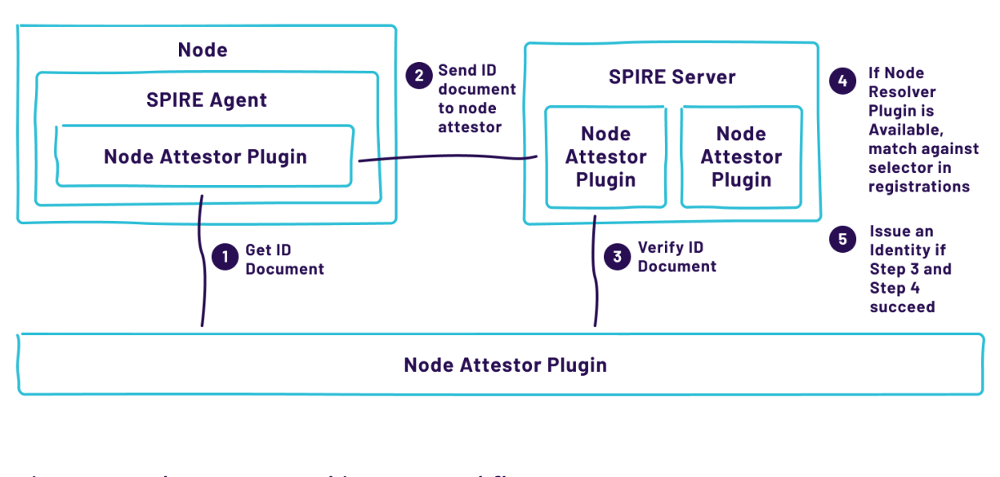

*图 6.12：节点验证器架构与流程。*

SPIRE 已为 Amazon Web Services（AWS）、Azure 和 Google Cloud Platform（GCP）提供了对应的节点验证器和解析器（Resolver）。云环境中的节点验证器针对特定云平台设计，其作用是在向运行于该节点上的 SPIRE Agent 签发身份之前完成节点验证。

节点身份确立之后，SPIRE Server 上还可以安装解析器插件（Resolver Plugin），用于根据该节点的元数据创建额外的选择器。可用的元数据因云平台而异。

而在另一端，如果某个云服务商不具备节点验证能力，也可以使用加入令牌（join token）完成引导。不过，这种方式所提供的安全保障非常有限，具体程度取决于令牌分发与使用流程的设计。

## 注册条目管理

SPIRE Server 支持两种添加注册条目的方式：通过命令行界面（CLI），或通过 Registration API（仅限管理员访问）。SPIRE 必须依赖注册条目才能正常运行。一种方式是由管理员手动创建这些条目。

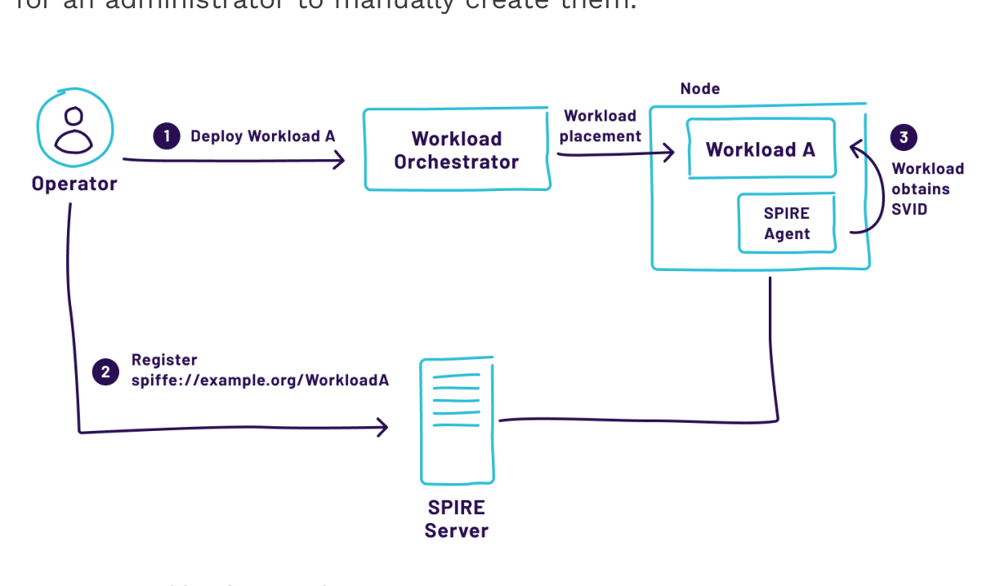

*图 6.13：工作负载手动注册。*

在大型部署或基础设施快速扩张的场景下，手动方式无法扩展。此外，任何手动流程都容易出错，且难以追踪所有变更。

对于包含大量注册条目的部署，更好的选择是通过 SPIRE API 采用自动化流程来创建注册条目。

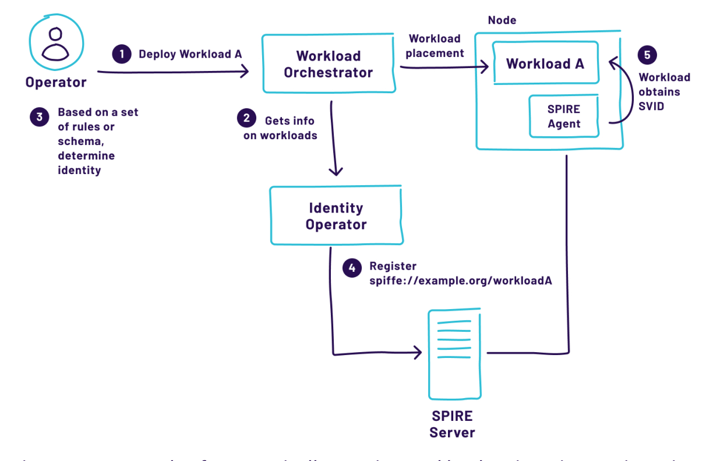

*图 6.14：使用与工作负载编排器（Workload Orchestrator）通信的“Identity Operator”自动创建工作负载注册条目的示例。*

## 纳入安全考量与威胁建模

你所做的每一项设计与架构决策，都会影响整个系统的威胁模型，甚至可能波及与之交互的其他系统。

以下是在设计阶段应当重点关注的一些关键安全考量及其安全影响。

### 公钥基础设施（PKI）设计

你的 PKI（公钥基础设施）采用何种结构、如何划分信任域以建立安全边界、私钥存放在何处以及多久轮换一次，这些都是你在这一阶段必须深入思考的核心问题。

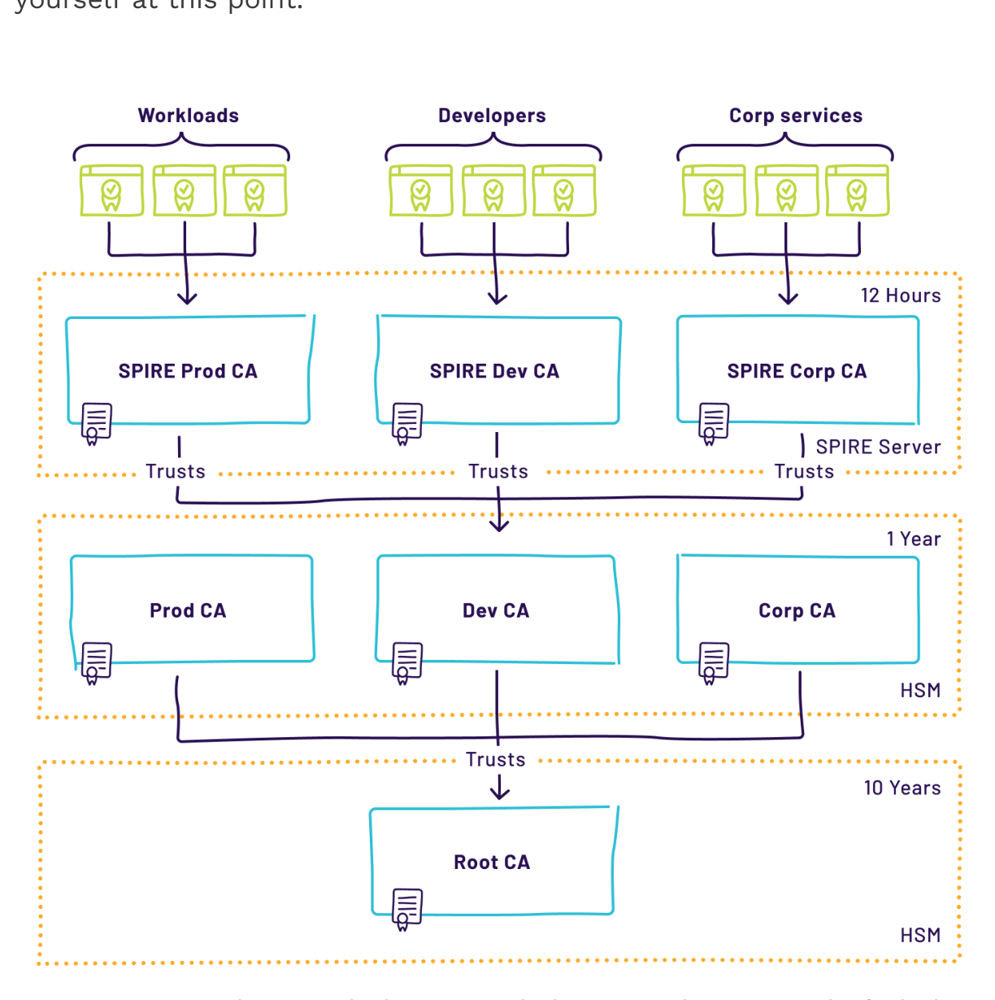

*图 6.15：包含三个信任域的 SPIRE 部署示例。每个信任域使用各自独立的企业级 CA，而这些企业级 CA 又共享同一个根 CA。在证书层级的每一层，证书的 TTL 逐级缩短。*

不同组织的需求各不相同，因此各自会采用不同的证书层级结构。上图展示的只是其中一种可能的证书层级。

#### TTL、吊销与续期

在涉及 PKI 时，证书过期、重新签发和吊销等问题总是绕不开的。影响这些决策的考量因素包括：

- **身份文档过期与重新签发的性能开销**——系统能够承受多大的性能开销？TTL 越短，性能开销越高。
- **身份文档的交付延迟**——TTL 必须大于身份文档的预期交付延迟，以确保服务在身份认证时不会出现空窗期。
- **PKI 生态的成熟度**——是否已经具备完善的吊销机制？这些机制是否得到持续维护和及时更新？
- **组织的风险偏好**——如果未启用吊销机制，一旦某个身份泄露并被发现，组织能够接受该身份继续保持有效的时间窗口有多长？
- **对象的预期生命周期**——TTL 的设置不应过长，而应与对象的预期生命周期相匹配。

#### 爆炸半径

在 PKI 设计阶段，务必认真评估某一个组件遭到攻破后对基础设施其余部分的影响范围。例如，如果你的 SPIRE Server 将密钥保存在内存中，一旦该服务端遭到攻破，所有下游 SVID 都必须作废并重新签发。为了将此类攻击的影响降至最低，你可以在设计 SPIRE 基础设施时，为不同的网段、虚拟私有云（VPC）或云服务商分别设立多个信任域。

#### 妥善保管私钥

私钥的存放位置至关重要。正如你在前面了解到的，SPIRE 具备密钥管理器（Key Manager）的概念，用于管理 CA 密钥。如果你打算让 SPIRE Server 充当 PKI 的根 CA，通常需要持久化保存根密钥，但将其直接存储在磁盘上并非明智之举。

一种存放 SPIRE 密钥的方案是使用软件或硬件形态的密钥管理服务（KMS，Key Management Service）。市面上既有独立的 KMS 产品，各大主流云服务商也都提供了内置的 KMS 服务。

另一种将 SPIRE 集成到现有 PKI 的设计策略是使用 SPIRE 上游颁发机构（Upstream Authority）插件接口。在这种模式下，SPIRE Server 通过受支持的插件与现有 PKI 通信，由现有 PKI 为其签发中间 CA 证书。

### SPIRE 数据存储的安全考量

我们在第 4 章的威胁模型中有意将 SPIRE Server 的数据存储排除在外。数据存储用于供 SPIRE Server 持久化通过 SPIRE Server API 写入的动态配置，例如注册条目和身份映射策略。SPIRE Server 数据存储支持多种不同的数据库系统。如果数据存储遭到攻破，攻击者就能够在任意节点上注册工作负载，甚至注册节点本身；攻击者还可以向信任包中注入密钥，从而混入下游基础设施的信任链。

攻击者还可能针对数据库本身或 SPIRE Server 与数据库之间的网络连接发起拒绝服务（DoS）攻击，进而导致其余基础设施陷入拒绝服务状态。

在生产环境中为 SPIRE Server 基础设施设计数据库方案时，你通常不会采用将数据库进程与服务端共置在同一台主机上的模型。尽管限制数据库访问并将其与服务端共置能显著缩小攻击面，但这种模式在生产环境中非常难以扩展。

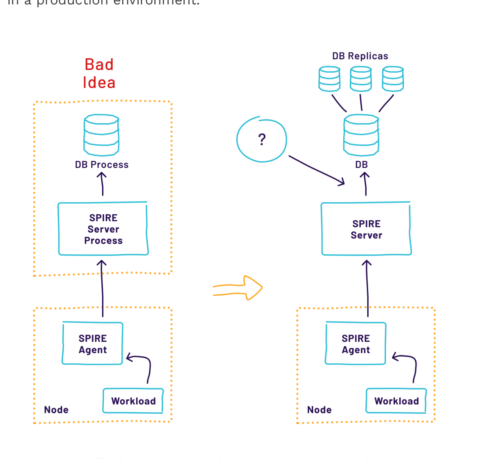

*图 6.16：出于可用性和性能考虑，SPIRE Server 数据存储通常通过网络连接运行在远程主机上，但这会带来安全挑战。*

出于可用性和性能考虑，SPIRE 数据存储通常会采用网络连接的数据库，但你应当考虑以下问题：

- 如果该数据库与其他服务共享，还有哪些人员可以访问和管理它？
- SPIRE Server 将如何向数据库进行身份认证？
- 数据库连接是否支持受 TLS 保护的安全通信？

这些问题都必须纳入考量，因为 SPIRE Server 连接数据库的方式在很大程度上决定了整个部署的安全性。如果采用 TLS 结合密码认证的方式，SPIRE Server 部署应当借助密钥管理器（secrets manager）或 KMS 来保障凭据安全。

在某些部署中，你可能还需要引入另一套更底层的元 PKI（meta PKI）基础设施，用来保护 SPIRE Server 与所有底层依赖组件（包括配置管理或部署软件）之间的通信安全。

### SPIRE Agent 配置与信任包

你在环境中分发和部署 SPIRE 生态组件及其配置的方式，可能会对威胁模型乃至整个系统的安全模型产生深远影响。这不仅是 SPIRE 的底层依赖，也是你所有安全系统的共同底座，因此这里我们仅聚焦于与 SPIFFE 和 SPIRE 直接相关的部分。

#### 信任包

分发 Agent 的引导信任包有多种方式。Agent 最初启动时，会使用这份引导信任包来认证 SPIRE Server。如果攻击者能够向初始信任包中添加密钥并实施中间人（man-in-the-middle）攻击，那么由于工作负载是从受害 Agent 处获取 SVID 和信任包的，攻击者同样可以对这些工作负载实施中间人攻击。

#### 配置

SPIRE Agent 的配置文件同样需要严加保护。如果攻击者能够篡改该配置文件，就可以将 Agent 指向一台已被攻破的 SPIRE Server，从而接管该 Agent。

### 节点验证插件的影响

通过多个相互独立的机制来断言信任，能够提供更强的信任保障。你所选择的节点验证方式可能会对 SPIRE 部署的安全性产生重大影响，并将其信任根转移到另一个系统之上。在决定采用何种验证方式时，应当将其纳入威胁模型，并在每次发生变更时重新评审该模型。

例如，任何其他基于持有证明（proof-of-possession）的验证机制都会转移信任根，因此你需要确保作为底层依赖的那个系统符合组织的安全与可用性标准。

如果设计的系统采用基于加入令牌（join token）的验证模型，务必仔细评估由运维人员或自动化置备系统添加与使用令牌的操作流程。

### 遥测与健康检查

SPIRE Server 和 SPIRE Agent 均支持健康检查以及多种类型的遥测（telemetry）。启用或错误配置健康检查与遥测可能会扩大 SPIRE 基础设施的攻击面，这一点最初可能并不显眼。SPIFFE 和 SPIRE 的威胁模型假设 Agent 仅通过本地 Unix 套接字暴露 Workload API 接口，并未考虑将健康检查服务错误地（或有意地）配置为监听在非 `localhost` 地址上——这可能会使 Agent 暴露于 DoS、远程代码执行（RCE）和内存泄漏等潜在攻击之下。在选择遥测集成方案时也应采取类似的预防措施，因为某些遥测插件（例如 Prometheus）可能会暴露额外的端口。
