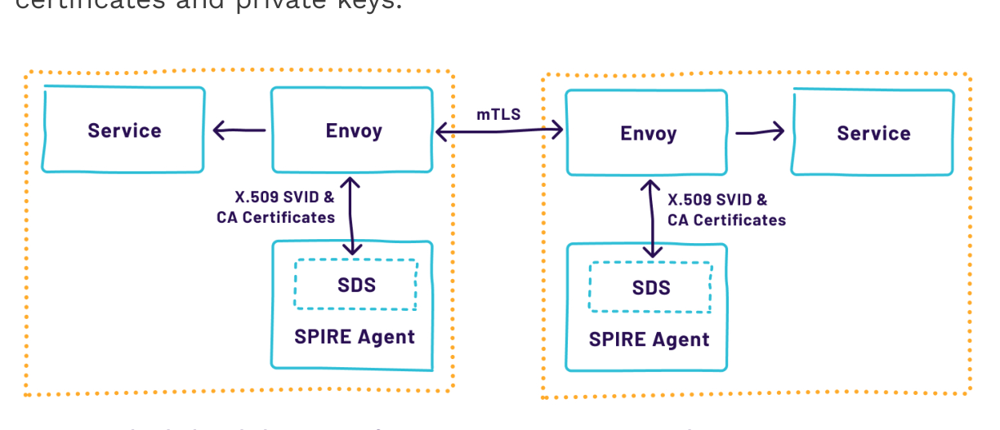
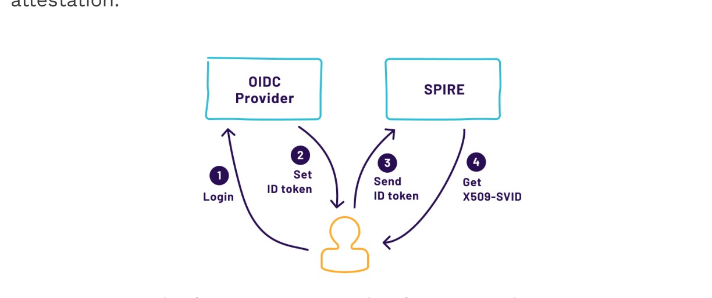
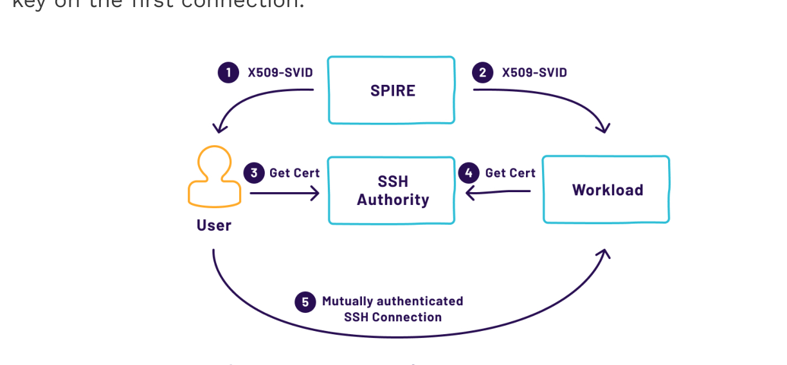

# 第 7 章　与其他系统集成

本章探讨 SPIFFE 和 SPIRE 如何与你的环境集成。

SPIFFE 从设计之初就注重可插拔性和可扩展性，因此将 SPIFFE 和 SPIRE 与其他软件系统集成是一个非常宽泛的话题。针对某一特定集成的具体架构设计超出了本书的讨论范围；相反，本章旨在梳理一些常见的可行集成方式及其高层概览，并提供开展集成工作的策略。

## 让软件使用 SVID

在考虑如何改造软件以使用 SVID 时，有多种方案可供选择。本节将介绍其中几种常见方式，以及每种方式需要权衡的考量因素。

### 原生 SPIFFE 支持

这种方式需要修改现有服务，使其具备感知 SPIFFE 的能力。当所需改动量较小，或者可以将改动引入应用服务通用的共享库或框架中时，这是首选方案。对于对延迟敏感的数据平面服务，或希望在应用层直接使用身份信息的服务而言，原生集成是最理想的做法。SPIFFE 提供了适用于 Go 语言的 `go-spiffe` 和适用于 Java 语言的 `java-spiffe` 等库，方便开发者构建支持 SPIFFE 的工作负载。

当你使用的编程语言已有官方支持的 SPIFFE 库时，原生集成通常是使用 SPIFFE 最直接的方式。上述 Go 和 Java 库都附带了在 gRPC 和 HTTPS 客户端及服务端中使用 SPIFFE 的示例。

话虽如此，你的选择并不局限于 Java 和 Go。这些库都是基于开放规范实现的。截至本书撰写时，社区正在积极开发适用于 Python、Rust 和 C 语言的 SPIFFE 库。

### 支持 SPIFFE 的代理

在很多情况下，重构成本可能过高，或者服务运行的是无法修改的第三方代码。在这些场景下，一种务实的做法是在应用前端部署一个支持 SPIFFE 的代理。根据应用的部署模型，这可以是一个独立代理（standalone proxy），也可以是一组与工作负载共置的代理（colocated proxy）。共置代理的优势在于，代理与未受保护的服务之间的流量始终保留在本地；如果采用独立代理，则仍需额外保障代理与应用之间的通信安全。

Envoy 是这方面的热门选择，Ghostunnel 也是一个不错的方案。虽然 NGINX 和 Apache 等其他代理也可以使用，但它们与 SPIFFE 相关的功能相对有限。

Ghostunnel 是一个 L3/L4 代理，对整套 SPIFFE 规范提供完全原生支持，包括 SPIFFE Workload API 和联邦机制。对于需要 L7 特性的应用，则推荐使用 Envoy。尽管 Envoy 并不原生支持 SPIFFE Workload API，但 SPIRE 实现了 Secret Discovery Service API（简称 SDS API）——这是 Envoy 用于获取和维护证书与私钥的接口。

*图 7.1：位于两个服务之间的两个 Envoy 代理利用 SPIRE Agent 的 SDS 实现来建立 mTLS（双向 TLS）的高层示意图。*

通过实现 SDS API，SPIRE 可以将 TLS 证书、私钥以及受信任的 CA 证书直接推送到 Envoy 中。随后，SPIRE 会按需负责轮换短期密钥和证书，并将更新直接推送给 Envoy，无需重启代理。

### 服务网格

像 Envoy 这样的 L7 代理除了提供 SPIFFE 安全能力之外，还能承担许多其他职责。例如，服务发现、请求授权和负载均衡都是 Envoy 具备的特性。在难以使用共享库的环境中（例如应用采用多种不同编程语言编写，或者无法修改应用代码），将这类通用功能卸载到代理中尤其具有吸引力。这种做法也会促使代理部署趋向于共置模式，即每个应用实例旁边都运行一个专属代理。

然而，这也带来了新的问题：如何管理如此庞大的代理集群？

服务网格（service mesh）是对代理集群及其配套代理控制平面的一种固定范式（opinionated）部署方案。它通常支持在工作负载部署时自动注入并配置共置代理，并对这些代理进行持续的生命周期管理。通过将诸多平台层面的关注点卸载给服务网格，应用程序就可以对这些底层能力保持无感知。

截至目前，大多数服务网格实现都利用 SPIFFE 认证来保护服务间流量。其中一些使用 SPIRE 来实现这一目标，另一些则实现了各自产品专属的 SPIFFE 身份提供方。

### 辅助程序

对于那些不原生支持 SPIFFE Workload API、但支持使用证书进行认证的工作负载，可以在其旁边运行一个辅助程序来弥合这一差距。这类辅助程序的一个典型例子是 SPIFFE Helper（参见：https://github.com/spiffe/spiffe-helper/）。SPIFFE Helper 会从 SPIFFE Workload API 获取 SVID 并将其写入磁盘，供应用程序读取。SPIFFE Helper 可以持续运行，确保磁盘上的证书在轮换时不断得到更新。一旦发生更新，辅助程序就可以向应用程序发送信号（或执行可配置的命令），使正在运行的应用加载最新证书。

许多支持 TLS 的现成软件都可以通过这种方式配置使用 SPIFFE。SPIFFE Helper 的代码仓库中提供了配置 MySQL 和 PostgreSQL 的示例；Apache HTTPD 和 NGINX 等众多 Web 服务器也可以采用类似方式进行配置。这种方式同样适用于那些只能配置读取磁盘证书的客户端软件，例如：

- `openssl`
- `x509curl`
- `grpcurl`

需要注意的是，这种方式的灵活性不如原生 SPIFFE 集成，尤其是可能无法实现同等细粒度的信任配置。例如，在使用 SPIFFE Helper 为 Apache HTTPD 配置 mTLS 时，无法将 `mod_ssl` 配置为仅接受带有特定 SPIFFE ID 的客户端。

## 在不支持 SPIFFE 的软件中使用 SVID

由于 SVID 是基于业界广为人知的文档类型构建的，因此在实际环境中经常会遇到支持这类文档类型、但本身并不具备 SPIFFE 感知能力的软件。好消息是，这种情况在设计之初就已经被充分预见到，SPIFFE 和 SPIRE 能够很好地应对这类场景。

### X509-SVID 的双重用途

许多非 SPIFFE 系统虽然支持使用 TLS（或 mTLS），但它们依赖证书主体中的通用名称（Common Name，CN）或主题备用名称（Subject Alternative Name，SAN）扩展中的 DNS 名称来承载身份信息。SPIRE 支持签发包含特定 CN 和 DNS SAN 值的 X.509 证书，且这些值可以按工作负载逐一指定（作为注册条目的一部分）。

这一特性非常重要，因为它使得 X509-SVID 能够用于那些无法直接理解 SPIFFE ID 的软件。例如，HTTPS 客户端通常要求服务端出示的证书与请求的 DNS 名称相匹配。再比如，MySQL 和 PostgreSQL 可以使用 CN 来识别 mTLS 客户端。借助 SPIRE 的这一特性以及 SPIFFE 本身提供的灵活性，只需使用同一套用于 SPIFFE 场景的 SVID，就能同时满足这些传统用例。

### JWT-SVID 的双重用途

与 X509-SVID 既可用于 SPIFFE 认证又可用于传统 X.509 场景类似，JWT-SVID 也具备这种双重能力。尽管 JWT-SVID 使用标准的 subject（即 `sub`）声明来存储 SPIFFE ID，但其验证方法与 OpenID Connect（OIDC）相似且兼容。

更具体地说，SPIFFE Federation API 通过 HTTPS 端点以 JWKS 文档的形式公开公钥，这与 OIDC 验证中获取公钥的机制完全一致。因此，任何支持 OIDC 身份联邦的技术，无论其本身是否支持 SPIFFE，都能够接受 JWT-SVID。

支持此类身份联邦的一个典型集成案例是 Amazon Web Services（AWS）的 Identity and Access Management（IAM）。通过在 AWS 账号中将 IAM 配置为接受来自 SPIRE 的身份作为 OIDC 身份提供方，工作负载就可以使用从 SPIFFE Workload API 获取的 JWT-SVID 来担任（assume）AWS IAM 角色。当需要访问 AWS 资源的工作负载本身并未运行在 AWS 内部时，这种方式尤为强大——它彻底消除了存储、共享和管理长期 AWS 访问密钥的必要。关于如何实现这一集成的详细步骤，请参阅 SPIFFE 官网上的 AWS OIDC 认证教程（参见：https://spiffe.io/spire/try/oidc-federation-aws/）。

## 基于 SPIFFE 构建更多能力的思路

一旦 SPIFFE 作为通用的身份基石落地于你的生态系统中并与各类应用完成集成，就值得进一步思考可以在其上构建哪些能力。本节旨在探讨基于 SPIFFE 和 SPIRE 可以实现的扩展方向。这并不意味着项目本身已经开箱即用地提供了全部构建模块——要实现这些能力，往往需要自行编写部分集成代码，具体实现方式也会因部署环境而异。

### 日志、监控、可观测性与 SPIFFE

SPIFFE 可以向其他系统提供可验证的身份证明，这对以下基础设施组件大有裨益：

- 指标基础设施（Metrics infrastructure）
- 日志基础设施（Logging infrastructure）
- 可观测性（Observability）
- 计量（Metering）
- 分布式追踪（Distributed tracing）

你可以利用 SVID 来保障这些系统的客户端与服务端通信安全；更进一步，还可以扩展这些组件，在采集的数据中附加 SPIFFE ID 信息。这样做能带来诸多好处，例如可以跨多种平台和运行时关联事件，甚至有助于识别尚未采用 SPIFFE 身份的应用和服务，或者无论运维异常与攻击发生在基础设施的哪个角落，都能及时发现。

### 审计

对于任何安全系统（例如你基于 SPIRE 构建的系统）而言，日志不仅是帮助开发者和运维人员了解系统发生了什么的信息，更是正在发生事件的证据，因此将日志集中存储是一个良好的实践。一旦发生安全事件，这类信息对于取证分析具有极高的价值。

SPIFFE 可以通过对集中式审计系统发起经过认证的调用，提供不可抵赖性（non-repudiation），从而增强审计数据的可信度。例如，在与审计系统建立会话时使用 X509-SVID 和 mTLS，就可以确切知晓每条日志的真实来源——攻击者无法轻易篡改所发送的标签或其他数据。

### 证书透明度

证书透明度（Certificate Transparency，CT）提供了一个用于近实时监控和审计 X.509 证书的开放框架，有助于发现针对证书基础设施的攻击。借助证书透明度，可以检测出从遭入侵的证书颁发机构（CA）恶意获取的证书，也能够识别出失控并恶意签发证书的 CA。要了解有关证书透明度的更多信息，请阅读其入门文档（参见：https://www.certificate-transparency.org/what-is-ct）。

将 SPIRE 与证书透明度集成有多种可行方案。通过这种集成，可以记录系统签发的所有证书信息，并利用一种名为默克尔树哈希（Merkle Tree Hashes）的特殊密码学机制加以保护，以防篡改和不当行为。

另一种可考虑的做法是在所有系统中强制启用证书透明度，从而阻止与证书信息未记录在证书透明度服务器中的应用和服务建立 TLS 及 mTLS 连接。

与 CT 的具体集成超出了本书的范围，请关注 SPIFFE/SPIRE 社区以获取更多信息和最新进展。

### 供应链安全

前文关于 SPIFFE 用途的讨论大多集中在保障软件系统运行时的通信安全，但在软件部署之前的各个阶段对其进行保护同样至关重要。供应链攻击是一种极具威胁的攻击向量，因此保护软件供应链的完整性、防止恶意行为者在代码中植入后门或引入存在漏洞的库显得尤为必要。验证软件制品的来源（provenance）以及构建流水线中执行的一系列步骤，是确认软件未被篡改的有效手段。

你可以考虑使用 SPIFFE 为签名提供信任根，也可以用它为供应链系统中的各个软件组件签发身份。它有多种方式可以与互补软件协同工作，例如 The Update Framework（TUF）、Notary 等制品签名服务，或与 In-Toto 等供应链日志系统结合使用。

SPIRE 与供应链组件的集成可以在两个层面上展开。

首先，可以用它来标识供应链系统中的各个组成部分，以保护构建设施和控制平面的安全。其次，可以通过自定义选择器来确保只有来源已知的二进制文件才能获得身份。对于后者，一个最基础的实现方式是：利用现有的 Docker 选择器将这些属性作为标签传入容器镜像，或者开发一个能够检查供应链元数据的自定义工作负载验证器。

## 为用户集成 SPIFFE 的思路

SPIFFE 和 SPIRE 架构的核心聚焦于软件身份。它并未将人类用户的身份纳入主要设计范围，因为该领域通常被认为已经有了成熟的解决方案，且向人类与向软件签发身份的方式存在显著差异。尽管如此，这并不意味着你不能为用户分发 SPIFFE 身份。

### 用户的可验证身份

在支持 SPIFFE 的生态系统中，用户应当如何参与交互？别忘了，SPIFFE 的全称是 Secure Production Identity Framework for Everyone（面向所有人的安全生产身份框架）。尽管本书绝大部分内容都在讨论软件身份，但为用户签发 SPIFFE 可验证身份文档（SVID）同样合理，甚至颇具价值。这样一来，工作负载能用 SVID 完成的所有操作（例如通过 mTLS 访问服务），人类用户同样可以做到。这对于正在开发软件、且需要访问与软件部署后相同资源的开发者来说尤为实用。

正如 SPIFFE 规范对 SPIFFE ID 的格式保持开放一样，如何表示人类用户也完全由你决定。一种简单的方式是将用户名放入 SPIFFE ID 的路径中，例如 `spiffe://example.com/users/zero_the_turtle`；或者，你也可以为用户和工作负载划分不同的信任域，例如 `spiffe://users.example.com/zero_the_turtle`。

在理想情况下，你现有的单点登录（SSO）提供方能够为用户签发 JWT（例如 OIDC 身份提供方）。此时，只要能将 SSO 提供方配置为在 `sub` 声明中使用 SPIFFE ID，你可能无需做任何额外工作就能为用户生成 SVID。

如果无法直接从身份提供方获取 SPIFFE JWT，但你能够获得一种可验证的身份令牌，那么可以使用自定义的 SPIRE 验证器，将身份提供方签发的身份令牌作为一种基础的验证依据。

*图 7.2：使用 OIDC ID 令牌进行 SPIRE 认证的示例。*

如果上述两种情况都不适用，你始终可以构建一个独立服务，将其集成到现有的 SSO 解决方案中，基于用户已认证的会话为其签发 SVID。你可以查看 SPIFFE 网站上的示例项目以作参考（参见：https://github.com/JackOfMostTrades/spiffe-user-demo）。

### 将 SPIFFE 和 SPIRE 与 SSH 结合使用

OpenSSH 支持基于证书颁发机构（CA）和证书的认证方式（参见：https://github.com/openssh/openssh-portable/blob/master/PROTOCOL.certkeys）。尽管 OpenSSH 证书的格式与 X.509 不同，但完全可以构建一个服务，以 SVID 作为认证凭据来签发 SSH 证书，从而将 SPIFFE 身份同样应用于 SSH 场景。

对于需要通过 SSH 访问生态系统中工作负载的用户而言，这种模式提供了临时性、短生命周期且可审计的 SSH 访问凭据，同时也提供了一个统一的控制点，便于实施访问控制策略或多因素认证（MFA）。

此外，工作负载也可以借此获取服务端（即“主机”）SSH 证书，从而向用户证明自身身份。有了这种证书后，用户在首次连接服务器时，就不再会被“是否信任服务器主机密钥”的提示打断 SSH 连接。

*图 7.3：使用 SVID 引导 SSH 证书。*

### 微服务用户界面

尽管本书的大部分内容关注的是工作负载之间的认证，但用户向工作负载进行认证的需求同样常见。如果用户通过命令行工具（CLI）或其他桌面工具访问服务，可以直接使用用户的 SVID 进行 mTLS 认证。然而，许多微服务还会提供某种基于浏览器的用户界面——这可能是因为开发者需要访问专为服务打造的管理后台，或者服务消费者希望借助 Swagger UI（参见：https://github.com/swagger-api/swagger-ui）这类工具来浏览和试用服务 API。

要为带有浏览器界面的服务提供良好的体验，就需要把对浏览器友好的认证方式与 SPIFFE mTLS 认证桥接起来。最简单的实现方式是为服务开放两个 API 端口：一个端口使用 mTLS，另一个端口接受对浏览器友好的认证方式，例如现有的 Web SSO 机制或 OAuth2/OIDC。

在第二个端口上，可以添加一个认证后过滤器（post-authentication filter），作为将浏览器认证主体映射为对应 SPIFFE ID 的转换层。如果你已经按照前文所述搭建了让用户直接获取 SVID 的机制，那么此处应当复用相同的映射规则。这样一来，底层应用程序就无需关心具体使用的是哪种认证机制——同一用户通过 Web 发起的请求，在功能上就与该用户使用其 SVID 通过 mTLS 发起的请求完全等价。
