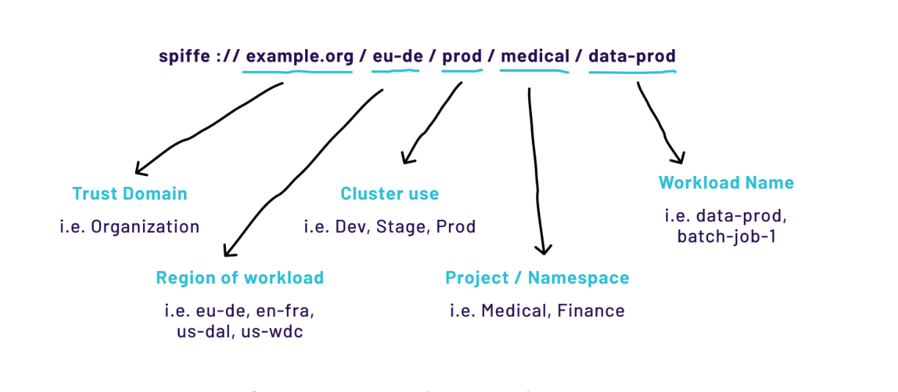
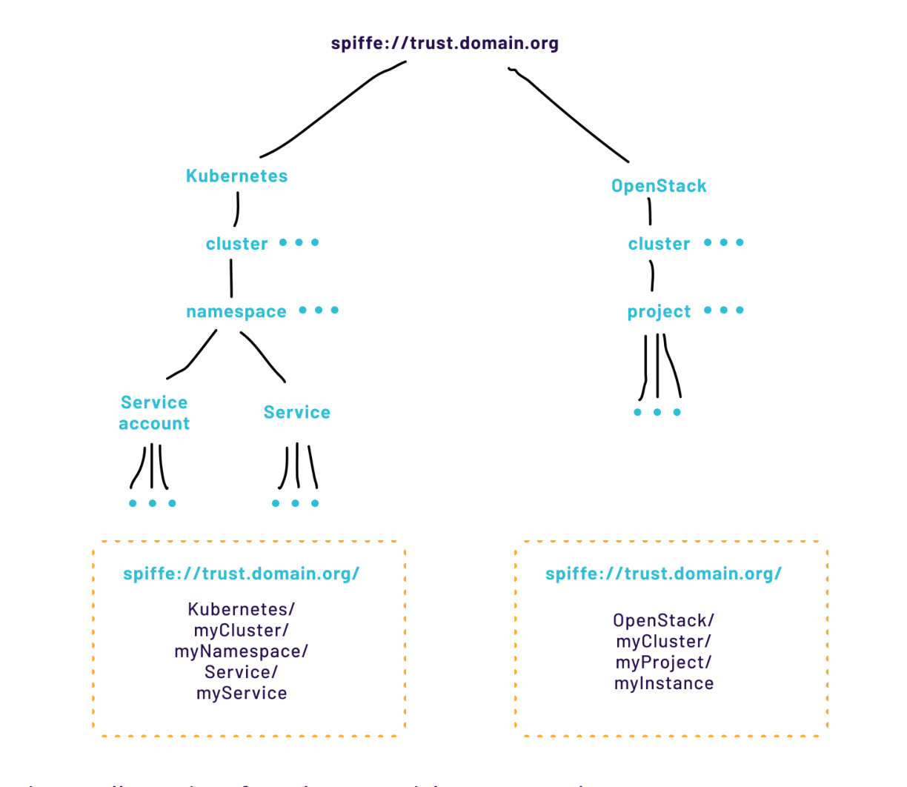

# 第 8 章　使用 SPIFFE 身份指导授权

本章介绍如何实现使用 SPIFFE 身份的授权策略。

## 在 SPIFFE 之上构建授权

SPIFFE 专注于为软件签发安全、可互操作的加密身份，但如本书前文所述，它并不直接解决这些身份的使用或消费问题。

SPIFFE 经常作为强大授权系统的基石，而 SPIFFE ID 本身在其中扮演着重要角色。在本章中，我们将探讨使用 SPIFFE 构建授权的各种方案。

## 认证与授权（AuthN 与 AuthZ）

一旦工作负载拥有了安全的加密身份，它就可以向其他服务证明自己的身份。向外部服务证明身份的过程称为**认证**（authentication）。认证通过后，该服务就可以决定允许对方执行哪些操作，这一过程称为**授权**（authorization）。

在某些系统中，任何通过认证的实体都会同时获得授权。由于 SPIFFE 会在服务启动时自动为其授予身份，因此必须清楚地认识到：并非每一个能够证明自身身份的实体都应该获得授权。

## 授权类型

授权的建模方式有很多种。最简单的方案是为每个资源附加一个已授权身份的**白名单**（allowlist）。然而，在深入分析这种方案时，我们会发现随着生态系统规模的扩大和复杂度的提升，白名单方式存在诸多局限。因此，我们还将探讨两种更成熟的模型：**基于角色的访问控制**（Role-Based Access Control，RBAC）和**基于属性的访问控制**（Attribute-Based Access Control，ABAC）。

### 白名单

在小型生态系统中，或者刚开始使用 SPIFFE 和 SPIRE 时，保持简单往往是最佳选择。例如，如果你的生态系统中只有十几个身份，那么可以通过为每个资源（如服务、数据库）维护一份允许访问的身份列表来管理访问权限：

```bash
ghostunnel server --allow-uri spiffe://example.com/blog/web
```

在这里，`ghostunnel` 服务器仅根据客户端的身份来显式授权访问。

这种模型的优点在于易于理解。只要身份数量有限且不常变动，在资源上定义和更新访问控制就非常简单。但可扩展性很快会成为瓶颈：如果一个组织拥有成百上千个身份，维护白名单就会迅速变得难以管理。例如，每当新增一个服务时，运维团队可能都需要更新大量的白名单。

### 基于角色的访问控制（RBAC）

在基于角色的访问控制（RBAC）中，服务被分配到不同的角色，然后基于角色来指定访问控制策略。这样一来，当新增服务时，通常只需要修改相对少量的角色配置即可。

虽然可以将服务的角色编码进其 SPIFFE ID 中，但这通常是一种不良实践，因为 SPIFFE ID 是静态的，而服务所分配的角色可能会发生变化。更推荐的做法是在外部维护 SPIFFE ID 与角色之间的映射关系。

### 基于属性的访问控制（ABAC）

基于属性的访问控制（ABAC）是一种根据与服务关联的属性来做出授权决策的模型。与 RBAC 结合使用时，ABAC 可以成为强化授权策略的有力工具。例如，为了满足法律法规要求，可能需要将某个数据库的访问权限限制为仅允许特定区域的服务访问。区域信息就可以作为 ABAC 模型中的一项属性用于授权，并编码在 SPIFFE ID 方案中。

## 为授权设计 SPIFFE ID 方案

> **警示**：在将授权元数据编码进组织的 SPIFFE ID 格式时，务必格外谨慎。下文的示例展示了如何做到这一点，这是因为我们不希望在此处引入额外的授权概念。

SPIFFE 规范并未规定或限制你可以在或应该在 SPIFFE ID 中编码哪些信息。你唯一需要注意的限制来自 SAN（主体备用名称）扩展的最大长度，以及允许使用的字符集。

### SPIFFE 方案示例

要基于 SPIFFE 身份的子字符串做出授权决策，我们必须明确定义身份中每一部分的含义。你可以采用按位置顺序编码信息的方式来设计方案。在这种方式下，第一部分可能代表区域，第二部分代表环境，依此类推。

下面是这种方案及其对应身份的一个示例：

```text
spiffe://trust.domain.org/<region>/<dev,stage,prod>/<organization>/<workload name>
```



*图 8.1：SPIFFE ID 的组成部分及其在某一组织中的可能含义。*

身份方案不仅可以采用一系列固定字段的形式，还可以根据组织的需求设计成更复杂的结构。一个常见的例子是跨不同编排系统的工作负载身份。例如，在 Kubernetes 和 OpenShift 中，工作负载的命名约定各不相同。下图展示了这样一个示例。你可能会注意到，这些字段不仅指向不同的属性和对象，而且 SPIFFE ID 的结构本身也取决于上下文。

身份的消费者可以通过观察身份的前缀来区分方案的结构。例如，按照下图所示的方案结构，带有前缀 `spiffe://trust.domain.org/Kubernetes/…` 的身份将被解析为 Kubernetes 身份。



*图 8.2：另一种可能的 SPIFFE ID 方案示意图。*

## 变更方案

组织往往会不断演变，对身份方案的要求也会随之改变。这可能是由于组织架构调整，也可能是技术栈迁移所致。我们很难预测几年后自己的环境会发生多大的变化。因此，在设计 SPIFFE ID 方案时，务必考虑未来可能发生的变更，以及这些变更将如何影响依赖于 SPIFFE 身份的其他系统。你应该思考如何在方案中融入向后兼容性和向前兼容性。如前所述，在有序方案中，你只需要将新字段添加到 SPIFFE ID 的末尾；但如果你需要在中间插入一个字段该怎么办呢？

一种方法是采用基于键值对的方案，另一种则是我们都非常熟悉的方法：版本控制！

### 基于键值对的方案

我们可以注意到，上述方案设计都是有序的：解析方案时需要先查看身份的前缀，再决定如何解析后面的后缀。然而，正是由于这种顺序依赖，很难轻松地向方案中添加新字段。

键值对本质上是无序的，这是一种无需大幅改动即可轻松向身份方案中扩展字段的方法。例如，你可以在身份中使用带有已知分隔符（如冒号 `:` 字符）的键值对。在这种情况下，上面的身份可以编码为如下形式：

```text
spiffe://trust.domain.org/environment:dev/region:us/organization:zero/name:turtle
```

由于身份的消费者会将其解析为一组键值对，因此无需更改方案的底层结构就可以添加更多键。未来 SPIFFE 也有可能原生支持在 SVID 中包含键值对。

与往常一样，需要在结构化数据类型与非结构化数据类型之间进行权衡。

### 版本控制

这里的另一种可行方案是在方案中引入版本控制。版本号可以作为方案中的第一项，也是最关键的部分。其他系统在处理 SPIFFE ID 数据时，只需遵循版本号与编码字段之间的映射关系即可：

```text
spiffe://trust.domain.org/v1/region/environment/organization/workload
```

v1 方案：

```text
0 = version
1 = region
2 = environment
3 = organization
4 = workload
```

```text
spiffe://trust.domain.org/v2/region/datacenter/environment/organization/workload
```

v2 方案：

```text
0 = version
1 = region
2 = datacenter
3 = environment
4 = organization
5 = workload
```

在 SPIFFE 中，单个工作负载可以拥有多个身份。不过，由工作负载自身负责决定使用哪一个身份。为了保持授权的简洁性，最好先为每个工作负载分配一个身份，确有必要时再增加更多身份。

## 使用 HashiCorp Vault 的授权示例

下面我们通过一个工作负载可能需要与之通信的服务——HashiCorp Vault——来进行示例说明。我们将分别演示一个 RBAC 示例和一个 ABAC 示例，并介绍在使用 SPIFFE/SPIRE 执行授权时需要注意的一些常见陷阱与考量。

Vault 是一种密钥存储（secret store）：管理员可以使用它安全地存储服务可能需要的密码、API 密钥和私钥等机密信息。即便在使用 SPIFFE 提供了安全身份之后，许多组织仍然需要安全地存储密钥，因此使用 SPIFFE 访问 Vault 是一个非常常见的需求。

```text
spiffe://example.org/<region>/<dev,stage,prod>/<organization>/<workload name>
```

### 为 Vault 配置 SPIFFE 身份

在处理客户端请求时，Vault 同时负责身份的认证与授权任务。与许多其他管理资源（此处为密钥）的应用程序一样，它为各种认证和授权机制提供了可插拔的接口。

在 Vault 中，这通过 TLS Certificate Auth Method（参见：https://www.vaultproject.io/api/auth/cert）或 JWT/OIDC Auth Method（参见：https://www.vaultproject.io/api-docs/auth/jwt）来实现，它们可以配置为识别并验证由 SPIFFE 生成的 JWT 和 X509-SVID。

为了让 Vault 能够使用 SPIFFE 身份，需要在这些可插拔接口中配置信任包，以便 Vault 能够对 SVID 进行认证。

这解决了认证问题，但我们仍然需要对其进行配置以执行授权。为此，需要制定一组授权规则，让 Vault 能够决定哪些身份可以访问哪些密钥。

### SPIFFE RBAC 示例

在以下示例中，我们假设使用的是 X509-SVID。Vault 允许创建规则来表达哪些身份可以访问哪些密钥。这通常包括创建一组访问权限，并创建一条将其与访问主体绑定起来的规则。

例如，下面是一条简单的 RBAC 策略：

```json
{
  "display_name": "medical-access-role",
  "allowed_common_names": [
    "spiffe://example.org/eu-de/prod/medical/data-proc-1",
    "spiffe://example.org/eu-de/prod/medical/data-proc-2"
  ],
  "token_policies": "medical-use"
}
```

这条规则表明：如果客户端的身份是 `"spiffe://example.org/eu-de/prod/medical/data-proc-1"` 或 `"spiffe://example.org/eu-de/prod/medical/data-proc-2"`，就可以获得一组权限（`"medical-use"`），从而获准访问医疗数据。

在此场景中，我们向这两个身份授予了访问该密钥的权限。Vault 负责将两个不同的 SPIFFE ID 映射到同一条访问控制策略上，这使得它属于 RBAC 而非单纯的白名单。

### SPIFFE ABAC 示例

在某些情况下，基于属性而非角色来设计授权策略会更加容易。当存在多组不同的属性各自可能匹配不同策略，且难以针对每种情况创建足够多的独立角色时，通常就需要采用这种方式。

沿用上面的例子，我们可以创建一条策略，授权具有特定 SPIFFE ID 前缀的工作负载：

```json
{
  ...
  "display_name": "medical-access-role",
  "allowed_common_names": [
    "spiffe://example.org/eu/prod/medical/batch-job*"
  ],
  "token_policies": "medical-use"
}
```

该策略表明，所有以前缀 `spiffe://example.org/eu/prod/medical/batch-job` 开头的工作负载都将被授权访问该密钥。这对于批处理作业非常有用，因为批处理作业通常是临时性的，并且可能会被分配随机后缀。

另一个策略示例如下：

```json
{
  ...
  "display_name": "medical-access-role",
  "allowed_common_names": [
    "spiffe://example.org/eu-*/prod/medical/data-proc"
  ],
  "token_policies": "medical-use"
}
```

这条策略的预期效果是：只允许位于任意欧盟（EU）数据中心中的 `data-proc` 工作负载访问医疗密钥。这样一来，如果在欧盟的新数据中心中启动了新的工作负载，任何 `data-proc` 工作负载都将自动获准访问这些医疗密钥。

## Open Policy Agent

Open Policy Agent（OPA）是一个云原生计算基金会（CNCF）项目，用于执行高级授权。它使用一种名为 Rego 的领域特定编程语言，能够高效地评估传入请求的属性，并确定该请求应被允许访问哪些资源。借助 Rego，可以设计出包括 ABAC 和 RBAC 在内的精细授权策略与规则。它还可以将与 SPIFFE 无关的连接属性（例如传入请求的用户 ID）纳入考量。Rego 策略存储在文本文件中，因此可以进行集中维护、通过持续集成系统部署，甚至编写单元测试。

下面的示例规定了某个数据库服务仅允许特定 SPIFFE ID 访问：

```rego
# allow Backend service to access DB service
allow {
  http_request.path == "/good/db"
  http_request.method == "GET"
  svc_spiffe_id == "spiffe://domain.test/eu-du/backend-server"
}
```

如果需要实现更加精细的授权策略，OPA 是一个极佳的选择。Envoy 代理同时集成了 SPIRE 和 OPA，因此无需修改服务代码即可立即上手使用。有关使用 OPA 进行授权的更多细节，请参阅 OPA 文档。

## 小结

授权本身就是一个庞大而复杂的主题，远远超出了本书的讨论范围。不过，与生态系统中所有同身份交互的其他领域一样，理解身份与授权（以及更广义上的策略）之间的关系是非常有益的。

在本章中，我们介绍了使用 SPIFFE 身份进行授权的几种思路，以及与身份相关的设计考量。这将有助于你在设计身份解决方案时，更好地满足组织的授权与策略需求。
